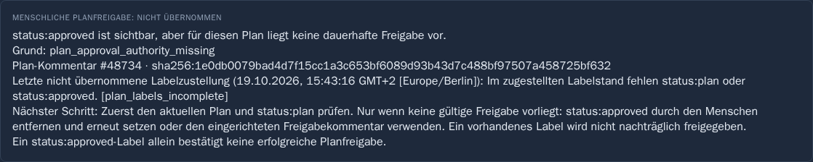
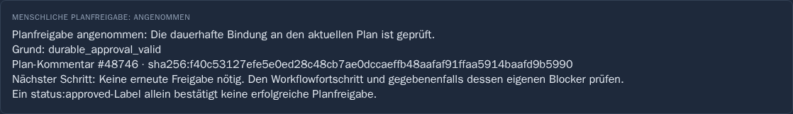
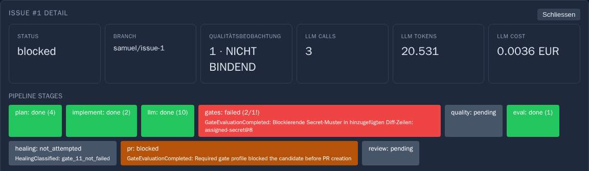
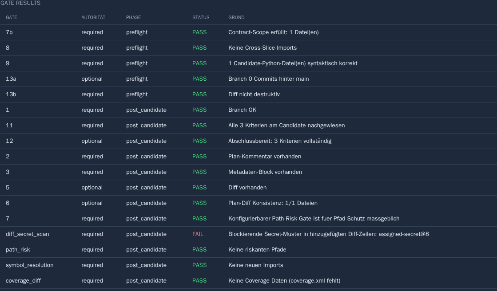
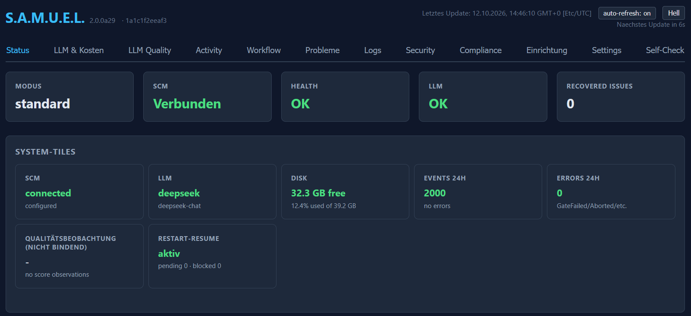
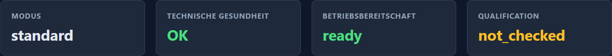
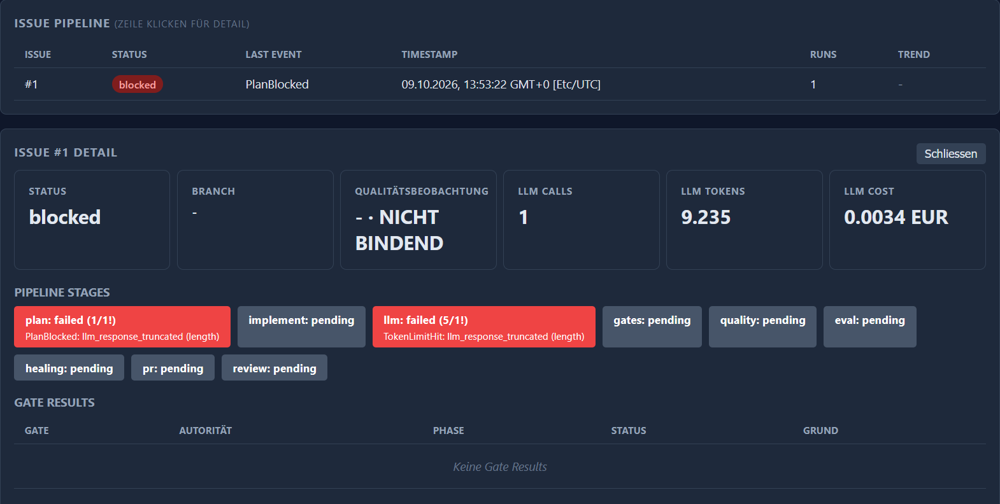
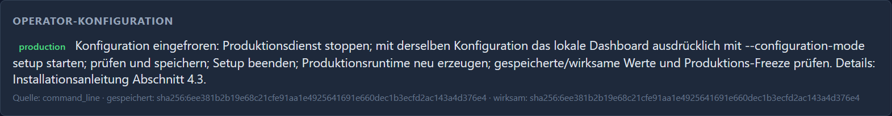
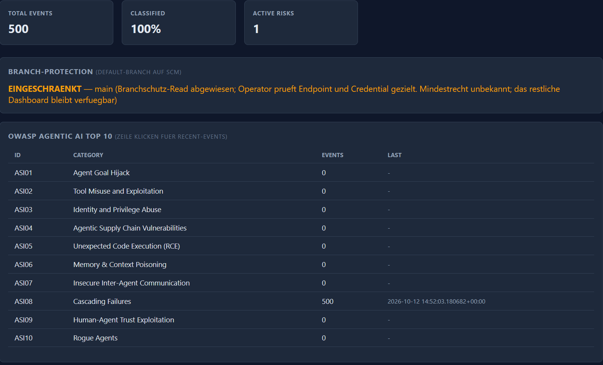

# Dashboard: Funktionen, Einstellungen und Datenquellen

[Produkt](../README.md) · [Technischer Überblick](TECHNICAL_OVERVIEW.md) · [Dokumentwege](README.md)

Diese Anleitung beschreibt die versionierten UI-/Handler-/Permission- und
Konfigurationsverträge aus der bestehenden
[Quellenbindung](capabilities/document-contract.json). Historische Screenshots
bleiben Nachweise ihres damaligen Stands.

## Aufgabenweg und wirksame Konfiguration

Diese Advanced-Anleitung richtet sich an Operatoren und Entwickler, die eine
Dashboardaktion ihren Voraussetzungen, Datenquellen und tatsächlichen Folgen
zuordnen müssen. Die Tabellen unten sind die vollständige Bedienreferenz;
Installation und Releasewechsel bleiben in ihren kanonischen Anleitungen.

| Aufgabe | Einstieg | Zu prüfendes Ergebnis |
|---|---|---|
| Erstinstallation und Zugriff vorbereiten | [INSTALL: Voraussetzungen](INSTALL.md#1-voraussetzungen), [Setup](INSTALL.md#4-konfiguration-via-wizard--samuel-setup) und [lokale Identitäten](INSTALL.md#44-lokale-dashboard-identitäten-und-cutover) | Runtimepfade, Zielprojekt, Credentials und konkrete Rechte; eine gespeicherte Konfiguration allein ist kein Betriebs-PASS. |
| Bestehenden Prozess beobachten | Status, Workflow, Probleme und Logs; [alle Bereiche](DASHBOARD.md#alle-dashboardbereiche) | Quelle, Aktualität und Evidencebindung lesen. Aktive Self-Checks und Modellproben können zusätzliche Netz-/Provideraufrufe ausführen. |
| Konfiguration ändern | [Operator-Konfiguration](DASHBOARD.md#operator-konfiguration) und [Produktions-Freeze](INSTALL.md#43-dashboard-rekonfiguration-und-produktions-freeze) | LLM-Konfigurationsmodus bei Leerlauf, Permission und Reauth; Entwurf und wirksamen Stand unterscheiden. |
| OCI-Projekt oder Toolchain bereitstellen | [OCI-Installation](INSTALL.md#91-oci-erstinstallation-auf-einem-leeren-docker-host-970) | Manifestgebundene Registrierung und Doctor; kein impliziter Toolchaininstall durch einen Workflow. |
| Core oder Release wechseln | [INSTALL: Updategrenze](INSTALL.md#121-ehrliche-updategrenze-der-alpha-serie), [Containerbetrieb](CONTAINER_RELEASE_OPERATIONS.md), [Versionierung](VERSIONING.md) | Produktversion, Revision, Digest und State-/Auditbindung; kein allgemeiner Upgrade-PASS aus einer neuen Dashboardanzeige. |
| Repository-CI betreiben | [Runnerbetrieb](CI_RUNNER_OPERATIONS.md) | Der externe CI-Runner hat eigene Betriebsregeln und wird nicht durch Dashboardsettings verwaltet. |

### Von der Datei zur Wirkung

Die [Dateizuordnung](README_technical.md#19-konfigurations-dateien) und die
[generierte Runtime-Referenz](RUNTIME_REFERENCE.md) nennen ausgelieferte
Oberflächen und Defaults. Folgende Consumergrenzen entscheiden, wann eine
Änderung wirkt; die UI ist kein Editor für beliebige JSON-Schlüssel.

| Quelle / Oberfläche | Consumer und Vorrang | Speicherung und Wirksamkeit |
|---|---|---|
| `agent.json`, globale CLI-Flags | `FileConfig`, Bootstrap und jeweiliger Command; globale `--config`-Bindung wählt das Configverzeichnis. | Dateien und Flags sind keine universelle Hot-Reload-Schnittstelle. Ein Watch-Scan lädt generische JSON-Werte erneut, erzeugt vorhandene Adapter/Workflows aber nicht neu. |
| `--configuration-mode`, `SAMUEL_CONFIGURATION_MODE` | Explizite CLI-Auswahl vor Umgebung, sonst `production`; `ConfigurationAuthority` bindet den gestarteten Prozess. | `setup` erlaubt nur zusammen mit den nötigen Permissions Schreibaktionen. Ein Dateiedit macht Produktion nicht schreibbar. |
| `.env` und externer Secretpfad | Start-/Setupweg und jeweiliger Secretconsumer; der Watch-Reload importiert `.env` nicht erneut. | Secrets werden nicht aus dem Dashboard zurückgelesen und fehlen bewusst im Configdigest. Ein Digest-PASS belegt keine gültigen Credentials. |
| `auth.json`, Identityverwaltung | Gewählter Authmodus und Identityservice; Rollen/Permissions bleiben unabhängig. | Der Authmodus ist Prozesskonfiguration. Benutzer-, Session- und Tokenaktionen haben hingegen eigene unmittelbare Verwaltungswirkungen und Reauth-/CSRF-Grenzen. |
| `features.json`, `compliance.json`, `extensions.json` | Jeweiliger Flag-/Compliance-/Extensionconsumer; `SAMUEL_RISK_CLASS` kann die gespeicherte Risikoklasse übersteuern. | Settings speichern die Operatorwahl. Aktiviert/gespeichert beweist weder wirksame Capability noch Rechts- oder Qualificationabnahme. Extensionwahl wird beim Start gebunden. |
| `llm.json`, `llm/defaults.json`, `llm/providers.json` | Factory/Taskrouting beziehungsweise Katalog; [Vorrang](README_technical.md#llm-konfiguration-zustaendigkeit-und-prioritaet) trennt Schedule, Task, globalen Default und Metadaten. | Save verändert Dateien. Der laufende Prozessdefault und echte Calls sind eigene Anzeigen; erst neu erzeugte Runtime und tatsächlicher Taskreadback belegen die neue Auswahl. |
| Promptoverrides | Vorhandener [Promptresolver](agents/AGENT_PROMPTS_AND_INSTRUCTIONS.md) mit Paket-, generischen, Provider- und Modellquellen. | View liest, Edit/Delete verändern den ausdrücklich gewählten Override. Kein automatischer Agentenregelimport und keine Änderung des Product-LLM-Vertrags aus dieser Anleitung. |
| `eval.json`, Gates, Workflows und sonstige Dateien aus §19 | Bestehende fachliche Resolver und ihre Validierungen. | Kein universeller Settings-Save. Änderungen an Tests, Gate-/Workflowwirkungen oder neuen Feldern brauchen ihren eigenen freigegebenen Scope und fachlichen Dokumentationsreview. |

Beispiel: Ein neuer globaler LLM-Default wird im Setup gespeichert. Die
gespeicherte Auswahl und `stored_config_digest` ändern sich, während die
gestartete Factory und `effective_config_digest` den bisherigen Prozess
beschreiben. `restart_required` bleibt wahr; danach Setup beenden und
Produktion neu erzeugen. Ein ausdrücklicher Task-/Scheduleoverride kann auch
im neuen Prozess weiterhin einen anderen Provider wählen. Deshalb sowohl
Configstatus als auch effektive Taskroute prüfen; eine Verbindungstestantwort
beweist weder Speicherung noch eine vollständig qualifizierte Taskausführung.

Containerprozesse binden ihr Konfigurationsverzeichnis mit
`SAMUEL_RUNTIME_CONFIG_DIR`; das Image setzt es auf `/app/config`.
Dashboard, Einmal-CLI und `samuel health` verwenden dadurch denselben
Config-/State-Kontext. Ein explizites `--config` muss bei gesetzter
Runtimebindung denselben normalisierten Pfad bezeichnen. Ein anderer Mount,
etwa `SAMUEL_RUNTIME_CONFIG_DIR=/qualification/config`, wird gemeinsam mit
dem Runtimeprozess konfiguriert; eine abweichende Einmal-CLI ist kein Ersatz.
Die Quelle dafür sind `Dockerfile` und `samuel.cli._resolve_runtime_config_dir`.

### Neue Settings und fachliche Änderungen pflegen

Für jede Änderung an Config, UI, Resolver oder Wirkung gilt die bestehende
[Documentation acceptance](../CONTRIBUTING.md#documentation-acceptance):
Dateizuordnung, betroffene Bedienfelder, Voraussetzungen, Rechte, Defaults,
Fehler und Restartwirkung im verursachenden PR prüfen und notwendige Texte,
Sourcebindings und Prüfungen gemeinsam aktualisieren. Das betrifft auch neue
Felder ohne bisheriges Binding. Der Commit-Impact zeigt geänderte Dateien und
begrenzt JSON-Feldpfade; dynamische Felder, Vorrang und geänderte Wirkungen bei
gleichem Feldnamen benötigen fachlichen Review. Ein leerer Strukturvergleich
ist kein Vollständigkeitsnachweis. Ein Verzicht auf Textänderung erhält den
geprüften Suchumfang und konkreten Grund im selben PR.

## Einstieg und Zugriffsrechte

`samuel --config <config-dir> dashboard` startet standardmäßig in `production`.
Die HTML-Shell `/` beziehungsweise `/dashboard` ist öffentlich; Betriebsdaten
verlangen Anmeldung. Port/Bindadresse stehen in [INSTALL](INSTALL.md), der
Authentisierungsmodus in `config/auth.json`.

`legacy_api_key` verwendet den vorhandenen Dashboard-Key im Sessionstorage
dieses Browsertabs. `local_identity` verwendet Benutzer/Passwort, HttpOnly-
Sessions und CSRF für Sessionwrites. Rollen sind unabhängig: Viewer liest
Status, Auditor Diagnose/Audit, Operator führt erlaubte Operationen aus,
Administrator verwaltet Identitäten. Administrator erbt keine Operatorrechte.
Automation-Tokens erhalten ausdrücklich gewählte Permissions. Die
[API-Referenz](README_technical.md#18-api-endpoints) ordnet jede Route zu.

Tab, Theme und Auto-Refresh sind Browserpräferenzen. Auto-Refresh aktualisiert
den gewählten Tab alle zehn Sekunden, startet aber keine Issues. Ein aktiver
Diagnose-/Modellendpunkt kann dennoch Providerzugriffe ausführen. Zeitangaben
mit bekanntem Offset werden in der Anzeigezeitzone formatiert; ohne Offset
bleibt die Zeitzone ausdrücklich unbekannt.

## Alle Dashboardbereiche

| Tab | Anzeige und Bedienung | Datenquelle / tatsächliche Wirkung |
|---|---|---|
| Status | Version, getrennte Revision/Dirty-Angabe, Modus, SCM, Datenträger, Eventvolumen, Metriken und passive Health-/Readiness-/Qualification- und Audit-Schreibpfadanzeige | Paketmetadaten, Buszähler und bestehende Projektionen. LLM-Konfiguration ist kein erfolgreicher Modellaufruf. |
| LLM & Kosten | Aktuelle/letzte Calls, Taskrouting, Token-/Kostensummen und Modell-/Preis-/Reasoning-/Cacheinformationen | Metering und vorhandene Caches. Current/Last sind flüchtig; alte Reservationen werden nach Neustart nicht laufende Calls. Metadaten garantieren keine Kontoverfügbarkeit. |
| LLM Quality | Provider/Modell × Task, gebundene Score-Serie, attribuierte Calls und getrennte Legacy-Serien | SQLite `quality_metrics`, Beobachtungen und Ableitungen. Advisory; kein automatischer Modellwechsel oder Freigabe. |
| Activity | SCM-Ereignisse, Bot-/Humanfilter und Details | SCM-/Webhookbeobachtungen; Actoranzeige ist keine Approvalauthority. |
| Workflow | Issues, Runs, Trend, Stages, Gates, TEST-/AC-Ergebnisse, Events, SCM-Links und Detailansicht | SQLite `run_projections` und gebundene Evidenceprojektionen. `merged`, `status:done` und geschlossenes Issue unterscheiden; `not_attempted`/`manual_pending` sind kein PASS. |
| Probleme | Filter Schwere/Kategorie/Issue, Historie/Debugdetails, letzte 20 Vorkommnisse mit bis zu zehn weiteren Meldungen derselben Issue/Korrelation, konkrete Prüf-/Behebungsschritte | Redigierte Diagnose-/Auditprojektion. Korrelation ist keine Kausalkette; Hinweise ändern keine Resume-/Healingauthority. |
| Logs | Kategorie/Level/Textfilter, aufklappbare Metadaten; höchstens 200 UI-Zeilen, ungelöste Planfreigabehinweise bevorzugt | Begrenzte Auditprojektion und verdichtete Planfreigabehinweise, kein vollständiger Rohlogexport oder Authority-State. |
| Security | Integritäts-/Signaturereignisse, OWASP-Kategoriezähler, Branchschutz und Schranken | OWASP-Zuordnung umfasst auch normale Auditereignisse und bestätigt keinen Angriff. Konkrete Prüfgründe stehen im Schranken-Protokoll und bei den Sicherheits-/Integritätsereignissen. 403 ist abgewiesener Read mit unbekanntem Mindestrecht, nicht automatisch fehlendes Adminrecht. |
| Compliance | Risikoklasse, Attribution und aufklappbare Frameworklegenden | `config/compliance.json`, Mappings und Audit; keine Rechtsklassifikation, Zertifizierung oder vollständige CRA-/GDPR-Abnahme. |
| Einrichtung | SCM-/Projekt-/LLM-/Dashboard-Grundkonfiguration, Tests und Speichern | [Vorhandener Setupweg](INSTALL.md#4-konfiguration-via-wizard--samuel-setup); Setupmodus und Permission, keine automatische Projektprovisionierung. Eingaben bleiben bis zur bestätigten Schreibfreigabe und während Save gesperrt; Backendfehler werden fokussiert und ins Sichtfeld gescrollt. |
| Settings | Konfigurationsstatus, gemeinsame Betriebsdiagnose, Extension, Flags, Labels, DLQ, LLM-Default/Tasks, Identity, Key-Status und Transferwarnungen | Im folgenden Abschnitt erklärt. |
| Self-Check | Technische Gesundheit, Readiness, Qualification, Audit-Schreibpfad und Einzelchecks | Aktive Probe wirksamer Taskrouten mit `RUN_PROVIDER_PROBES`; kein passiver Statusabruf oder Golden-/D0-PASS. Self-Mode-Diagnose ist ein eigener Operationspfad. |

Der **Audit-Schreibpfad** wird auf Status und Self-Check getrennt angezeigt.
„Hauptpfad gestört, Ersatzpfad genutzt“ bestätigt den Ersatzappend;
„Ereignisverlust festgestellt“ bewahrt den Verlustzähler auch nach späteren
erfolgreichen Writes. Zeit, letzte Schreibbeobachtung, Ersatz- und Verlustzähler
helfen beim Einordnen. Fehlende, veraltete oder nach Neustart ungeprüfte Daten
werden nicht grün. Ein technisches Health-OK ist kein Auditwriter-PASS.
Kettenintegrität prüfst du separat mit `audit verify`; auch eine intakte Kette
beweist keine vollständige Ereignishistorie. Details stehen in der
[Audit-Schreibdiagnose](README_technical.md#audit-schreibdiagnose-986).

### SCM-Berechtigungen einordnen (#897)

Unter **Security → Branch-Protection** steht zusätzlich die verwendete Rolle,
die geprüfte Operation und der nächste Schritt. Ein erfolgreicher Read bestätigt
nur diesen Zugriff. HTTP401/403 zeigt „Gezielte Operatorprüfung erforderlich“:
Endpoint und verwendetes Credential prüfen; das Mindestrecht bleibt unbekannt.
Unter **Probleme** erscheinen abgewiesene SCM-Aufrufe und vorhandene
API-Guards mit Behebungshinweis. Eine gesperrte Verwaltungsoperation verlangt
die Korrektur des aufrufenden Pfads, keine zusätzlichen Adminrechte für den Bot.
Mehrdeutige Antworten bleiben „nicht prüfbar“.

**Einrichtung** zeigt beim bestehenden Verbindungstest denselben Vertrag für
den Label-Read. Das bestätigt keine Schreibrechte, Webhookeinrichtung oder
vollständige Betriebsbereitschaft. Die Hinweise speichern keine Rechte und
starten keine zusätzlichen Proben. Siehe [SCM-Diagnosevertrag](README_technical.md#scm-berechtigungsdiagnosen-897).
Datierte Screenshots weiter unten dokumentieren ihren damaligen Stand;
die ergänzte Diagnosezeile ist darin noch nicht abgebildet.

### Gemeinsame Betriebsdiagnose (#921)

**Konfig → Betriebsdiagnose**, direkt unter der Operator-Konfiguration, bündelt
vorhandene Befunde. **Vorhandene Befunde neu laden** liest nur diese Übersicht;
es startet weder Health noch SCM-/LLM-Proben und erneuert keine Prüfzeit.
Der Endpunkt verlangt `READ_DIAGNOSTICS` (Operator oder Auditor, keine implizite
Administratorberechtigung). Andere bestehende Funktionen des Konfig-Tabs,
beispielsweise Guthabenabfragen, behalten ihre eigene Wirkung.

Jede Zeile nennt Quelle, Prüfzeit/Aktualität, Aussagegrenze und nächsten Schritt:

| Anzeige | Bedeutung |
|---|---|
| Geprüfte Voraussetzung erfüllt | Der konkrete aktuelle Fachbefund ist positiv. |
| Fehler festgestellt | Der konkrete aktuelle Fachbefund ist negativ. |
| Nachweis fehlt oder ist veraltet | Kein aktueller belastbarer Befund; kein PASS. Ein früherer Fehler bleibt als solcher kenntlich. |
| Eingeschränkt | Bestehender Audit-Fallback oder gespeicherte Konfiguration mit Neustartbedarf. |

Die Übersicht umfasst Health-Einzelbefunde, die vorhandene Betriebsbereitschaft,
aktuelle Projektbindung, Doctor, Auditintegrität, Audit-Schreibpfad und den
Vergleich gespeicherter/wirksamer Konfiguration. Darunter steht die vorhandene
Webhook-Diagnose. Sie erteilt keine Gesamtfreigabe und führt keine Startsperre ein.
Insbesondere bestätigt SCM-Lesezugriff weder Schreibrechte noch Branchschutz;
Ausführungsprovider-Health ist kein TEST-Runner-Nachweis. Doctor speichert nur
sein Gesamtergebnis: konkrete Einzelprobleme weiterhin in dessen Ausgabe lesen.
LLM-Taskrouten/Metadaten, Workspace-Ownership, Credentialpräsenz und SCM-Mappings
werden nicht aus einem groben positiven Befund abgeleitet.

Fehlende, abgelaufene oder fremdinstanzgebundene Projektionen bleiben unbekannt.
Persistierte Projektionen folgen ADR-0693 (eine Stunde, State-Instanz); sie sind
nicht an jede spätere Konfigurationsänderung gebunden. Deshalb Konfigabweichungen
klären und Fachprüfungen danach wiederholen. Aktuelle lokale Vergleiche haben
keinen gespeicherten Prüfzeitpunkt; bei mehreren Auditwritern wird kein gemeinsamer
Zeitpunkt erfunden. Native Zustellung bleibt separat `not_proven`.

Für neue Befunde die angegebene Fachprüfung verwenden: `samuel health`,
`samuel doctor`, `samuel audit verify` oder den vorhandenen aktiven **Self-Check**.
Self-Check und **SCM-Hook-Metadaten lesen** behalten `RUN_PROVIDER_PROBES`.
Die datierten Screenshots unten bilden diese neue Übersicht nicht ab. Die reale
Installations-/Bedienabnahme bleibt gesammelt in #962/#994.

### Webhook-Diagnose lesen (#905)

**Konfig → Betriebsdiagnose → Webhook-Diagnose** sowie der gleichnamige Abschnitt
unter **Einrichtung** zeigen Schlüsselpräsenz, Hook-Konfiguration,
Ingress-Empfang, Signatur, Verarbeitung und native Zustellung getrennt. Das
Öffnen/Auto-Refresh liest nur vorhandene Prozessbeobachtungen (`READ_DIAGNOSTICS`).
**SCM-Hook-Metadaten lesen** benötigt `RUN_PROVIDER_PROBES` und liest explizit
die erste Seite (maximal 50 Hooks) mit dem vorhandenen Runtime-Credential.
Eine Administratorrolle allein enthält diese Rechte nicht.

Ziel, Aktivierung, JSON/Payload-Typ und fehlende Events erscheinen mit konkreter
Abhilfe. Private IP-Ziele erhalten den gezielten Gitea-Allowlist-Hinweis;
Hostnamen werden nicht aufgelöst. Bei 401/403 prüft der Operator Endpoint und
Credential, ohne pauschal neue Botrechte zu vergeben. Keine Testzustellung,
Hookänderung, neue Startsperre oder automatische Fehlerbehebung wird ausgelöst.

Signaturerfolg ist kein nativer Zustellnachweis. `not_proven` bedeutet hier,
dass die Diagnose keinen gebundenen nativen Nachweis auswertet; extern
abgenommene Zustellungen bleiben separat dokumentiert. Beobachtungen können
verschiedene Requests betreffen; nach einer Stunde sind sie `stale`, nach
Neustart fehlen sie. Gespeicherte Setupänderungen sind bis zum vorgesehenen
Neustart nicht die wirksame Prüfkonfiguration. Siehe
[Diagnosegrenzen und Behebung](INSTALL.md#webhook-diagnose-ohne-neue-startsperre-905).
Die vorhandenen datierten Screenshots zeigen diese neue Sektion noch nicht.

### Versuch beenden, neu planen oder technisch fortsetzen (#920)

Unter **Workflow → Issue-Zeile → Weiteres Vorgehen** zeigt das Dashboard den
Versuch, die betroffene Phase, den beobachteten Grund, Blocker und die erlaubte
nächste Aktion. Lesen benötigt die Operator- oder Auditorberechtigung
`READ_DIAGNOSTICS`; Aktionen benötigen `RUN_OPERATIONS`. Bei lokaler Anmeldung
sind CSRF und eine frische Passwortbestätigung erforderlich. Die
Administratorrolle allein enthält keine Operationsberechtigung.

- **Versuch beenden:** Mit Begründung den bisherigen Plan ausdrücklich
  widerrufen, verbleibende sichere Checkpoints über den vorhandenen
  Abandon-Pfad aufgeben und aktive Start-/Plan-/Arbeitslabels nachprüfbar
  entfernen. Historie, Candidates, Budgets und tatsächlicher Verbrauch bleiben
  erhalten. Erst nach bestätigtem Abschluss entfällt der Issueblocker für
  Konfigurationsänderungen. Ein SCM-Issue wird dabei nicht geschlossen.
- **Neu planen:** Den bisherigen Versuch sicher beenden und dasselbe Issue mit
  neuer Korrelation, neuem Plan und eigenem Implementation-Branch beginnen.
  Auch in Night-/Autonomous-Profilen benötigt dieser Ersatzplan eine neue
  menschliche Freigabe. Bestehende MANUAL-Receipts, Gates oder alte Approval
  werden nicht auf den neuen Candidate übertragen.
- **Technischen Abschluss fortsetzen:** Nur vorhandene fortsetzbare technische
  Checkpoints an den bisherigen Resume-Koordinator übergeben. Er prüft weiter
  seine Contract-, Policy-, Quellen-, Git-, Lease- und SCM-Bindungen. Ein
  fehlgeschlagener Versuch wird dadurch nicht neu geöffnet. Normales Warten
  auf Planfreigabe oder MANUAL ist keine technische Unterbrechung.

Ein schlechter Plan wird mit Begründung beendet und neu geplant. Für eine
LLM-Konfigurationskorrektur zuerst **Versuch beenden**, dann bei vollständigem
Leerlauf im Konfigurations-Tab ändern, anschließend **Neu planen** ausführen.
Der endgültig gescheiterte Versuch bleibt in der Historie gescheitert.
Der terminale SCM-Kommentar verweist auf diese vorhandenen Aktionen. Ein
verbliebenes Startlabel hebt die Sperre auch bei fehlgeschlagenen SCM-Schreibzugriffen
nicht auf. `help wanted` kann einen älteren Handlungsbedarf bezeichnen und
wird ohne belegte Erledigung nicht automatisch entfernt.

Laufende Arbeit, ungeklärte externe Effekte, offene Budgetreservationen und
Healingclaims sperren einen Neubeginn. Ein bekannter offener PR muss zuerst
aufgelöst werden; ein bereits gemergter PR wird nicht durch diese Aktion neu
geplant. Ein technischer Checkpoint kann zur Klärung seines unbestätigten
Effekts verwendet werden, soweit seine eigenen Guards dies erlauben.
Fehlende Evidence bleibt unbekannt. Veraltete Tabs und wiederholte Aktionen
müssen den aktuellen Zustand neu laden; eine verlorene HTTP-Antwort ist keine
Aufforderung zum blinden Wiederholen. Fehlgeschlagene Labeländerungen geben
keine neue Arbeit frei.

Diese Bedienung ist durch lokale HTTP-/SQLite-/Planungs- und Regressionstests
geprüft. Die gemeinsame Endabnahme in der später installierten Liveumgebung
bleibt im bestehenden Abnahmeumfang #962/#994; keine Teilinstallation pro Issue.

### Automatische und manuelle Kriterien im Plan prüfen (#880)

Lies vor einer Planfreigabe die Akzeptanzkriterien im SCM-Plan-Kommentar.
Deterministisch prüfbare Eigenschaften sollen die vorhandenen automatischen
Prüftypen verwenden, Verhalten einen passenden `[TEST]`. Fehlende Tests,
Toolchain oder Zugänge allein sind kein Grund für `[MANUAL]`: Benenne und
kläre die fehlende Voraussetzung; nötige Tests gehören in den autorisierten
Änderungsscope.

Ein MANUAL-Kriterium nennt die konkrete menschliche Entscheidung und begründet,
warum automatische Evidence dafür nicht genügt. Beispiel: fachliche
Verständlichkeit einer Meldung beurteilen. Ob diese Meldung beim richtigen
Fehler erscheint, bleibt automatisch prüfbar. Automatische und menschliche
Anteile gehören in getrennte Kriterien; erfolgreiche Tests brauchen keine
zusätzliche MANUAL-Bestätigung.

Ist ein Kriterium ungeeignet, kläre es vor der Freigabe. Einen vorhandenen
aktiven Plan über den [ausdrücklichen Replanpfad](DASHBOARD.md#versuch-beenden-neu-planen-oder-technisch-fortsetzen-920)
ersetzen; freigegebene Verträge werden nicht automatisch umgeschrieben.
Die Auswahlregel steht im Paketprompt und in den Laufzeitanweisungen für Erstplan
und bestehenden Retry. Sie ist keine neue semantische Prüfung oder Startsperre
und garantiert keine fehlerfreie Auswahl durch das Modell. Eigene
Systemprompt-Overrides bleiben erhalten und sollten auf Widersprüche geprüft werden.

Die Planfreigabe bestätigt weiterhin nur den Plan zur Umsetzung. Eine spätere
MANUAL-Abnahme erfolgt über den vorhandenen gebundenen SCM-Befehl mit AC-ID,
Contract und Candidate-Head; das Dashboard erteilt sie nicht. Ältere Kriterien
ohne ausgeschriebene Begründung bleiben formal gültig. Live-/Modell- und
Transportabnahme erfolgen gesammelt in #962/#994.

### Menschliche Planfreigabe prüfen (#948)

Öffne **Workflow → Issue-Zeile → Menschliche Planfreigabe** oberhalb der
Pipeline Stages. Die Anzeige prüft den aktuellen Plan-Kommentar und Contract
mit dem vorhandenen Authority-Resolver; sie erteilt selbst keine Freigabe.

| Anzeige | Bedeutung und nächster Schritt |
|---|---|
| Angenommen | Die dauerhafte menschliche Freigabe ist für den aktuellen Plan nachweisbar. Nicht erneut freigeben; bei Stillstand den eigenen Workflowblocker prüfen. |
| Nicht übernommen | `status:approved` ist sichtbar, aber für diesen Plan fehlt die dauerhafte Freigabe. Grund der letzten zugeordneten ignorierten nativen Labelzustellung und deren Beobachtungszeit beachten. |
| Keine menschliche Freigabe gespeichert | Keine dauerhafte menschliche Freigabe gefunden. Zuerst den aktiven Workflow prüfen: Ein ausdrücklich policyfreigegebener Workflow verlangt nicht allein wegen dieser Anzeige eine menschliche Freigabe. |
| Nicht prüfbar / Kein aktiver Plan | Evidence, SCM oder Authority nicht verfügbar beziehungsweise kein gültiger aktiver Plan. Keine Freigabe oder Labelbereinigung auf Verdacht. Gespeicherte, inzwischen ungültige Freigaben erhalten den Resolver-Grundcode. |

Beim Labelweg zuerst den aktuellen Plan lesen und `status:plan` abwarten.
Nur wenn keine gültige Freigabe vorliegt und der angezeigte Grund eine neue
Humanaktion erlaubt: `status:approved` **selbst entfernen und erneut setzen**
oder den eingerichteten Freigabekommentartransport verwenden. Das bloße
Vorhandensein beider Labels holt eine zuvor ignorierte Zustellung nicht nach.
Bei Timeline-/State-/Budgetfehlern erst den benannten Blocker prüfen; ein
Labelwechsel repariert ihn nicht. Ein Ersatzplan benötigt seine eigene
Freigabe. Ein Statuslabel allein widerruft keine bereits materialisierte
Authority; der ausdrückliche Widerruf erfolgt über den bestehenden Replanpfad.

Die letzte ignorierte Labelzustellung ist eine datierte Diagnose, kein Beweis
einer menschlichen Freigabehandlung: Native Gitea-Payloads enthalten kein
Label-Delta. Die Diagnose bleibt an Repository, Issue, Plan-Kommentar und
Contract gebunden. Eine gültige Authority hat Vorrang vor einem späteren
ignorierten Delivery. Fehlende Diagnose bedeutet unbekannte Zustellhistorie,
keinen Erfolg. GETs ändern weder Labels noch Authority oder Workflowstatus.
Die Anzeige wird beim Öffnen der Issue-Zeile neu gelesen; ein offenes Detail
muss für einen frischen Readback erneut geöffnet werden.

Im Tab **Logs**, Kategorie **workflow**, steht zusätzlich ein kompakter
**Planfreigabe-Hinweis** mit Issue, Zeitpunkt und Grund. Derselbe Hinweis wird
bei Replay nicht vervielfacht oder zeitlich aufgefrischt. Nach angenommener
Freigabe erscheint er als erledigt (`RESOLVED`, Info statt Warnung).
Ungelöste Hinweise erhalten innerhalb der begrenzten Ansicht Vorrang vor
neueren Auditmeldungen. Dadurch verdrängt normale Hintergrundaktivität den
Hinweis nicht. Erst nach dieser Auswahl werden die Zeilen nach ihrem echten
Zeitpunkt sortiert. Bei mehr als 200 ungelösten Hinweisen werden die neuesten
200 angezeigt; die jeweilige Workflowkarte und Issue-Rückmeldung bleiben
zusätzlich zugänglich. Erledigte Hinweise altern wie normale Logmeldungen aus.
Plan-/Contractbindung und nächste Aktion stehen in den aufklappbaren Details;
die vollständige Statuskarte bleibt im Workflowdetail. Zähler und Filter
beziehen sich auf dieselbe begrenzte Logansicht. Das ist eine verdichtete
Diagnoseprojektion, kein zusätzlicher vollständiger Audit-/Deliveryverlauf.

Für zuordenbare aktuelle native Gitea-Labelzustellungen schreibt das Produkt
eine **Rückmeldung zur Planfreigabe direkt ins SCM-Issue**: Erklärung,
Link auf den konkreten Plan-Kommentar, Contract und nächste Aktion.
Eine angenommene Freigabe wird ebenfalls bestätigt; spätere Workflowblocker
bleiben getrennt. Pro Plan/Contract und Rückmeldegrund entsteht höchstens
ein Kommentar. Bots und fremde Subjects erzeugen keine Rückmeldung, ein alter
Delivery wird nicht auf einen Ersatzplan übertragen. Die Rückmeldung selbst
erteilt oder widerruft keine Freigabe.

Die Webhook-Einstellungen und das erneute Senden einer Zustellung gehören
zur technischen Abnahme, nicht zur normalen Behebung eines Labelproblems.

`plan_approval_source_revision_mismatch` bedeutet, dass die aktuelle Plan-/Issue-/
Basisrevision von der gespeicherten Bindung abweicht. Prüfe diese Quellen;
ein Webhook-Replay repariert die Abweichung nicht. Nach einem abgeschlossenen
Merge können historische Freigabe und aktueller Quellencheck unterschiedliche
Aussagen liefern: Der frühere Merge bleibt sein eigener Nachweis, die Freigabe
wird nicht auf die neue Basis übertragen. Für einen neuen Auftrag den
vorgesehenen Plan-/Replanpfad nutzen, keine Labels auf Verdacht ändern.
Benutzer folgen der Rückmeldung im Issue oder Workflowdetail. Bei einem
belegten Zustellungsfehler prüft der Betreiber den Transport; eine erneute
Zustellung erzeugt keine fehlende menschliche Freigabe.

Wird ein Kommentar-POST nicht bestätigt, gibt es keinen blinden erneuten POST.
Der Produktmarker im SCM-Kommentar kann einen bereits erfolgten Write beim
nächsten Delivery bestätigen. Andernfalls bleiben Zustand und Prozessdiagnose
unbestätigt; bei zugehörigem Loghinweis steht dies auch in dessen Details.
Die Runtime benötigt die vorhandene SCM-Kommentarschreibberechtigung und
den Projection-Store mit atomarem Compare-and-swap (SQLite-Referenzadapter).
Fehlender Store, fehlende CAS-Unterstützung oder ein Schreibfehler werden
sichtbar behandelt und ändern keine Approvalentscheidung. Ein Hinweis zu
einer bereits gültigen Freigabe fordert keine neue Freigabe oder Labelbereinigung.

#### Reale Freigabekarten aus der Abnahme vom 19.10.2026

Die folgenden Karten stammen aus zwei **getrennten echten Testumgebungen**
desselben installierten Development-Stands. Sie erklären die Rückmeldung zur
Planfreigabe; die Screenshots zeigen weder die menschliche Labelaktion noch
deren Signaturprüfung. Diese Bezüge sind in den erhaltenen nativen
Abnahmenachweisen zu #948 dokumentiert.

> 
>
> *Negativfall, 19.10.2026: „Nicht übernommen“, Plan-Kommentar #48734 und Contract `sha256:1e0db0079bad4d7f15cc1a3c653bf6089d93b43d7c488bf97507a458725bf632`. Die Karte nennt die letzte ignorierte Zustellung um 15:43:16 MESZ und den Grund `plan_labels_incomplete`. In diesem Subject entstand keine Umsetzung und kein PR.*

Die menschliche Entfernung von `status:plan` und das anschließende Setzen von
`status:approved` bilden hier gezielt den Negativtest. Die abgebildete nächste
Aktion richtet sich an eine fehlende Freigabe; sie berechtigt nicht zum
Entfernen eines gültigen Plans oder zu einer automatischen Neufreigabe.
Normale Benutzer lesen die Issue-/Workflowrückmeldung und bearbeiten keine
Webhookeinstellungen.

> 
>
> *Positivfall, 19.10.2026: „Angenommen“, Plan-Kommentar #48746 und Contract `sha256:f40c53127efe5e0ed28c48cb7ae0dccaeffb48aafaf91ffaa5914baafd9b5990`, Grund `durable_approval_valid`. Die native menschliche Freigabe um 16:04:22 MESZ wurde verarbeitet. Der separate Nachweis enthält anschließend Umsetzung, Candidate `cf3ac004d02d4053342b1b32cbfd1350a2b8ea93`, grüne Required CI/Review und Acceptance 6/6; diese Ergebnisse sind nicht auf der Karte sichtbar.*

**Quelle und Verarbeitung:** installierter Product-Commit
`2a2edd627e3697dceee9c4f4b1398abfe1d86d02`, Version
`2.0.0a30.dev139+g2a2edd627`, unveränderte OCI-Identität
`sha256:0b50c0f89f55cf0398097f2e4da8566e9e6358c98ea146938e49e03bc83e705c`.
Direkte Chromium-Elementaufnahmen nach den realen Humanaktionen, Viewport
1440 x 1050, Device Scale 1. Die beiden veröffentlichten PNGs sind **bytegleich
zu den geschützten Kartenoriginalen**; keine Skalierung, Retusche oder
nachgestellte UI. Persönliche Handles, Zugangsdaten und interne Adressen sind
in diesen Elementen nicht enthalten. Explizite Browserversion und damaliger
Zoom wurden nicht abgefragt und bleiben unbekannt. Originale, Capture-Skripte
und native Timeline-/Deliverybelege bleiben in den Abnahmepaketen 252/253 am
Product-Issue #948; ausgemusterte Umgebungsdaten wurden getrennt archiviert.

Die Screenshots dokumentieren diesen datierten Stand. Der spätere Logs-Fix
in #1056 ändert Auswahl/Priorität der kompakten Logszeilen und ist nicht auf
diesen Karten abgebildet. Die zwei Subjects werden nicht zu einem Goldenlauf
zusammengesetzt. Positive native Wiederholung und MANUAL-Strecke sind durch diese Karten nicht
belegt. Der tatsächliche spätere menschliche Merge ist im folgenden Abschnitt
separat nachgewiesen; fehlende Motive bleiben in #1048.

### Reale Abschlussansicht des positiven Freigabefalls

Der positive #948-Test ist tatsächlich menschlich gemergt: Candidate
`cf3ac004d02d4053342b1b32cbfd1350a2b8ea93`, PR #2, Merge
`ecdc4e29725e8626994b3b21cf5044e727bad3e9` am **19.10.2026 um 16:07:48 MESZ**.
Der native Readback nennt den menschlichen Maintainer; das unveränderte
Dashboard projiziert `PRMerged` um 16:07:50 MESZ. Für diese Aufnahme wurde kein Merge oder Workflow erneut ausgeführt.

> 
>
> *Statuskarte desselben positiven Issue #1: `merged`, Branch `samuel/issue-1`, drei LLM-Calls und ausdrücklich nicht bindende Qualitätsbeobachtung. Die Karte zeigt das Ergebnis; die menschliche Mergehandlung ist im nativen PR-Nachweis belegt.*

> 
>
> *Die Stageanzeige trennt `done` von `quality: not_attempted` und `healing: not_attempted`. Letzteres nennt `required_gates_passed`. Klammerzähler sind Ereigniszähler und nicht zusätzliche physische Modellaufrufe. Es wurde kein Quality-/Healing-PASS erfunden.*

| Echte Detailaufnahme desselben positiven Subjects | Sichtbare Aussage und Grenze |
|---|---|
| [Gateergebnisse mit Authority, Phase, Status und Grund.](images/product-captures/workflow-merged-gates-2026-10-19.png) | 17 Beobachtungen unterscheiden Required/Optional und Preflight/Post-Candidate. Gate 11 nennt sechs Kriterien. `coverage_diff` zeigt den damaligen PASS-Grund „Keine Coverage-Daten“; das beweist keine gemessene Testabdeckung. |
| [Kandidaten- und frühere Planungskriterien mit Beobachtungszeit.](images/product-captures/workflow-merged-acceptance-2026-10-19.png) | Sechs Kandidatenprüfungen um 16:04:46 MESZ und drei frühere Planungsbeobachtungen um 16:03:08 MESZ. Die neun Zeilen sind nicht neun unabhängige Kandidatenkriterien und enthalten kein MANUAL. |
| [Runs mit Planungsanteil und tatsächlich gemergter Fortsetzung samt PR-Link.](images/product-captures/workflow-merged-runs-2026-10-19.png) | Früherer Planungsanteil `incomplete`, anschließend `merged` mit PR #2 und passiver Beobachtung 1.00. Die getrennten Runprojektionen werden nicht zu einem störungsfreien Goldenlauf umetikettiert. |

**Quelle/Aufnahme:** derselbe installierte Product-/Image-Stand wie bei den
Freigabekarten oben, gelesen am **19.10.2026** nach dem schon erfolgten Merge.
Neue direkte Chromium-Elementaufnahmen, Browser **153.0.8010.12**, Viewport
1440 x 1050, Device Scale/Device Pixel Ratio/Visual-Viewport-Scale jeweils 1.
Die fünf PNGs sind bytegleiche Kopien der geschützten Elementaufnahmen; keine
Skalierung, Retusche oder synthetischen Daten. Der vollständig erhaltene
Detailoriginalnachweis verbindet die einzelnen Elemente. Capturereceipt und
native PR-/Sourcebezüge liegen bei #1048. Es gab nur lesende GETs, keinen
aktiven Modellaufruf, Watch, Replay oder Neustart.

Der aktuelle Freigabe-Quellencheck dieser alten Installation meldet nach dem
Merge `plan_approval_source_revision_mismatch`: Die gespeicherte Basis ist
`558beeaefa4d9599592c8043a3eaefe89ac8e19e`, die aktuelle Basis der Mergecommit
`ecdc4e29725e8626994b3b21cf5044e727bad3e9`; Issue- und Repositorybindung sind
unverändert. Das betrifft die heutige Wiederverwendbarkeit der Freigabe.
Die tatsächlich frühere Freigabe und der abgeschlossene Merge bleiben ihre
eigenen Nachweise. Die vollständige geschützte Ansicht enthält auch diese
Diagnose; sie wird nicht als aktuell gültige neue Approval ausgegeben.
Der datierte UI-Text enthält noch die pauschale Webhookempfehlung; der
aktuelle Diagnosehinweis erklärt diese Abweichung als Quellrevisionsthema. Eine neue Basis wird nicht durch Labelwechsel oder Replay freigegeben.

MANUAL, aktiver RUNNING-Call, positiver nativer Replay und native SCM-/Wiki-
Browseraufnahme sind durch diese Abschlussbilder weiterhin nicht nachgewiesen.
Die erhaltene Testumgebung dient dem fehlenden Dokumentationsanschluss, nicht
einer nochmaligen menschlichen Mergehandlung.

### Historische reale Gateblockade eines negativen Subjects

Für das noch benötigte Motiv A5 aus #1048 ist eine echte ältere Aufnahme
vorhanden. Sie zeigt den separaten **Q10-Negativsubject vom 04.10.2026**,
aufgenommen am **05.10.2026 um 14:27:50 MESZ**. Die Beobachtungszeit der
Gateblockade ist 04.10.2026, 21:13:32 MESZ. Dies ist ein anderer Subject und
Produktstand als der positive Freigabefall; die Bilder erklären einen
nachgewiesenen Required-Gateblock und werden nicht zu dessen Mergefolge addiert.

> 
>
> *Negatives Issue #1: Workflow `blocked`, Gates `failed`, PR `blocked`. Healing ist `not_attempted` mit `gate_11_not_failed`. Das damalige `quality: pending` ist eine datierte UI-Projektion, kein neu ausgeführter oder bestandener Qualitycheck.*

> 
>
> *`diff_secret_scan`, Authority `required`, Phase `post_candidate`, tatsächlich FAIL. Der sichtbare Grund `assigned-secret@8` ist Regelname/Dateizeile und enthält keinen Secretwert. Drei bestandene Acceptance-Kriterien und ein passiver Score überstimmen dieses Gate nicht. Es entstand kein PR.*

**Bindung:** Product `ce0b36908cb847d766339950eef872e06561f84e`, angezeigte
Version `2.0.0a26.dev142+gce0b36908`, Image
`sha256:50e1e3592ab576f14e41abfcbccbf491c7add3fbac4c4c4c19bfff541f10c41f`,
Subject `ce0b3690-20261004-01`, Candidate
`d3c4023f3f67b093f765aeb23ca77c15bd06f895`, Plan #45643, Contract
`sha256:4cd7b210ae6cada0800e76d3d75394e7ae990e56dafb29f286a1dfee55bb97c6`.
Browserbindung und terminaler Q10-Nachweis sind erhalten; Playwright 1.63.0
wurde erfasst, explizite Chromiumversion/Zoom bleiben unbekannt. Das Original
hat 1600 x 4521 Pixel. Die beiden rechteckigen Ausschnitte sind pixelgleich
zum Original, ohne Skalierung oder Maskierung; Koordinaten und Dateidigests
liegen im Nachweis zu #1048. Sie enthalten keine privaten Adressen, Handles
oder Secretwerte. Für die Wiederverwendung wurden weder Runtime noch Repo
wiederhergestellt und kein neuer Negativlauf gestartet. Die alten Daten sind
nach Maintainerauftrag geschützt archiviert.

Die tatsächlich erwartete Schranke dieses eigenen Negativfalls ist belegt.
Das ist kein vollständiger Golden-/D0-PASS und keine heutige Gesamtbewertung
der Securitykontrollen. Die aktuelle Problemanzeige und der bestehende terminale
SCM-Kommentar unterscheiden den Secret-Gatebefund von nicht zulässigem Healing
und nennen passende nächste Schritte (#890; [Problemdiagnosen](README_technical.md#problemdiagnosen)).
Die Bilder bleiben historische Evidence; eine native Prüfung der neuen
Meldungen erfolgt erst in der gemeinsamen Abnahme #962/#994.

## Settings vollständig erklärt

### Operator-Konfiguration

Die Anzeige nennt Prozessmodus, gespeicherten/wirksamen Digest und den
Konfigurationsstatus mit Owner, Version und optionalen Verbindungstests.
`.env`-Secrets fehlen bewusst im Digest. Digestgleichheit ist keine Provider-,
Gate- oder Qualificationabnahme.

**Konfiguration bearbeiten** öffnet den LLM-Bereich nur bei echtem Leerlauf.
Laufende Issues und Wartezustände für Planfreigabe, MANUAL oder erforderliches
Review blockieren; eine fertig reviewte PR braucht nicht erst gemergt zu werden.
Watch/Night/Self können eingeschaltet bleiben. Während der Bearbeitung beginnt
keine neue Arbeit. Speichern im Taskeditor oder bei Default/Fallbacks ändert nur
den gemeinsamen Entwurf. Die Vorschau zeigt Standard-, Schedule- und
Fallback-Routen samt Prompt-Quelle. **Übernehmen und Betrieb fortsetzen**
validiert und aktiviert alles gemeinsam, ohne Dienstneustart.

**Verwerfen und Betrieb fortsetzen** nimmt den Entwurf zurück. Nach Browser-
oder Prozessabbruch bleibt der Modus bestehen; **Vorherigen Stand
wiederherstellen** steht auch einem anderen frisch authentisierten Administrator
zur Verfügung. Fehler geben die Arbeit nicht frei. **Ausführungsstatus
abgleichen** räumt nur nachweislich verwaiste Prozessausführungen auf; fachlich
wartende Issues und ungeklärte externe Vorgänge bleiben blockierend.

`WRITE_CONFIGURATION` und bei lokalen Identitäten frische Reauthentisierung
sind erforderlich. Bei einer Reauthmeldung im Identitätsbereich das aktuelle
Passwort bestätigen und die Aktion wiederholen. Verbindungstests benötigen
zusätzlich `RUN_PROVIDER_PROBES`. Sie prüfen den gespeicherten Entwurf und sind
optional; `provider.validate` ist keine Modellantwort. Fehlgeschlagene Tests
können nur bewusst bestätigt übergangen werden. Benchmarkhinweise blockieren
nie. Änderungen von Promptinhalten, Secrets, Flags und anderen Setupbereichen
bleiben außerhalb dieses LLM-Modus. [Details und Recovery](INSTALL.md#43-dashboard-rekonfiguration-und-produktions-freeze).

### Einrichtung: Required Check, Projekt und Testpolicy

Das Formular zeigt den erwarteten Required-Check-Kontext und dessen Quelle.
Ein explizit leerer Wert wird weiter vom Backend abgewiesen; am sichtbaren
Fehlerort stehen Feldname, Ursache und Aufforderung zur Korrektur. Nicht
gespeicherte Eingaben bleiben erhalten. Produktion zeigt Read-only und den
bestehenden Setup-/Production-Wechsel; fehlende Permission erteilt ebenfalls
keine Schreibfreigabe. Secrets werden nicht zurückgelesen.

Das Zielprojekt muss aus Sicht der Runtime erreichbar sein. Im OCI-Betrieb
zuerst einen dedizierten sauberen Standalone-Git-Checkout mit passendem
Repository/Origin, vollständigem initialem SHA und Runtime-Schreibrechten über
`samuel-container project` registrieren. Ein Pfad auf einem anderen Rechner
wird dadurch nicht erreichbar. Den Produktcheckout nicht als Agentenbestand
verwenden. [Projektregistrierung](INSTALL.md#91-oci-erstinstallation-auf-einem-leeren-docker-host-970).

Die vorhandene Testpolicy steht in `config/eval.json`: explizites `test_cmd`
mit `{test}` hat Vorrang, sonst gelten unterstützte Projektmarker. Missing
oder Invalid blockiert den Doctor-Runnercheck. Der Workflow installiert keine
Projektabhängigkeiten. Die benötigte Python/Pytest-Toolchain im OCI-Betrieb über
`samuel-container toolchain` bereitstellen.
[Setup/Testpolicy](INSTALL.md#4-konfiguration-via-wizard--samuel-setup),
[OCI-Projekt und Toolchain](INSTALL.md#91-oci-erstinstallation-auf-einem-leeren-docker-host-970).
Diese Hinweise verwenden dieselben Resolver und Registrierungsmechanismen.
Doctor-PASS ist ein Runnercheck, kein bestandener Candidate-Test oder Human-
Gate-11-PASS. Ein Toolchaineditor wird nicht angeboten.

### Documentation Extension

| Feld | Bedeutung / Speicherung |
|---|---|
| Aktiviert | `config/extensions.json`, `capabilities.documentation.static_claims.enabled`: vorhandene Capability berücksichtigen |
| Erforderlich | `required`: fehlende/deaktivierte/inkompatible Capability blockiert die betreffende Statusauflösung; keine allgemeine Gateauthority |
| Manifestpfad | `manifest_path`: für die Runtime erreichbares Capability-Manifest; kein Download/Fremdcodeimport |
| Gespeichert | `available`, `blocked`, `status`, `reason` der gespeicherten Wahl |
| Wirksam | `effective_*`: beim Prozessstart erfasste Wahl; Neustart nötig |
| Speichern | Bestehende Policy validieren/persistieren; Setup + `WRITE_CONFIGURATION` |

Die Checkbox führt keinen Consumer aus und baut/publiziert kein Wiki.
`samuel-documentation` liest diese Dashboardwahl derzeit nicht. Contract,
Manifest, Request/Result und advisory Grenze:
[Extensionvertrag](EXTENSION_CONTRACT.md#dashboard-documentation-extension-und-wiki).

### Feature Flags, Labels und DLQ

Featureflags zeigen Name, Beschreibung und gespeicherten Wert aus
`config/features.json`. Umschalten sendet `name`/`enabled` an den vorhandenen
Flagendpoint; bei Fehler setzt die UI zurück, Produktion sperrt die Schalter.
Der [Runtimekatalog](RUNTIME_REFERENCE.md) listet sämtliche ausgelieferten
Flags. Ein Flag erzeugt keinen fehlenden Adapter, Qualification oder Authority;
Wirkung hängt vom Consumer/Start-/Reloadpfad ab.

**Labels auf SCM synchronisieren** verwendet `/api/v1/setup/labels`,
`RUN_OPERATIONS` und Setupmodus. Der Setuphandler gleicht die Labels aus
`config/labels.json` mit dem Repository ab. Das ist eine reale SCM-Mutation,
keine Planfreigabe oder Issuebeauftragung.

Die **Dead-Letter-Queue** enthält Events fehlgeschlagener Subscriber im
vorhandenen JSONL-DLQ-Pfad, nicht SQLite. Die UI liest; Replay ist die CLI-Aktion
`samuel dlq replay <id>`. Sie publiziert erneut und kann Subscriberwirkungen
auslösen. Kein rein lesender Refresh oder Ersatz fehlender Human-/Planbindung.

### LLM Default & Fallback

Default und geordnete Fallbacks werden in `config/llm.json::default`
gespeichert. Unterstützt: `claude`, `deepseek`, `gemini`, `openai`, `openrouter`,
`ollama`, `lmstudio`, `manual`. Kommagetrennte Fallbacknamen werden geprüft;
Dubletten und Default werden entfernt. `SAMUEL_LLM_PROVIDER` kann den
Dateidefault übersteuern. Speichern legt im Konfigurationsmodus zunächst einen Entwurf an.

Die Statuskachel **LLM-Default (Prozess)** und die Settingsanzeige
**Prozessdefault** verwenden die vorhandenen Factoryfacts des gestarteten
Prozesses. **Gespeicherter Default** und **Gespeicherte Fallback-Kette** sind
die Editorwerte aus der Datei. Die Quelle nennt `config` oder `environment`;
`SAMUEL_LLM_PROVIDER` kann den Dateidefault beim Start übersteuern.

Während der Bearbeitung zeigt der Editor den Entwurf; der Prozessdefault bleibt
bis zum gemeinsamen Übernehmen wirksam. Danach zeigt er die neu aktivierte
Factorywahl, sofern kein Environmentoverride gilt. Ein Environmentoverride
wird in der Vorschau ausdrücklich genannt und durch diesen Editor nicht verändert.

Die Kachel ist neutral, bei Neustartbedarf oder fehlendem Default warnend.
`runtime_adapter` bedeutet nur, dass die Factory einen Adapter erzeugt hat;
ohne Factoryfacts gilt `process_configuration` und ausdrücklich kein
Adapter-Nachweis. Weder Zustand noch Keypräsenz/Katalog beweisen einen
erfolgreichen Call. Tatsächliche Current-/Last-Calls im LLM-Tab und das
effektive Taskrouting bleiben getrennte Quellen. Der #999-Fix ist in Main
integriert; die ursprüngliche externe UX-011-Ursache bleibt UNKNOWN.

### LLM Task Configuration

`edit` öffnet eine der fünf konfigurierbaren Tasks `planning`, `implementation`,
`review`, `healing`, `evaluation`. Die ersten vier besitzen Consumer;
`evaluation` hat keinen aktiven LLM-Consumer. Speicherung:
`config/llm/defaults.json::tasks.<task>`. Unbekannte Tasks/Felder werden
abgelehnt; leere Werte entfernen Overrides und fallen auf Defaults zurück.

| Editorfeld / Aktion | Bedeutung und Grenze |
|---|---|
| Provider | Taskoverride; globaler Default, Task und Schedule sind getrennte Auswahlstufen |
| Model | Frei eingebbare Modell-ID mit optionalen Katalog-/Endpointvorschlägen. Unbekannte oder entfernte IDs bleiben erhalten und werden allein deshalb nicht abgelehnt |
| Modellrefresh | OpenRouter-Preis-/Modell-/Reasoning-/Benchmarkcache aktualisieren; kein Modellpull/Installation/Kontofreigabe |
| `base_url` | Endpoint aus Sicht der Runtime; Container-`localhost` ist der Container. Ollama/LM Studio benötigen eine erreichbare URL |
| `timeout` | Provider-Requesttimeout in Sekunden; kein Workflow-/TEST-Budget |
| `system_prompt` | Markdowndateiname; `(none)` entfernt Taskoverride, View liest; Promptdatei-Edit bleibt im Konfigurationsmodus gesperrt |
| Sourcebadge | Aufgelöste Quelle: Paket, generischer Operator-, Provider- oder Modelloverride |
| Per-Provider Overrides | Provider → Promptdatei; leere UI-Zeilen nicht speichern, entfernte Zuordnung beim Save entfernen; bestehender Resolver |
| `max_tokens` | Positive ganze Content-Outputgrenze; keine zusätzliche Budgetzulassung |
| `reasoning_reserve` | Nicht negative ganze Zahl; 0 = Providerdefault, nicht Reasoning aus. Explizite Reserve nur OpenRouter, Content-/Modellgrenzen gelten |
| Reasoning-Hinweis | Capability-/Katalogmetadaten, keine garantierte Qualität |
| Kostenhinweis | Optionales advisory Pareto-Angebot geeigneter günstigerer Modelle; kein Wechsel |
| Überqualifiziert-Marge | 0–1 relativ zur Taskschwelle: 0,20 bei Schwelle 50 ergibt 60; keine automatische Routenänderung |
| `temperature` | Samplingwert, tatsächliche Unterstützung adapterabhängig |
| Save | Taskwerte als Entwurf speichern; Konfigurationsmodus + `WRITE_CONFIGURATION`; wirksam nach gemeinsamem Übernehmen |
| Test | Im Konfigurationsmodus optionaler Check des gespeicherten Entwurfs mit `RUN_PROVIDER_PROBES`; Status/Zeit/Version bleiben sichtbar. Kein Modellcompletion-Nachweis |
| Cancel | Editor ohne Save schließen; separat gespeicherte Promptänderungen nicht rückgängig machen |

Keys gehören in den externen Secretpfad, nicht Task-JSON. Benchmarks, Konto,
Call und Qualification unterscheiden. Präzedenz und Defaults:
[LLM-Stack](README_technical.md#8-llm-stack).

### Freie Modelleingabe und optionale Vorschläge

In der **Einrichtung**, der **Taskkonfiguration** und dem **Schedule** kannst
du eine Modell-ID direkt eingeben. Die Vorschlagsliste ist eine Orientierung,
keine Zulassungsliste. Du musst keinen Vorschlag auswählen. Beim Laden,
Providerwechsel oder Aktualisieren bleibt deine Eingabe erhalten, auch wenn
die ID unbekannt ist oder inzwischen aus dem Katalog entfernt wurde. Erst
bewusstes Übernehmen aktiviert den Entwurf; Konfigurationsmodus, erforderliche
Zugriffsrechte und vorhandene Verbindungstests bleiben bestehen.

Der Hinweis am Feld zeigt, ob der Katalog aktuell, veraltet, fehlend oder nicht
erreichbar ist. Die freie Eingabe funktioniert auch ohne Liste. In der
Ersteinrichtung ist die vorbelegte Provider-/Modellwahl ein Produktdefault;
sie bestätigt weder eine Empfehlung noch einen erfolgreichen Aufruf. Ein
anderer Cloudprovider benötigt seinen eigenen API-Key. Lokale Listen in der
Einrichtung werden erst mit **Optionale Modellvorschläge laden** am angegebenen
Endpoint abgefragt. Task-/Schedulelisten nutzen weiterhin den bestehenden
Modellendpunkt und die Taskeditor-URL. Solche Abfragen benötigen
`provider:probe`; Katalogrefresh benötigt `operations:execute`. Fehlende
Berechtigung sperrt keine freie Eingabe und verleiht keine Speicherrechte.

Unter **LLM & Kosten** werden **Modellkatalog** und **Benchmarks** getrennt
angezeigt. Ein aktueller Katalog kann mit fehlenden oder fehlgeschlagenen
Benchmarkdaten zusammenfallen. Aktualisieren erneuert auch die Vorschläge
in bereits geöffneten Cloudprovider-Formularen; verspätete Antworten eines
früheren Providers oder Endpoints überschreiben sie nicht. Lokale Listen sind
keine OpenRouter-Kataloge und werden durch diesen Refresh nicht abgefragt.

Katalogeintrag, Benchmarkwert und lokale Endpointliste beweisen keine
tatsächliche Modell-/Kontoverfügbarkeit. Dafür dienen die vorhandenen
ausdrücklichen Verbindungstests beziehungsweise echte Calls. Unbestätigte
Verfügbarkeit bleibt **UNKNOWN**. Routingpriorität, Qualitätsbewertung,
Kostenhinweise und Fallbackregeln bleiben unverändert; Vorschläge ersetzen
niemals automatisch ein Modell.

### Schedule und Systemprompt

Schedulefelder: `active`, `from`, `to`, `provider`, `model`. Zeiten sind
`HH:MM`, auch über Mitternacht. Aktiv benötigt gültigen Provider und nicht
leeres Modell; `active=false` entfernt den gespeicherten Scheduleoverride.
Der Editor hat keine separate Schedule-URL; Modellabfrage benutzt die
Taskeditor-URL. [Runtime-Zeitzone/Präzedenz](README_technical.md#12-routing-schedules-und-budgets).
Auch das Schedulemodell ist frei eingebbar; eine neue Liste ersetzt den
gespeicherten oder gerade eingegebenen Wert nicht.
Schedule ist kein Cronjob und startet keine Issues.

View liest den aufgelösten Prompt, Edit schreibt einen Markdownoverride unter
dem Configverzeichnis, Delete gibt die niedrigere Quellstufe frei. Paketprompts
bleiben erhalten. [Scopes/Auflösung](agents/AGENT_PROMPTS_AND_INSTRUCTIONS.md).
Writes benötigen Setup + `WRITE_CONFIGURATION`; kein laufender Adapterneuaufbau.
Die integrierte FD-Härtung öffnet Komponenten unterhalb der expliziten
Configwurzel descriptorrelativ ohne Symlinkfolgen. Nur reguläre UTF-8-Dateien
mit gültigem Markdownbasename werden gelesen; unsichere/unlesbare Kandidaten
werden in der vorhandenen Kaskade übersprungen. Schreiben verwendet einen
privaten exklusiven Stagingpfad und Rename, Delete entfernt nur den benannten
Override. Fehlende sichere Plattformoperationen erzeugen keinen unsicheren
Fallback. Es entsteht kein zweiter Promptresolver. Fehlende optionale Overrides erzeugen
keine Warnung. Tatsächliche Datei-/UTF-8-/Pfadprobleme sowie eine vollständig
erschöpfte Promptkaskade bleiben sichtbar; Probleme/Logs erklären sie als
„Promptkonfiguration prüfen“. Effektive Quelle und Runstatus getrennt lesen.

### Identitäten und Sitzungen

Nur `local_identity` bietet Benutzer-/Session-/Automationverwaltung. Fehlende
Permission bleibt eingeschränkt. Benutzeranlage, Rollen-/Passwort-/Disabled-
Änderungen und Tokenanlage benötigen die vorhandene Adminpermission und frische
Passwort-Reauth. Mehrere unabhängige Rollen sind möglich, SCM-Labels ersetzen
sie nicht. Sessions einzeln oder mit `REVOKE ALL SESSIONS` widerrufen.
Automation-Tokens: Name, explizite Permissions, begrenzte Lebensdauer; Rohwert
nur bei Anlage, Listen nur Metadaten. Argon2-/Session-/Tokenhashes, Rollen und
Widerrufe liegen in den [Identitytabellen](STATE_STORE.md#tabellen-und-funktion).
Restore kann `recovery_pending` setzen; Recovery verwendet `samuel identity`,
kein neuer OAuth-/SSO-/IAM-Pfad.

### API Keys und Transfer-Warnungen

API Keys zeigt Präsenz, keine Secretwerte oder wieder auslesbaren Keys.
Bei unterstützten Providern kann der injizierte Balanceabruf realen
Netzkontakt auslösen. `configured` heißt vorhanden, nicht garantiert gültig.
Änderungen benutzen Setup/externe Secretquelle.

Transferwarnungen erscheinen bei vorhandenen Privacyhinweisen zu konfigurierten
Providerstandorten. Sie sind technische Information, keine abgeschlossene
DPA-/Transferprüfung. Tatsächliche Deployment-/Datenverhältnisse gehören zur
[Datenschutzvorlage](DSGVO_VVT.md).

## Compliance und Attribution bedienen

Der Compliancebereich verbindet die Frameworklegende mit zwei vorhandenen
Operatoraktionen. Die angezeigten rechtlichen Hinweise sind Produkttexte;
eine Auswahl oder ein Badge ist keine Rechtsprüfung oder Zertifizierung.

| Feld / Anzeige | Quelle, Bedienung und tatsächliche Grenze |
|---|---|
| Deployment-Risikoklasse | `minimal_risk`, `limited_risk`, `high_risk`; gespeichert in `compliance.json`. `SAMUEL_RISK_CLASS` hat Vorrang, die UI zeigt die Quelle und sperrt den Selektor bei Environmentbindung. |
| Externe LLM-Code-Kennzeichnung | `enabled` schreibt `features.json::llm_attribution`; beeinflusst vorhandene externe Attributionsconsumer. Die separate Auditspur bleibt bestehen. |
| Ausführlichkeit | `verbosity` mit `minimal` oder `full`, gespeichert unter `privacy.json::attribution.verbosity`. Ein UI-Save ist kein vollständiger Attributionsnachweis für alle Ausgabepfade. |
| Gesperrt | `locked` folgt der effektiv aufgelösten Produkt-Risikoklasse; `high_risk` blockiert die Attributionsänderung im bestehenden Handler mit 409. Permission und Setupmodus bleiben zusätzliche Voraussetzungen. |
| Teilweise Speicherung | `configuration_partial_persistence` bedeutet: der Flagwrite war bereits erfolgreich, der nachfolgende Privacywrite schlug fehl. Dateistand und Fehler prüfen; kein vollständiger Save-PASS, Neustartbedarf bleibt sichtbar. |

Die Änderung benötigt `WRITE_CONFIGURATION` und einen expliziten Setup-Prozess.
Configstatus, gespeicherte Werte und wirksame Consumer nach dem regulären
Recreate prüfen. Die [API-Referenz](README_technical.md#18-api-endpoints)
benennt Requests, Permission und Antworten.

## Wirkungs- und Nachweisgrenzen

Das Dashboard erteilt keine Human-Planfreigabe, MANUAL-Acceptance, automatische
Issue-Schließung, Qualification oder Human-Mergeauthority. Probes/SCMoperationen
haben eigene Permissions. Die begrenzten Fixes #999/#1000 sind in Main
integriert; reale Host-, Release- und weitergehende Qualificationclaims bleiben
an ihre eigenen Nachweise gebunden. Maßgeblich bleiben
[heutige Issuereste](status/ISSUE_IMPLEMENTATION_MATRIX.md) und das
[Qualification-Runbook](runbooks/TEST_AND_QUALIFICATION_RUNBOOK.md).

## Technische Quellen

`samuel/server.py`, `samuel/slices/dashboard/handler.py`, `data.py`,
`samuel/adapters/api/auth.py`, `samuel/core/identity.py`,
`samuel/core/configuration_mode.py`, `samuel/adapters/llm/factory.py`,
`samuel/slices/setup/handler.py`, `config/auth.json`, `features.json`,
`llm.json`, `llm/defaults.json`, `extensions.json`.

## Reale Aufnahmen aus dem bereitgestellten Bildbestand

Die vom Maintainer bereitgestellten Originale wurden am **13.10.2026** einzeln
visuell geprüft. Die sichtbaren Dashboardkopfzeilen nennen **2.0.0a29**,
Revision **1a1c1f2eeaf3** und Anzeigezeiten am **12.10.2026** in `Etc/UTC`.
Der Aufnahmezeitpunkt von Teilbildern ohne Kopfzeile ist nicht separat belegt;
sie werden über Inhalt und Überlappungen diesem Bildbestand zugeordnet.
Browserkennung, vollständige Installations-/OCI-Bindung und etwaige lokale
UI-Änderungen sind nicht aus den Bildern bestimmbar. Der Quellenreview für
diese Erklärung erfolgte auf Main `fff8f58d320ecf0868f50b440acec5312e91bfca`.
Die Bilder zeigen ihren datierten Stand, nicht automatisch den aktuellen Main.

Der sichtbare Setup gehört zu einem konkreten lokalen Testprojekt; dessen
private Repositoryzuordnung bleibt im Originalnachweis.
Die Workflowdetails zeigen dessen historischen Issue-#1-Block vom **09.10.2026**.
Das separate [Gitea-Beispiel](../technische%20Beschreibungen/README.md#reale-scm-aufnahmen-des-änderungsablaufs)
betrifft ein anderes Repository und eine andere Produktrevision. Diese Quellen
werden nicht zu einem gemeinsamen erfolgreichen Lauf zusammengesetzt.

### Status, LLM und Beobachtung in den Aufnahmen

> 
>
> *Statusübersicht der historischen a29-Installation. Technische Anzeigen und Qualitätsbeobachtung haben unterschiedliche Quellen.*

Die grünen SCM-/Health-/LLM-Kacheln beschreiben die jeweilige Anzeigequelle.
Der konfigurierte Provider `deepseek` und das Defaultmodell `deepseek-chat`
sind vom historischen Taskcall `deepseek-v4-pro` zu unterscheiden. Die
LLM-Runtime zeigt **idle und null aktuelle Calls**, während die persistierte
Quality-Matrix einen älteren **unattribuierten** Planningcall enthält. Das
ist keine widersprüchliche Messung derselben Zeit-/Herkunftsgrenze.

| Aufnahme | Sichtbare Aussage / Fachkapitel |
|---|---|
| [LLM-Runtime idle, null Calls/Tokens/Kosten; konfigurierte Auswahl ist kein Call.](images/product-captures/llm-runtime-idle-a29.png) | [LLM Default und wirksame Route](DASHBOARD.md#llm-default--fallback): keine Calls dieser Runtime. |
| [Konfigurierte Taskrouten und Benchmarkhinweise; kein Schedule konfiguriert.](images/product-captures/llm-task-routes-a29.png) | [Taskkonfiguration](DASHBOARD.md#llm-task-configuration): Taskoverrides, Tokenlimits, keine konfigurierte Nachtzeit; `evaluation` ohne produktiven LLM-Consumer. |
| [Modell-/Benchmarkcache; Aktualität ist keine Kontoverfügbarkeit.](images/product-captures/llm-model-cache-a29.png) | [Katalog und Benchmark](DASHBOARD.md#llm-task-configuration): Cache frisch; keine Liveverfügbarkeit oder Taskqualification. |
| [Unattribuierter historischer Planningcall ohne gebundenen Score.](images/product-captures/llm-quality-unattributed-a29.png) | [LLM Quality](DASHBOARD.md#alle-dashboardbereiche): Serien-Calls 0, unattribuiert 1, kein Score. |
| [Leere Token-/Calltabellen; doppelte Quality-Matrix weggelassen.](images/product-captures/llm-empty-metering-a29.png) | [LLM & Kosten](DASHBOARD.md#alle-dashboardbereiche): leere Token-/Calltabellen. |
| [HealthCheck-/ResumePending-Zähler; keine nachgewiesene Resumeausführung.](images/product-captures/runtime-event-counts-a29.png) | [Status](DASHBOARD.md#alle-dashboardbereiche): Zähler, keine nachgewiesene Wiederaufnahme. |
| [Leere Score- und Anomalietabellen.](images/product-captures/runtime-empty-observations-a29.png) | [Status](DASHBOARD.md#alle-dashboardbereiche): leere Score-/Anomalietabellen im Ausschnitt. |
| [Leere SCM-Activity; keine native Zustellung nachgewiesen.](images/product-captures/scm-activity-empty-a29.png) | [Activity](DASHBOARD.md#alle-dashboardbereiche): leere Webhookbeobachtung beweist weder fehlende Konfiguration noch funktionierende Zustellung. |
| [Keine passenden aktiven Probleme; Filter-/Zeitfenstergrenze bleibt sichtbar.](images/product-captures/problems-empty-a29.png) | [Probleme](DASHBOARD.md#alle-dashboardbereiche): keine passenden aktiven Probleme bei den sichtbaren Filtern. |
| [HealthCheck-Log mit aufgeklappten korrelierten Metadaten; begrenzter UI-Ausschnitt.](images/product-captures/audit-log-details-a29.png) | [Logs](DASHBOARD.md#alle-dashboardbereiche): aufgeklappte HealthCheck-Metadaten; begrenzte Auditprojektion. |
| [Technische Einzelchecks OK; keine Golden-Qualification.](images/product-captures/health-checks-a29.png) | [Self-Check](DASHBOARD.md#alle-dashboardbereiche): technische Einzelprüfungen, kein Golden-PASS. |
| [Pixelgleich zusammengesetzte Self-Check-Tabelle mit LLM-Detailfortsetzung.](images/product-captures/self-check-details-a29.png) | [Self-Check](DASHBOARD.md#alle-dashboardbereiche): zusammengesetzte Tabelle; `configured_unverified`, `reachability: not_checked` und separat `live_probe=performed` bleiben unterscheidbar. |

> 
>
> *Self-Check derselben a29-Installation: Readiness und Qualification bleiben getrennt.*

**`ready` und `not_checked` stehen hier gleichzeitig.** Readiness ist keine
Qualification. Die detaillierte Probeantwort ist ebenfalls keine erfolgreiche
Planning-/Implementation-/Reviewausführung oder vollständige Isolation.

> 
>
> *Historischer Planblock: Stagefehler und Gesamtzustand desselben Issues sind gleichzeitig sichtbar.*

Hier ist **`blocked` der Gesamtzustand**, während `plan` und `llm` jeweils
**`failed`** anzeigen. Grund: `llm_response_truncated (length)`. Ein
abgeschlossener LLM-Call oder Budgetsettlement bedeutet keine erfolgreiche
fachliche Planung. Implementierung, Gates und weitere Stages bleiben pending;
Gate-, Test- und Acceptanceergebnisse fehlen.

| Aufnahme | Sichtbare Aussage / Fachkapitel |
|---|---|
| [Historischer Planningcall, keine Tests/Acceptance; Run endet blocked am 09.10.2026.](images/product-captures/workflow-blocked-evidence-a29.png) | Ein historischer Planningcall, 9.235 Tokens und 0.0034 EUR; keine Tests/Acceptance; Run am 09.10.2026 beendet. |
| [Auditfortsetzung: DiagnosticRaised, Budgetsettlement, Kontext und IssueReady.](images/product-captures/workflow-blocked-audit-a29.png) | Weitere Zeilen desselben Ausschnittbestands: Diagnose, Callabschluss, Budget, Kontext und IssueReady. Nicht nahtlos mit dem vorherigen Bild verbunden. |

### Einrichtung und Settings in den Aufnahmen

> 
>
> *Eingefrorene Operator-Konfiguration. Die Aufnahme zeigt den gespeicherten und wirksamen Stand, keine Schreibaktion.*

Die Kopfaufnahme zeigt `production`, eingefrorene Konfiguration und gleiche
gespeicherte/wirksame Digests. In anderen Ausschnitten sichtbare Schalter oder
Savebuttons beweisen **keine erfolgreiche Schreibaktion**; Modus, Permission
und Backendantwort behalten den oben beschriebenen Vertrag. Aufnahmen im
Setupmodus, erfolgreicher Speicherung und anschließendem Recreate fehlen. Diese historische Aufnahme zeigt außerdem nicht den später ergänzten exklusiven LLM-Konfigurationsmodus.

| Aufnahme | Sichtbare Aussage / Fachkapitel |
|---|---|
| [Vorhandene Konfiguration, Production-Freeze und passiver Projektzugriff.](images/product-captures/setup-readonly-project-summary-a29.png) | [Einrichtung](DASHBOARD.md#einrichtung-required-check-projekt-und-testpolicy): vorhandene Konfiguration, Required Check und passiver Projektzugriff. |
| [SCM-/Projektfelder; interne Serveradresse geschwärzt.](images/product-captures/setup-project-fields-a29.png) | [Einrichtung](DASHBOARD.md#einrichtung-required-check-projekt-und-testpolicy): SCM/Zielprojekt/Identitäten; interne Serveradresse und private Repositoryzuordnung geschwärzt. |
| [Provider-/Modell-/URL-Eingabe; API-Key ist nur Platzhalter.](images/product-captures/setup-llm-fields-a29.png) | [LLM Default](DASHBOARD.md#llm-default--fallback): DeepSeek, freies Modellfeld und lokale URL; keine Providerprobe belegt. |
| [Speicherbereich und expliziter unbestätigter Save; keine Speicherung ausgeführt.](images/product-captures/setup-save-fields-a29.png) | [Einrichtung](DASHBOARD.md#einrichtung-required-check-projekt-und-testpolicy): Geheimnisplatzhalter und ausdrücklicher unbestätigter Save; kein Save ausgeführt. |
| [Documentation Extension disabled; Auswahl publiziert kein Wiki.](images/product-captures/settings-documentation-extension-a29.png) | [Documentation Extension](DASHBOARD.md#documentation-extension): gespeichert/wirksam disabled; Auswahl ist kein Wiki-Publish. |
| [Featureflags; Auto-Merge und Expected-Head-Qualification ausgeschaltet.](images/product-captures/settings-feature-flags-a29.png) | [Feature Flags](DASHBOARD.md#feature-flags-labels-und-dlq): Auto-Merge und Expected-Head-Qualification off; eingeschalteter Flag belegt keinen fehlenden Consumer. |
| [Labelsynchronisierung als reale SCM-Aktion; nicht ausgeführt.](images/product-captures/settings-label-sync-a29.png) | [Labels](DASHBOARD.md#feature-flags-labels-und-dlq): native Synchronisierung hat SCM-Wirkung; Button wurde für die Dokumentation nicht betätigt. |
| [Leere Dead-Letter-Queue; Replay ist kein rein lesender Refresh.](images/product-captures/settings-dlq-empty-a29.png) | [DLQ](DASHBOARD.md#feature-flags-labels-und-dlq): leer; Replay kann Subscriberwirkungen auslösen. |
| [Default/Fallback-Editor; sichtbarer Button beweist keine Schreibfreigabe.](images/product-captures/settings-default-fallback-a29.png) | [Default/Fallback](DASHBOARD.md#llm-default--fallback): Default deepseek; `openrouter, ollama` im Feld ist kein nachgewiesener ausgeführter Fallback. |
| [Task-/Promptzuordnung mit Paketscope; evaluation ist kein produktiver LLM-Consumer.](images/product-captures/settings-task-prompts-a29.png) | [Tasks](DASHBOARD.md#llm-task-configuration) und [Prompts](DASHBOARD.md#schedule-und-systemprompt): package-Scope; `evaluation` in der Anzeige belegt keinen produktiven LLM-Aufruf. |
| [Legacy-API-Key-Modus; kein local-identity-Cutover nachgewiesen.](images/product-captures/settings-legacy-identity-a29.png) | [Identitäten](DASHBOARD.md#identitäten-und-sitzungen): Legacy-API-Key-Modus, keine lokale Benutzer-/Sessionverwaltung im Bild. |
| [Providercredential-Präsenz und URL-only; keine Schlüsselwerte.](images/product-captures/provider-key-presence-a29.png) | [API Keys](DASHBOARD.md#api-keys-und-transfer-warnungen): configured, missing und url_only; nur Variablennamen/URLs, keine Secretwerte. |
| [Transferwarnungen; Kontoguthaben aus dem oberen Bildteil ausgeschlossen.](images/product-captures/provider-transfer-warnings-a29.png) | [Transferwarnungen](DASHBOARD.md#api-keys-und-transfer-warnungen): technische Providerhinweise; Kontoguthaben aus dem Original bewusst nicht übernommen. |

### Security, Compliance und Retention in den Aufnahmen

> 
>
> *Securityausschnitt mit eingeschränktem Branchschutz-Read und beobachteten Ereigniskategorien.*

Der Branchschutz-Read ist eingeschränkt; das nötige Mindestrecht bleibt unknown.
Das ist kein Nachweis deaktivierter Branchprotection und kein Anlass für
pauschale Adminrechte. Die Kategorie `Cascading Failures` enthält hier
HealthCheck-Ereignisse. Ein Kategoriezähler oder „100% classified“ ist weder
ein bestätigter Angriff noch ein Nachweis behobener Sicherheitsbefunde.
Die historische Beschriftung „Active Risks“ im Bild zählt Kategorien mit
Ereignissen. Die aktuelle Oberfläche nennt diesen Wert deshalb „Kategorien
mit Ereignissen“ und erklärt die Zuordnung direkt im Security-Tab. Weder
Klassifikation noch Zählweise wurden geändert; ein normales `PlanCreated`
kann weiterhin einer OWASP-Kategorie zugeordnet sein. Die datierte Aufnahme
bleibt als Original erhalten.

| Aufnahme | Sichtbare Aussage / Fachkapitel |
|---|---|
| [Leere Schranken-, OTel- und Integritätsereignistabellen.](images/product-captures/security-empty-events-a29.png) | [Security](DASHBOARD.md#alle-dashboardbereiche): keine Schranken-/OTel-/Tamperereignisse im sichtbaren Fenster. |
| [OWASP-Kategorienlegende; beschreibende Zuordnung.](images/product-captures/compliance-owasp-legend-a29.png) | [Compliance](DASHBOARD.md#compliance-und-attribution-bedienen): beschreibende OWASP-Legende; kein Wirksamkeitsbeweis. |
| [Datierter AI-Act-UI-Text und Risikowahl; keine rechtliche Abnahme.](images/product-captures/compliance-ai-act-ui-a29.png) | [Compliance](DASHBOARD.md#compliance-und-attribution-bedienen): historische UI-Formulierungen und Limited-Risk-Auswahl; keine Rechts- oder Zertifizierungsaussage dieser Dokumentation. |
| [Vier advisory Framework-Mappings.](images/product-captures/compliance-framework-mappings-a29.png) | [Framework-Mappings](COMPLIANCE_FRAMEWORK_MAPPINGS.md): OWASP, AI Act, GDPR und CRA jeweils advisory. |
| [Externe LLM-Kennzeichnung und Ausführlichkeit; keine Savewirkung belegt.](images/product-captures/compliance-attribution-a29.png) | [Attribution](DASHBOARD.md#compliance-und-attribution-bedienen): externe Kennzeichnung an/full; separate Auditspur, keine Save-/Vollconsumerabnahme. |
| [Not-Aus aktiv, Pending Review 29 und report_only_pending_review; keine Löschung.](images/product-captures/retention-report-only-a29.png) | [State/Retention](STATE_STORE.md): Not-Aus aktiv, Pending Review 29, report_only_pending_review; keine Löschung nachgewiesen. |

### Fehlende Zustände und gezielte Folgeaufnahmen

Die Nachlieferung wird im **Sammelissue #1048** des operativen Gitea-Projekts
geführt. Dort stehen die benötigten echten Ausschnitte, Bindungen und
Aufnahmemetadaten. Der vorhandene Bildbestand bleibt integriert; die folgenden
fehlenden Aufnahmen sind ausdrücklich übertragene Nachweise, keine behaupteten
Erfolge und kein Anlass, die vorhandenen Bilder erneut zu erstellen.

Die folgende Aufnahmeplanung folgt der **echten** Statusreduktion in
`samuel/core/workflow_outcome.py`, den Dashboardprojektionen
`_derive_workflow_issue_state`, `_classify_run_final_status`, den Stage-
Ableitungen in `samuel/slices/dashboard/data.py` und der UI in `samuel/server.py`.
Zustände werden nicht für eine vermeintlich vollständige Bildserie erfunden.

| Zustand / Übergang | Im Bildbestand vorhanden? | Passende echte Folgeaufnahme |
|---|---|---|
| `blocked` / PlanBlocked | Ja, Issue #1; Grund und Zeitpunkt sichtbar. | Bereits aufgenommen; getrennte aktuelle Regression wäre ein eigener Nachweis. |
| Stage `failed` | Ja, plan/llm im gleichen Block. | Kein zusätzliches globales `FAILED`-Badge behaupten. |
| `running` / aktiver LLM-Call | Nein; aktuelle Callansicht ist idle. | Tatsächlich aktiven gebundenen Call mit Task/Modell/Attempt und Zeit aufnehmen. `ready`, `planned`, `implemented` sind eigene Issueprojektionen. |
| `manual_pending` | Nein. Das Gitea-Beispiel hat sechs maschinelle Kriterien. | Eigenes tatsächlich wartendes MANUAL-Kriterium mit AC-ID/Contract/Head sowie spätere echte Humanfortsetzung aufnehmen. |
| `pr_created`, `reviewed`, `merged` im Dashboard | Nein; Gitea zeigt Review und Merge eines anderen Beispiels. | Dashboarddetail eines passenden gebundenen Vorgangs aufnehmen; Repository/Attempt zur SCM-Seite zuordnen. |
| `aborted` | Nein. Der Reducer kennt es; die Issueübersicht projiziert terminale Abbrüche als blocked. | Detail/Run/Audit einschließlich WorkflowAborted und kausalem Grund aufnehmen; kein fremder FAIL übertragen. |
| `eval_failed`, `incomplete` / Trend `failed` | Nein; dies sind Run-/Trendprojektionen, kein allgemeiner Workflowstatus `failed`. | Betroffene tatsächliche Runliste bzw. zwei passende terminale Runs aufnehmen. |
| Gate-/Acceptance FAIL, ERROR, MISSING EVIDENCE, MANUAL PENDING oder SKIP | Nein; der Block hat keine Gateergebnisse, das SCM-Beispiel zeigt PASS. | Einen realen betroffenen Candidate mit Gateautorität, Phase, Grund und Ausführungsgrenze aufnehmen. |
| Setup-Schreibfreigabe, Restart erforderlich und wirksamer neuer Stand | Nein; Bilder zeigen production/Freeze. | Nur einen tatsächlich autorisierten Setup→Save→Recreate-Vorgang mit getrennten Readbacks dokumentieren. |
| Aktive Problemdiagnose, SCM-Delivery und echte Recovery | Nein; Tabellen/Queues sind leer. | Vorhandene reale Diagnose/Delivery/Recovery samt Quelle, Zustand und Handlung aufnehmen. |

Für diese Bildintegration wurde kein Workflow, Providerprobe, Hooktest,
DLQ-Replay, MANUAL-Receipt oder Merge ausgelöst. Die Tabelle benennt fehlende
Aufnahmen, nicht automatisch fehlende Implementierungen. Es wurden keine
synthetischen Beispielzustände erzeugt. Ein späteres UI-Beispiel aus Testdaten
muss ausdrücklich „BEISPIEL / SYNTHETISCHE DATEN“ heißen und getrennt von
realen Aufnahme- und Qualificationclaims bleiben.

### Herkunft und Verarbeitung der Aufnahmen

Alle **37** PNG-Originale aus dem bereitgestellten Ordner `docs/raw_bilder`
wurden einzeln gelesen und bleiben am Quellort unverändert. Die **29**
Dashboardoriginale werden hier zugeordnet, die **8** SCM-Originale in der
[Pipelinebeschreibung](../technische%20Beschreibungen/README.md#reale-scm-aufnahmen-des-änderungsablaufs).
Veröffentlicht werden verlustfreie PNG-Ausschnitte mit ursprünglichen Pixeln,
ohne Skalierung, Rekonstruktion oder nachgestellte UI. Explizite Ausnahme:
opaque Maskierung interner Serveradressen, privater Repositoryzuordnung
und persönlicher Maintainerhandles.
Kontoguthaben werden durch Ausschnittwahl ausgeschlossen. Actorrollen, Candidate-/Contract-/Policybindungen und Ergebniszeilen bleiben für
die fachliche Zuordnung erhalten. Browser-/Aufnahmemetadaten fehlen weiterhin.

Die Self-Check-Scrollteile sind über ein **27 × 1.526 Pixel** großes identisches
Band verbunden; jede Zeile außerhalb der entfernten Doppelung stammt aus
einem Original. `systemtiers.png` ist ein pixelgleich überlappender Ausschnitt
der Statusaufnahme und wird nicht nochmals publiziert. Die Quality-Matrix
aus `diverse.png` wiederholt die bereits separat gezeigte LLM-Quality-Aussage;
hier wird nur der unterschiedliche Meteringteil verwendet. Andere
Scrollansichten bleiben getrennt, wenn kein durchgehender Anschluss belegt ist.

| Originaldatei(en) | Zuordnung und verwendete Teile |
|---|---|
| `Status.png`, `systemtiers.png` | Statusübersicht; System-Tiles als Doppelung erkannt. |
| `statusanzeigen.png`, `llm_task_routing.png`, `open_router_datenloader.png` | LLM-Runtime, konfigurierte Routen und Katalogzustand. |
| `llm_quality.png`, `diverse.png`, `diverse2.png` | Qualitätsserien, Metering, Eventzähler und leere Beobachtungen. |
| `scm_activity.png`, `Problems.png`, `Logs.png` | Activity, Problemfilter und aufgeklappte Auditmetadaten. |
| `Plan_Blocket_Workflow_1.png`, `_2.png`, `_3.png` | Gesamtblock, Stagefehler, historischer Call/Run und Auditfortsetzung; keine nahtlose Gesamtsicht behauptet. |
| `Einrichtung1.png`, `Einrichtung2.png` | Read-only-Zusammenfassung, SCM/Projekt sowie LLM- und Savefelder; Serveradresse und private Repositoryzuordnung maskiert. |
| `settings1.png` | Production-Freeze und deaktivierte Documentation Extension. |
| `settings2.png` | Featureflags und Labelsynchronisierung getrennt ausgeschnitten. |
| `settings3.png` | DLQ, Default/Fallback, Tasks/Prompts und Legacy-Identity jeweils eigener Ausschnitt. |
| `settings4.png`, `API-KEYS-Status.png` | Transferwarnungen und separate Keypräsenz; Guthaben nicht übernommen. |
| `security_1.png`, `Security_2.png` | Branchschutz-/Kategoriedarstellung und leere Ereignistabellen. |
| `OWASP1.png`, `OWASP2.png` | OWASP-Legende; die zweite Datei zeigt tatsächlich AI Act, Frameworks und Attribution, nicht eine zweite OWASP-Tabelle. |
| `Retention.png`, `heald_Check.png` | Report-only-Retention mit Not-Aus sowie technische Healthchecks. |
| `selv_check_1.png`, `selv_check_2.png` | Self-Check-Zusammenfassung und pixelgleich zusammengesetzte Detailtabelle. |

Original-/Ausgabe-SHA256, Ausschnittkoordinaten, Joinbänder, Masken und
Pixelvergleiche gehören zum PR-Prüfnachweis. Bilddateien und diese Aussagen
sind im bestehenden Document Contract an die maßgeblichen UI-/Statusquellen
gebunden. Pflegezuständigkeit: `repository-maintainers`; Bildfolgen und
begründete Nichtänderungen folgen weiterhin der bestehenden
[Documentation acceptance](../CONTRIBUTING.md#fachliche-bilder-und-diagramme).
Native Repository-/Wiki-Anzeige und erfolgreiche Bildnavigation müssen nach
Human Merge am tatsächlich publizierten Main geprüft werden; die bereitgestellten
Dashboard-/SCM-Aufnahmen belegen diese spätere Wiki-Abnahme nicht.

## Datierte reale Dashboardaufnahmen

Die folgenden anklickbaren Aufnahmen erläutern gespeicherte und wirksame
Konfiguration sowie die Grenzen von Statusanzeigen. Es sind echte
Chromium-Aufnahmen vom **10.10.2026** aus einem Installationstest mit
synthetischer lokaler Konfiguration, keine Darstellung eines heute vollständig
qualifizierten Releases oder erfolgreichen Issue-to-Merge-Laufs.

Quelle: installiertes OCI-Image
sha256:90e9d892eb175892bed796ceacc8319248b15af1986250bfb05c8b3fccb224e2,
mit schreibgeschütztem UI-Quelloverlay
271a20701b97cf000433b0ece60dc811a53772ca. Die sichtbare Buildrevision
1a1c1f2 gehört zum darunterliegenden Image; der Overlay-Commit bezeichnet
die tatsächlich verwendeten UI-Quellen. Keine Provider-/SCM-Anfrage und kein
Workflow wurden für diese Aufnahmen ausgeführt. Die Originalaufnahmen bleiben
unverändert: nach Sichtprüfung keine Schlüsselwerte oder personenbezogenen
Identitäten, daher keine Maskierung, Retusche oder Ausschnittänderung.
Pflegezuständigkeit: repository-maintainers.

| Reale Aufnahme | Sichtbare Aussage und Grenze |
|---|---|
| [Settings im eingefrorenen Produktionsmodus](images/dashboard-settings-2026-10-10.png) | Operatorbanner und deaktivierte Einstellungen zeigen den Freeze. Gespeicherter Default und effektiver Prozessdefault sind hier beide deepseek; Testmodell-/Providernamen beweisen keinen API-Aufruf. „Adapter erzeugt“ ist kein Nutzungsnachweis. |
| [Status ohne SCM-, Call- oder Score-Nachweis](images/dashboard-status-2026-10-10.png) | SCM ist getrennt, Health zeigt Fehler, LLM-/Callbereiche und Score-History sind leer. Leere Tabellen sind kein PASS; passive Qualitätsbeobachtung schafft keine Freigabeauthority. |

Die wesentlichen Aussagen stehen in der Tabelle und in
[Wirkungs- und Nachweisgrenzen](DASHBOARD.md#wirkungs--und-nachweisgrenzen) auch ohne Bild.
Für den fachlichen Änderungsablauf zeigt der
[technische Überblick](TECHNICAL_OVERVIEW.md#visueller-prüfzusammenhang)
ein getrennt gekennzeichnetes Erklärdiagramm. Vollständige native SCM-Aufnahmen
von Issue, PR, Review und tatsächlichem Human Merge bleiben ein anderer
Nachweis; diese Dashboardbilder ersetzen sie nicht.

Die Bilddateien, diese Erklärung und maßgebliche UI-/Konfigurationsquellen sind
im vorhandenen Dokumentvertrag gebunden. Bei relevanten Änderungen werden Bild,
Text, Binding und Prüfungen im selben PR geprüft; eine begründete Nichtänderung
benennt Aussage und Quelle nach der
[Documentation acceptance](../CONTRIBUTING.md#fachliche-bilder-und-diagramme).
Eine überprüfte anklickbare Bildquelle ist noch kein Nachweis nativer
Inlineanzeige im privaten Repository oder Wiki.

## Historische Dashboardbilder

**HISTORICAL — Illustrationen aus Juni/Juli 2026.** Letzter gemeinsamer
Bildbestand-Commit: `7fc456e2352a4022ade3309f464c7ebf66185371` (01.07.2026).
Die Bilder und die Tour bleiben als historische Darstellung erhalten. Sie
belegen weder die heutige Rollen-/Production-Schreibsperre noch aktuelle
Routen, Modelle, Workflowzustände oder einen Golden-/D0-PASS. Insbesondere
zeigen die alten Settingsbilder editierbare Felder ohne heutigen Betriebsmodus.

- [Frühere Dashboardtour](demo/dashboard-tour.gif)
- [Früherer Workflow-Drilldown](demo/workflow-drilldown.png)
- [Früheres LLM-Routing](demo/llm-routing-night.png)
- [Frühere LLM-Konfiguration](demo/settings-llm-config.png)

Aktuelle Bedienung und Aussagegrenzen stehen in
[Dashboard-/Konfigurationsreferenz](README_technical.md) und
[INSTALL](INSTALL.md).
