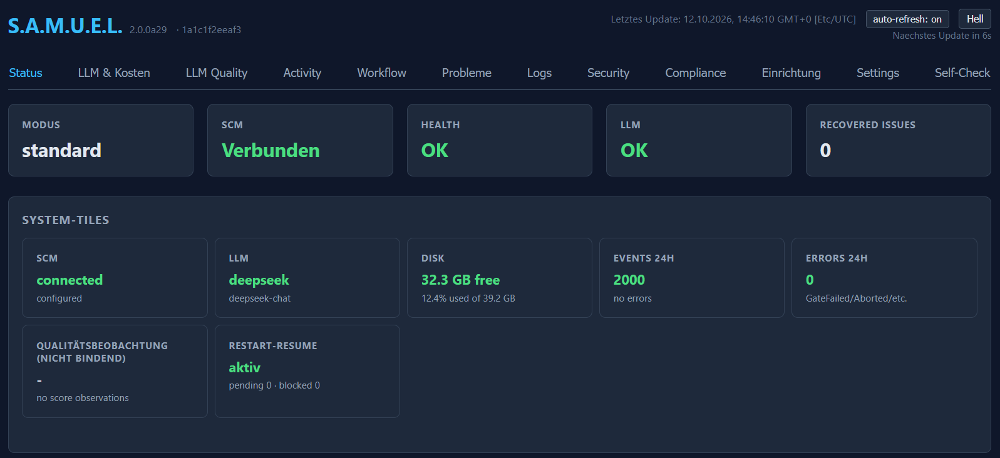
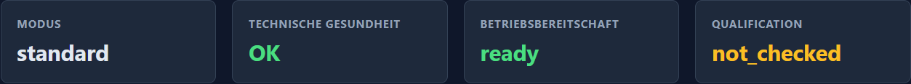
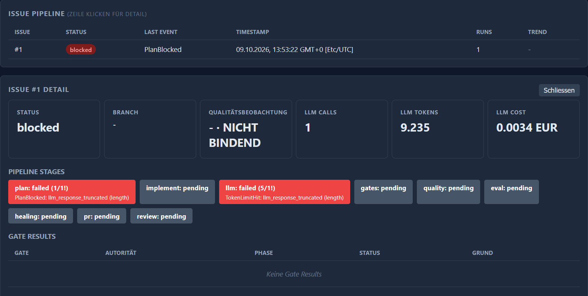
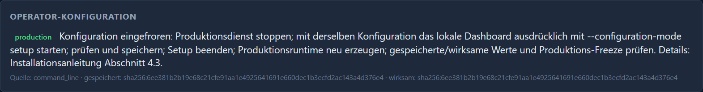
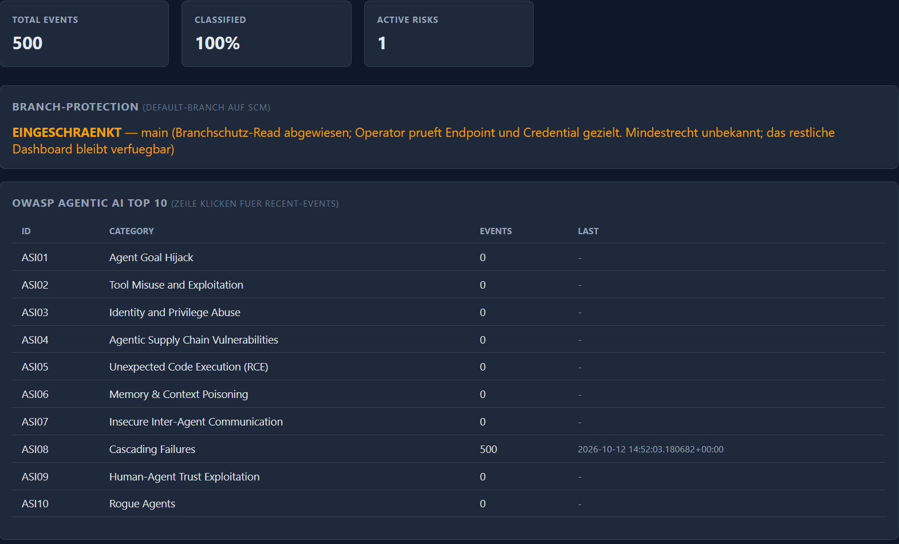

# Dashboard: Funktionen, Einstellungen und Datenquellen

[Produkt](../README.md) · [Technischer Überblick](TECHNICAL_OVERVIEW.md) · [Dokumentwege](README.md)

Diese Anleitung beschreibt die versionierten UI-/Handler-/Permission- und
Konfigurationsverträge aus der bestehenden
[Quellenbindung](capabilities/document-contract.json). Historische Screenshots
bleiben Nachweise ihres damaligen Stands.

## Aufgabenweg und wirksame Konfiguration

Diese Advanced-Anleitung richtet sich an Operatoren und Entwickler, die eine
Dashboardaktion ihren Voraussetzungen, Datenquellen und tatsächlichen Folgen
zuordnen müssen. Die Tabellen unten sind die vollständige Bedienreferenz;
Installation und Releasewechsel bleiben in ihren kanonischen Anleitungen.

| Aufgabe | Einstieg | Zu prüfendes Ergebnis |
|---|---|---|
| Erstinstallation und Zugriff vorbereiten | [INSTALL: Voraussetzungen](INSTALL.md#1-voraussetzungen), [Setup](INSTALL.md#4-konfiguration-via-wizard--samuel-setup) und [lokale Identitäten](INSTALL.md#44-lokale-dashboard-identitäten-und-cutover) | Runtimepfade, Zielprojekt, Credentials und konkrete Rechte; eine gespeicherte Konfiguration allein ist kein Betriebs-PASS. |
| Bestehenden Prozess beobachten | Status, Workflow, Probleme und Logs; [alle Bereiche](DASHBOARD.md#alle-dashboardbereiche) | Quelle, Aktualität und Evidencebindung lesen. Aktive Self-Checks und Modellproben können zusätzliche Netz-/Provideraufrufe ausführen. |
| Konfiguration ändern | [Operator-Konfiguration](DASHBOARD.md#operator-konfiguration) und [Produktions-Freeze](INSTALL.md#43-dashboard-rekonfiguration-und-produktions-freeze) | Setupmodus und Permission; Speicherung, Prozessneuerzeugung und effektiven Readback getrennt prüfen. |
| OCI-Projekt oder Toolchain bereitstellen | [OCI-Installation](INSTALL.md#91-oci-erstinstallation-auf-einem-leeren-docker-host-970) | Manifestgebundene Registrierung und Doctor; kein impliziter Toolchaininstall durch einen Workflow. |
| Core oder Release wechseln | [INSTALL: Updategrenze](INSTALL.md#121-ehrliche-updategrenze-der-alpha-serie), [Containerbetrieb](CONTAINER_RELEASE_OPERATIONS.md), [Versionierung](VERSIONING.md) | Produktversion, Revision, Digest und State-/Auditbindung; kein allgemeiner Upgrade-PASS aus einer neuen Dashboardanzeige. |
| Repository-CI betreiben | [Runnerbetrieb](CI_RUNNER_OPERATIONS.md) | Der externe CI-Runner hat eigene Betriebsregeln und wird nicht durch Dashboardsettings verwaltet. |

### Von der Datei zur Wirkung

Die [Dateizuordnung](README_technical.md#19-konfigurations-dateien) und die
[generierte Runtime-Referenz](RUNTIME_REFERENCE.md) nennen ausgelieferte
Oberflächen und Defaults. Folgende Consumergrenzen entscheiden, wann eine
Änderung wirkt; die UI ist kein Editor für beliebige JSON-Schlüssel.

| Quelle / Oberfläche | Consumer und Vorrang | Speicherung und Wirksamkeit |
|---|---|---|
| `agent.json`, globale CLI-Flags | `FileConfig`, Bootstrap und jeweiliger Command; globale `--config`-Bindung wählt das Configverzeichnis. | Dateien und Flags sind keine universelle Hot-Reload-Schnittstelle. Ein Watch-Scan lädt generische JSON-Werte erneut, erzeugt vorhandene Adapter/Workflows aber nicht neu. |
| `--configuration-mode`, `SAMUEL_CONFIGURATION_MODE` | Explizite CLI-Auswahl vor Umgebung, sonst `production`; `ConfigurationAuthority` bindet den gestarteten Prozess. | `setup` erlaubt nur zusammen mit den nötigen Permissions Schreibaktionen. Ein Dateiedit macht Produktion nicht schreibbar. |
| `.env` und externer Secretpfad | Start-/Setupweg und jeweiliger Secretconsumer; der Watch-Reload importiert `.env` nicht erneut. | Secrets werden nicht aus dem Dashboard zurückgelesen und fehlen bewusst im Configdigest. Ein Digest-PASS belegt keine gültigen Credentials. |
| `auth.json`, Identityverwaltung | Gewählter Authmodus und Identityservice; Rollen/Permissions bleiben unabhängig. | Der Authmodus ist Prozesskonfiguration. Benutzer-, Session- und Tokenaktionen haben hingegen eigene unmittelbare Verwaltungswirkungen und Reauth-/CSRF-Grenzen. |
| `features.json`, `compliance.json`, `extensions.json` | Jeweiliger Flag-/Compliance-/Extensionconsumer; `SAMUEL_RISK_CLASS` kann die gespeicherte Risikoklasse übersteuern. | Settings speichern die Operatorwahl. Aktiviert/gespeichert beweist weder wirksame Capability noch Rechts- oder Qualificationabnahme. Extensionwahl wird beim Start gebunden. |
| `llm.json`, `llm/defaults.json`, `llm/providers.json` | Factory/Taskrouting beziehungsweise Katalog; [Vorrang](README_technical.md#llm-konfiguration-zustaendigkeit-und-prioritaet) trennt Schedule, Task, globalen Default und Metadaten. | Save verändert Dateien. Der laufende Prozessdefault und echte Calls sind eigene Anzeigen; erst neu erzeugte Runtime und tatsächlicher Taskreadback belegen die neue Auswahl. |
| Promptoverrides | Vorhandener [Promptresolver](agents/AGENT_PROMPTS_AND_INSTRUCTIONS.md) mit Paket-, generischen, Provider- und Modellquellen. | View liest, Edit/Delete verändern den ausdrücklich gewählten Override. Kein automatischer Agentenregelimport und keine Änderung des Product-LLM-Vertrags aus dieser Anleitung. |
| `eval.json`, Gates, Workflows und sonstige Dateien aus §19 | Bestehende fachliche Resolver und ihre Validierungen. | Kein universeller Settings-Save. Änderungen an Tests, Gate-/Workflowwirkungen oder neuen Feldern brauchen ihren eigenen freigegebenen Scope und fachlichen Dokumentationsreview. |

Beispiel: Ein neuer globaler LLM-Default wird im Setup gespeichert. Die
gespeicherte Auswahl und `stored_config_digest` ändern sich, während die
gestartete Factory und `effective_config_digest` den bisherigen Prozess
beschreiben. `restart_required` bleibt wahr; danach Setup beenden und
Produktion neu erzeugen. Ein ausdrücklicher Task-/Scheduleoverride kann auch
im neuen Prozess weiterhin einen anderen Provider wählen. Deshalb sowohl
Configstatus als auch effektive Taskroute prüfen; eine Verbindungstestantwort
beweist weder Speicherung noch eine vollständig qualifizierte Taskausführung.

Containerprozesse binden ihr Konfigurationsverzeichnis mit
`SAMUEL_RUNTIME_CONFIG_DIR`; das Image setzt es auf `/app/config`.
Dashboard, Einmal-CLI und `samuel health` verwenden dadurch denselben
Config-/State-Kontext. Ein explizites `--config` muss bei gesetzter
Runtimebindung denselben normalisierten Pfad bezeichnen. Ein anderer Mount,
etwa `SAMUEL_RUNTIME_CONFIG_DIR=/qualification/config`, wird gemeinsam mit
dem Runtimeprozess konfiguriert; eine abweichende Einmal-CLI ist kein Ersatz.
Die Quelle dafür sind `Dockerfile` und `samuel.cli._resolve_runtime_config_dir`.

### Neue Settings und fachliche Änderungen pflegen

Für jede Änderung an Config, UI, Resolver oder Wirkung gilt die bestehende
[Documentation acceptance](../CONTRIBUTING.md#documentation-acceptance):
Dateizuordnung, betroffene Bedienfelder, Voraussetzungen, Rechte, Defaults,
Fehler und Restartwirkung im verursachenden PR prüfen und notwendige Texte,
Sourcebindings und Prüfungen gemeinsam aktualisieren. Das betrifft auch neue
Felder ohne bisheriges Binding. Der Commit-Impact zeigt geänderte Dateien und
begrenzt JSON-Feldpfade; dynamische Felder, Vorrang und geänderte Wirkungen bei
gleichem Feldnamen benötigen fachlichen Review. Ein leerer Strukturvergleich
ist kein Vollständigkeitsnachweis. Ein Verzicht auf Textänderung erhält den
geprüften Suchumfang und konkreten Grund im selben PR.

## Einstieg und Zugriffsrechte

`samuel --config <config-dir> dashboard` startet standardmäßig in `production`.
Die HTML-Shell `/` beziehungsweise `/dashboard` ist öffentlich; Betriebsdaten
verlangen Anmeldung. Port/Bindadresse stehen in [INSTALL](INSTALL.md), der
Authentisierungsmodus in `config/auth.json`.

`legacy_api_key` verwendet den vorhandenen Dashboard-Key im Sessionstorage
dieses Browsertabs. `local_identity` verwendet Benutzer/Passwort, HttpOnly-
Sessions und CSRF für Sessionwrites. Rollen sind unabhängig: Viewer liest
Status, Auditor Diagnose/Audit, Operator führt erlaubte Operationen aus,
Administrator verwaltet Identitäten. Administrator erbt keine Operatorrechte.
Automation-Tokens erhalten ausdrücklich gewählte Permissions. Die
[API-Referenz](README_technical.md#18-api-endpoints) ordnet jede Route zu.

Tab, Theme und Auto-Refresh sind Browserpräferenzen. Auto-Refresh aktualisiert
den gewählten Tab alle zehn Sekunden, startet aber keine Issues. Ein aktiver
Diagnose-/Modellendpunkt kann dennoch Providerzugriffe ausführen. Zeitangaben
mit bekanntem Offset werden in der Anzeigezeitzone formatiert; ohne Offset
bleibt die Zeitzone ausdrücklich unbekannt.

## Alle Dashboardbereiche

| Tab | Anzeige und Bedienung | Datenquelle / tatsächliche Wirkung |
|---|---|---|
| Status | Version, getrennte Revision/Dirty-Angabe, Modus, SCM, Datenträger, Eventvolumen, Metriken und passive Health-/Readiness-/Qualification- und Audit-Schreibpfadanzeige | Paketmetadaten, Buszähler und bestehende Projektionen. LLM-Konfiguration ist kein erfolgreicher Modellaufruf. |
| LLM & Kosten | Aktuelle/letzte Calls, Taskrouting, Token-/Kostensummen und Modell-/Preis-/Reasoning-/Cacheinformationen | Metering und vorhandene Caches. Current/Last sind flüchtig; alte Reservationen werden nach Neustart nicht laufende Calls. Metadaten garantieren keine Kontoverfügbarkeit. |
| LLM Quality | Provider/Modell × Task, gebundene Score-Serie, attribuierte Calls und getrennte Legacy-Serien | SQLite `quality_metrics`, Beobachtungen und Ableitungen. Advisory; kein automatischer Modellwechsel oder Freigabe. |
| Activity | SCM-Ereignisse, Bot-/Humanfilter und Details | SCM-/Webhookbeobachtungen; Actoranzeige ist keine Approvalauthority. |
| Workflow | Issues, Runs, Trend, Stages, Gates, TEST-/AC-Ergebnisse, Events, SCM-Links und Detailansicht | SQLite `run_projections` und gebundene Evidenceprojektionen. `merged`, `status:done` und geschlossenes Issue unterscheiden; `not_attempted`/`manual_pending` sind kein PASS. |
| Probleme | Filter Schwere/Kategorie/Issue, Historie/Debugdetails, letzte 20 Vorkommnisse, Gründe/nächste Schritte | Redigierte Diagnose-/Auditprojektion. Korrelation ist keine Kausalkette; Hinweise ändern keine Resume-/Healingauthority. |
| Logs | Kategorie/Level/Textfilter, aufklappbare Metadaten; höchstens 200 passende UI-Zeilen | Begrenzte Auditprojektion, kein vollständiger Rohlogexport oder Authority-State. |
| Security | Integritäts-/Signaturereignisse, OWASP, Branchschutz und Schranken | Audit und lesender SCM-Abruf. 403 ist abgewiesener Read mit unbekanntem Mindestrecht, nicht automatisch fehlendes Adminrecht. |
| Compliance | Risikoklasse, Attribution und aufklappbare Frameworklegenden | `config/compliance.json`, Mappings und Audit; keine Rechtsklassifikation, Zertifizierung oder vollständige CRA-/GDPR-Abnahme. |
| Einrichtung | SCM-/Projekt-/LLM-/Dashboard-Grundkonfiguration, Tests und Speichern | [Vorhandener Setupweg](INSTALL.md#4-konfiguration-via-wizard--samuel-setup); Setupmodus und Permission, keine automatische Projektprovisionierung. Eingaben bleiben bis zur bestätigten Schreibfreigabe und während Save gesperrt; Backendfehler werden fokussiert und ins Sichtfeld gescrollt. |
| Settings | Konfigurationsstatus, Extension, Flags, Labels, DLQ, LLM-Default/Tasks, Identity, Key-Status und Transferwarnungen | Im folgenden Abschnitt erklärt. |
| Self-Check | Technische Gesundheit, Readiness, Qualification, Audit-Schreibpfad und Einzelchecks | Aktive Probe wirksamer Taskrouten mit `RUN_PROVIDER_PROBES`; kein passiver Statusabruf oder Golden-/D0-PASS. Self-Mode-Diagnose ist ein eigener Operationspfad. |

Der **Audit-Schreibpfad** wird auf Status und Self-Check getrennt angezeigt.
„Hauptpfad gestört, Ersatzpfad genutzt“ bestätigt den Ersatzappend;
„Ereignisverlust festgestellt“ bewahrt den Verlustzähler auch nach späteren
erfolgreichen Writes. Zeit, letzte Schreibbeobachtung, Ersatz- und Verlustzähler
helfen beim Einordnen. Fehlende, veraltete oder nach Neustart ungeprüfte Daten
werden nicht grün. Ein technisches Health-OK ist kein Auditwriter-PASS.
Kettenintegrität prüfst du separat mit `audit verify`; auch eine intakte Kette
beweist keine vollständige Ereignishistorie. Details stehen in der
[Audit-Schreibdiagnose](README_technical.md#audit-schreibdiagnose-986).

## Settings vollständig erklärt

### Operator-Konfiguration

Die Anzeige nennt `mode`, `source`, `writable`, `stored_config_digest`,
`effective_config_digest`, `restart_required`. Priorität: CLI
`--configuration-mode`, `SAMUEL_CONFIGURATION_MODE`, Default `production`.
Gespeichert beschreibt den aktuellen nicht geheimen Dateistand; wirksam die
beim Dashboardstart erfasste Bindung. `.env`-Secrets fehlen bewusst im Digest.
Digestgleichheit ist keine Provider-, Gate- oder Qualificationabnahme.

Zum Ändern Produktion stoppen, dasselbe Configverzeichnis im lokalen Dashboard
ausdrücklich mit `--configuration-mode setup` öffnen, prüfen/speichern,
Setup beenden, Produktionsruntime neu erzeugen und Freeze/Readbacks prüfen.
`WRITE_CONFIGURATION` und Setupmodus müssen beide vorliegen. Produktion
blockiert vor der Mutation mit `409 configuration_frozen`. Save baut keine
Adapter neu. Dies ist die Dashboardgrenze: Watch lädt generische JSON-Werte
pro Scan erneut, baut Factory/Workflows/Wiring aber nicht neu und importiert
`.env` nicht erneut. [Details](README_technical.md#operator-konfigurationsmodus).

### Einrichtung: Required Check, Projekt und Testpolicy

Das Formular zeigt den erwarteten Required-Check-Kontext und dessen Quelle.
Ein explizit leerer Wert wird weiter vom Backend abgewiesen; am sichtbaren
Fehlerort stehen Feldname, Ursache und Aufforderung zur Korrektur. Nicht
gespeicherte Eingaben bleiben erhalten. Produktion zeigt Read-only und den
bestehenden Setup-/Production-Wechsel; fehlende Permission erteilt ebenfalls
keine Schreibfreigabe. Secrets werden nicht zurückgelesen.

Das Zielprojekt muss aus Sicht der Runtime erreichbar sein. Im OCI-Betrieb
zuerst einen dedizierten sauberen Standalone-Git-Checkout mit passendem
Repository/Origin, vollständigem initialem SHA und Runtime-Schreibrechten über
`samuel-container project` registrieren. Ein Pfad auf einem anderen Rechner
wird dadurch nicht erreichbar. Den Produktcheckout nicht als Agentenbestand
verwenden. [Projektregistrierung](INSTALL.md#91-oci-erstinstallation-auf-einem-leeren-docker-host-970).

Die vorhandene Testpolicy steht in `config/eval.json`: explizites `test_cmd`
mit `{test}` hat Vorrang, sonst gelten unterstützte Projektmarker. Missing
oder Invalid blockiert den Doctor-Runnercheck. Der Workflow installiert keine
Projektabhängigkeiten. Die benötigte Python/Pytest-Toolchain im OCI-Betrieb über
`samuel-container toolchain` bereitstellen.
[Setup/Testpolicy](INSTALL.md#4-konfiguration-via-wizard--samuel-setup),
[OCI-Projekt und Toolchain](INSTALL.md#91-oci-erstinstallation-auf-einem-leeren-docker-host-970).
Diese Hinweise verwenden dieselben Resolver und Registrierungsmechanismen.
Doctor-PASS ist ein Runnercheck, kein bestandener Candidate-Test oder Human-
Gate-11-PASS. Ein Toolchaineditor wird nicht angeboten.

### Documentation Extension

| Feld | Bedeutung / Speicherung |
|---|---|
| Aktiviert | `config/extensions.json`, `capabilities.documentation.static_claims.enabled`: vorhandene Capability berücksichtigen |
| Erforderlich | `required`: fehlende/deaktivierte/inkompatible Capability blockiert die betreffende Statusauflösung; keine allgemeine Gateauthority |
| Manifestpfad | `manifest_path`: für die Runtime erreichbares Capability-Manifest; kein Download/Fremdcodeimport |
| Gespeichert | `available`, `blocked`, `status`, `reason` der gespeicherten Wahl |
| Wirksam | `effective_*`: beim Prozessstart erfasste Wahl; Neustart nötig |
| Speichern | Bestehende Policy validieren/persistieren; Setup + `WRITE_CONFIGURATION` |

Die Checkbox führt keinen Consumer aus und baut/publiziert kein Wiki.
`samuel-documentation` liest diese Dashboardwahl derzeit nicht. Contract,
Manifest, Request/Result und advisory Grenze:
[Extensionvertrag](EXTENSION_CONTRACT.md#dashboard-documentation-extension-und-wiki).

### Feature Flags, Labels und DLQ

Featureflags zeigen Name, Beschreibung und gespeicherten Wert aus
`config/features.json`. Umschalten sendet `name`/`enabled` an den vorhandenen
Flagendpoint; bei Fehler setzt die UI zurück, Produktion sperrt die Schalter.
Der [Runtimekatalog](RUNTIME_REFERENCE.md) listet sämtliche ausgelieferten
Flags. Ein Flag erzeugt keinen fehlenden Adapter, Qualification oder Authority;
Wirkung hängt vom Consumer/Start-/Reloadpfad ab.

**Labels auf SCM synchronisieren** verwendet `/api/v1/setup/labels`,
`RUN_OPERATIONS` und Setupmodus. Der Setuphandler gleicht die Labels aus
`config/labels.json` mit dem Repository ab. Das ist eine reale SCM-Mutation,
keine Planfreigabe oder Issuebeauftragung.

Die **Dead-Letter-Queue** enthält Events fehlgeschlagener Subscriber im
vorhandenen JSONL-DLQ-Pfad, nicht SQLite. Die UI liest; Replay ist die CLI-Aktion
`samuel dlq replay <id>`. Sie publiziert erneut und kann Subscriberwirkungen
auslösen. Kein rein lesender Refresh oder Ersatz fehlender Human-/Planbindung.

### LLM Default & Fallback

Default und geordnete Fallbacks werden in `config/llm.json::default`
gespeichert. Unterstützt: `claude`, `deepseek`, `gemini`, `openai`, `openrouter`,
`ollama`, `lmstudio`, `manual`. Kommagetrennte Fallbacknamen werden geprüft;
Dubletten und Default werden entfernt. `SAMUEL_LLM_PROVIDER` kann den
Dateidefault beim Prozessstart übersteuern. Save verlangt Neustart.

Die Statuskachel **LLM-Default (Prozess)** und die Settingsanzeige
**Prozessdefault** verwenden die vorhandenen Factoryfacts des gestarteten
Prozesses. **Gespeicherter Default** und **Gespeicherte Fallback-Kette** sind
die Editorwerte aus der Datei. Die Quelle nennt `config` oder `environment`;
`SAMUEL_LLM_PROVIDER` kann den Dateidefault beim Start übersteuern.

Nach Save können gespeicherter Default und Prozessdefault absichtlich
verschieden sein: etwa gespeichert `deepseek`, laufender Prozess `gemini`.
Der Neustarthinweis bleibt bis zum Production-Recreate sichtbar. Save allein
baut keinen Adapter und ändert keinen laufenden Taskcall. Nach Recreate liest
der neue Prozess die gespeicherte Wahl, sofern kein Environmentoverride gilt.

Die Kachel ist neutral, bei Neustartbedarf oder fehlendem Default warnend.
`runtime_adapter` bedeutet nur, dass die Factory einen Adapter erzeugt hat;
ohne Factoryfacts gilt `process_configuration` und ausdrücklich kein
Adapter-Nachweis. Weder Zustand noch Keypräsenz/Katalog beweisen einen
erfolgreichen Call. Tatsächliche Current-/Last-Calls im LLM-Tab und das
effektive Taskrouting bleiben getrennte Quellen. Der #999-Fix ist in Main
integriert; die ursprüngliche externe UX-011-Ursache bleibt UNKNOWN.

### LLM Task Configuration

`edit` öffnet eine der fünf konfigurierbaren Tasks `planning`, `implementation`,
`review`, `healing`, `evaluation`. Die ersten vier besitzen Consumer;
`evaluation` hat keinen aktiven LLM-Consumer. Speicherung:
`config/llm/defaults.json::tasks.<task>`. Unbekannte Tasks/Felder werden
abgelehnt; leere Werte entfernen Overrides und fallen auf Defaults zurück.

| Editorfeld / Aktion | Bedeutung und Grenze |
|---|---|
| Provider | Taskoverride; globaler Default, Task und Schedule sind getrennte Auswahlstufen |
| Model | Frei eingebbare Modell-ID mit optionalen Katalog-/Endpointvorschlägen. Unbekannte oder entfernte IDs bleiben erhalten und werden allein deshalb nicht abgelehnt |
| Modellrefresh | OpenRouter-Preis-/Modell-/Reasoning-/Benchmarkcache aktualisieren; kein Modellpull/Installation/Kontofreigabe |
| `base_url` | Endpoint aus Sicht der Runtime; Container-`localhost` ist der Container. Ollama/LM Studio benötigen eine erreichbare URL |
| `timeout` | Provider-Requesttimeout in Sekunden; kein Workflow-/TEST-Budget |
| `system_prompt` | Markdowndateiname; `(none)` entfernt Taskoverride, View liest und Edit schreibt Operatoroverride |
| Sourcebadge | Aufgelöste Quelle: Paket, generischer Operator-, Provider- oder Modelloverride |
| Per-Provider Overrides | Provider → Promptdatei; leere UI-Zeilen nicht speichern, entfernte Zuordnung beim Save entfernen; bestehender Resolver |
| `max_tokens` | Positive ganze Content-Outputgrenze; keine zusätzliche Budgetzulassung |
| `reasoning_reserve` | Nicht negative ganze Zahl; 0 = Providerdefault, nicht Reasoning aus. Explizite Reserve nur OpenRouter, Content-/Modellgrenzen gelten |
| Reasoning-Hinweis | Capability-/Katalogmetadaten, keine garantierte Qualität |
| Kostenhinweis | Optionales advisory Pareto-Angebot geeigneter günstigerer Modelle; kein Wechsel |
| Überqualifiziert-Marge | 0–1 relativ zur Taskschwelle: 0,20 bei Schwelle 50 ergibt 60; keine automatische Routenänderung |
| `temperature` | Samplingwert, tatsächliche Unterstützung adapterabhängig |
| Save | Taskwerte validieren/persistieren; Setup + `WRITE_CONFIGURATION`, Neustart |
| Test | Temporärer Check aus Editorwerten mit `RUN_PROVIDER_PROBES`; möglicher Netz-/Kostenkontakt, speichert die Taskkonfiguration nicht; Fehlprobe publiziert ein Diagnoseereignis, keine vollständige Taskabnahme |
| Cancel | Editor ohne Save schließen; separat gespeicherte Promptänderungen nicht rückgängig machen |

Keys gehören in den externen Secretpfad, nicht Task-JSON. Benchmarks, Konto,
Call und Qualification unterscheiden. Präzedenz und Defaults:
[LLM-Stack](README_technical.md#8-llm-stack).

### Freie Modelleingabe und optionale Vorschläge

In der **Einrichtung**, der **Taskkonfiguration** und dem **Schedule** kannst
du eine Modell-ID direkt eingeben. Die Vorschlagsliste ist eine Orientierung,
keine Zulassungsliste. Du musst keinen Vorschlag auswählen. Beim Laden,
Providerwechsel oder Aktualisieren bleibt deine Eingabe erhalten, auch wenn
die ID unbekannt ist oder inzwischen aus dem Katalog entfernt wurde. Erst
bewusstes Speichern ändert die Konfiguration; Produktions-Freeze, erforderliche
Zugriffsrechte und vorhandene Verbindungstests bleiben bestehen.

Der Hinweis am Feld zeigt, ob der Katalog aktuell, veraltet, fehlend oder nicht
erreichbar ist. Die freie Eingabe funktioniert auch ohne Liste. In der
Ersteinrichtung ist die vorbelegte Provider-/Modellwahl ein Produktdefault;
sie bestätigt weder eine Empfehlung noch einen erfolgreichen Aufruf. Ein
anderer Cloudprovider benötigt seinen eigenen API-Key. Lokale Listen in der
Einrichtung werden erst mit **Optionale Modellvorschläge laden** am angegebenen
Endpoint abgefragt. Task-/Schedulelisten nutzen weiterhin den bestehenden
Modellendpunkt und die Taskeditor-URL. Solche Abfragen benötigen
`provider:probe`; Katalogrefresh benötigt `operations:execute`. Fehlende
Berechtigung sperrt keine freie Eingabe und verleiht keine Speicherrechte.

Unter **LLM & Kosten** werden **Modellkatalog** und **Benchmarks** getrennt
angezeigt. Ein aktueller Katalog kann mit fehlenden oder fehlgeschlagenen
Benchmarkdaten zusammenfallen. Aktualisieren erneuert auch die Vorschläge
in bereits geöffneten Cloudprovider-Formularen; verspätete Antworten eines
früheren Providers oder Endpoints überschreiben sie nicht. Lokale Listen sind
keine OpenRouter-Kataloge und werden durch diesen Refresh nicht abgefragt.

Katalogeintrag, Benchmarkwert und lokale Endpointliste beweisen keine
tatsächliche Modell-/Kontoverfügbarkeit. Dafür dienen die vorhandenen
ausdrücklichen Verbindungstests beziehungsweise echte Calls. Unbestätigte
Verfügbarkeit bleibt **UNKNOWN**. Routingpriorität, Qualitätsbewertung,
Kostenhinweise und Fallbackregeln bleiben unverändert; Vorschläge ersetzen
niemals automatisch ein Modell.

### Schedule und Systemprompt

Schedulefelder: `active`, `from`, `to`, `provider`, `model`. Zeiten sind
`HH:MM`, auch über Mitternacht. Aktiv benötigt gültigen Provider und nicht
leeres Modell; `active=false` entfernt den gespeicherten Scheduleoverride.
Der Editor hat keine separate Schedule-URL; Modellabfrage benutzt die
Taskeditor-URL. [Runtime-Zeitzone/Präzedenz](README_technical.md#12-routing-schedules-und-budgets).
Auch das Schedulemodell ist frei eingebbar; eine neue Liste ersetzt den
gespeicherten oder gerade eingegebenen Wert nicht.
Schedule ist kein Cronjob und startet keine Issues.

View liest den aufgelösten Prompt, Edit schreibt einen Markdownoverride unter
dem Configverzeichnis, Delete gibt die niedrigere Quellstufe frei. Paketprompts
bleiben erhalten. [Scopes/Auflösung](agents/AGENT_PROMPTS_AND_INSTRUCTIONS.md).
Writes benötigen Setup + `WRITE_CONFIGURATION`; kein laufender Adapterneuaufbau.
Die integrierte FD-Härtung öffnet Komponenten unterhalb der expliziten
Configwurzel descriptorrelativ ohne Symlinkfolgen. Nur reguläre UTF-8-Dateien
mit gültigem Markdownbasename werden gelesen; unsichere/unlesbare Kandidaten
werden in der vorhandenen Kaskade übersprungen. Schreiben verwendet einen
privaten exklusiven Stagingpfad und Rename, Delete entfernt nur den benannten
Override. Fehlende sichere Plattformoperationen erzeugen keinen unsicheren
Fallback. Es entsteht kein zweiter Promptresolver.

### Identitäten und Sitzungen

Nur `local_identity` bietet Benutzer-/Session-/Automationverwaltung. Fehlende
Permission bleibt eingeschränkt. Benutzeranlage, Rollen-/Passwort-/Disabled-
Änderungen und Tokenanlage benötigen die vorhandene Adminpermission und frische
Passwort-Reauth. Mehrere unabhängige Rollen sind möglich, SCM-Labels ersetzen
sie nicht. Sessions einzeln oder mit `REVOKE ALL SESSIONS` widerrufen.
Automation-Tokens: Name, explizite Permissions, begrenzte Lebensdauer; Rohwert
nur bei Anlage, Listen nur Metadaten. Argon2-/Session-/Tokenhashes, Rollen und
Widerrufe liegen in den [Identitytabellen](STATE_STORE.md#tabellen-und-funktion).
Restore kann `recovery_pending` setzen; Recovery verwendet `samuel identity`,
kein neuer OAuth-/SSO-/IAM-Pfad.

### API Keys und Transfer-Warnungen

API Keys zeigt Präsenz, keine Secretwerte oder wieder auslesbaren Keys.
Bei unterstützten Providern kann der injizierte Balanceabruf realen
Netzkontakt auslösen. `configured` heißt vorhanden, nicht garantiert gültig.
Änderungen benutzen Setup/externe Secretquelle.

Transferwarnungen erscheinen bei vorhandenen Privacyhinweisen zu konfigurierten
Providerstandorten. Sie sind technische Information, keine abgeschlossene
DPA-/Transferprüfung. Tatsächliche Deployment-/Datenverhältnisse gehören zur
[Datenschutzvorlage](DSGVO_VVT.md).

## Compliance und Attribution bedienen

Der Compliancebereich verbindet die Frameworklegende mit zwei vorhandenen
Operatoraktionen. Die angezeigten rechtlichen Hinweise sind Produkttexte;
eine Auswahl oder ein Badge ist keine Rechtsprüfung oder Zertifizierung.

| Feld / Anzeige | Quelle, Bedienung und tatsächliche Grenze |
|---|---|
| Deployment-Risikoklasse | `minimal_risk`, `limited_risk`, `high_risk`; gespeichert in `compliance.json`. `SAMUEL_RISK_CLASS` hat Vorrang, die UI zeigt die Quelle und sperrt den Selektor bei Environmentbindung. |
| Externe LLM-Code-Kennzeichnung | `enabled` schreibt `features.json::llm_attribution`; beeinflusst vorhandene externe Attributionsconsumer. Die separate Auditspur bleibt bestehen. |
| Ausführlichkeit | `verbosity` mit `minimal` oder `full`, gespeichert unter `privacy.json::attribution.verbosity`. Ein UI-Save ist kein vollständiger Attributionsnachweis für alle Ausgabepfade. |
| Gesperrt | `locked` folgt der effektiv aufgelösten Produkt-Risikoklasse; `high_risk` blockiert die Attributionsänderung im bestehenden Handler mit 409. Permission und Setupmodus bleiben zusätzliche Voraussetzungen. |
| Teilweise Speicherung | `configuration_partial_persistence` bedeutet: der Flagwrite war bereits erfolgreich, der nachfolgende Privacywrite schlug fehl. Dateistand und Fehler prüfen; kein vollständiger Save-PASS, Neustartbedarf bleibt sichtbar. |

Die Änderung benötigt `WRITE_CONFIGURATION` und einen expliziten Setup-Prozess.
Configstatus, gespeicherte Werte und wirksame Consumer nach dem regulären
Recreate prüfen. Die [API-Referenz](README_technical.md#18-api-endpoints)
benennt Requests, Permission und Antworten.

## Wirkungs- und Nachweisgrenzen

Das Dashboard erteilt keine Human-Planfreigabe, MANUAL-Acceptance, automatische
Issue-Schließung, Qualification oder Human-Mergeauthority. Probes/SCMoperationen
haben eigene Permissions. Die begrenzten Fixes #999/#1000 sind in Main
integriert; reale Host-, Release- und weitergehende Qualificationclaims bleiben
an ihre eigenen Nachweise gebunden. Maßgeblich bleiben
[heutige Issuereste](status/ISSUE_IMPLEMENTATION_MATRIX.md) und das
[Qualification-Runbook](runbooks/TEST_AND_QUALIFICATION_RUNBOOK.md).

## Technische Quellen

`samuel/server.py`, `samuel/slices/dashboard/handler.py`, `data.py`,
`samuel/adapters/api/auth.py`, `samuel/core/identity.py`,
`samuel/core/configuration_mode.py`, `samuel/adapters/llm/factory.py`,
`samuel/slices/setup/handler.py`, `config/auth.json`, `features.json`,
`llm.json`, `llm/defaults.json`, `extensions.json`.

## Reale Aufnahmen aus dem bereitgestellten Bildbestand

Die vom Maintainer bereitgestellten Originale wurden am **13.10.2026** einzeln
visuell geprüft. Die sichtbaren Dashboardkopfzeilen nennen **2.0.0a29**,
Revision **1a1c1f2eeaf3** und Anzeigezeiten am **12.10.2026** in `Etc/UTC`.
Der Aufnahmezeitpunkt von Teilbildern ohne Kopfzeile ist nicht separat belegt;
sie werden über Inhalt und Überlappungen diesem Bildbestand zugeordnet.
Browserkennung, vollständige Installations-/OCI-Bindung und etwaige lokale
UI-Änderungen sind nicht aus den Bildern bestimmbar. Der Quellenreview für
diese Erklärung erfolgte auf Main `fff8f58d320ecf0868f50b440acec5312e91bfca`.
Die Bilder zeigen ihren datierten Stand, nicht automatisch den aktuellen Main.

Der sichtbare Setup gehört zu einem konkreten lokalen Testprojekt; dessen
private Repositoryzuordnung bleibt im Originalnachweis.
Die Workflowdetails zeigen dessen historischen Issue-#1-Block vom **09.10.2026**.
Das separate [Gitea-Beispiel](../technische%20Beschreibungen/README.md#reale-scm-aufnahmen-des-änderungsablaufs)
betrifft ein anderes Repository und eine andere Produktrevision. Diese Quellen
werden nicht zu einem gemeinsamen erfolgreichen Lauf zusammengesetzt.

### Status, LLM und Beobachtung in den Aufnahmen

> 
>
> *Statusübersicht der historischen a29-Installation. Technische Anzeigen und Qualitätsbeobachtung haben unterschiedliche Quellen.*

Die grünen SCM-/Health-/LLM-Kacheln beschreiben die jeweilige Anzeigequelle.
Der konfigurierte Provider `deepseek` und das Defaultmodell `deepseek-chat`
sind vom historischen Taskcall `deepseek-v4-pro` zu unterscheiden. Die
LLM-Runtime zeigt **idle und null aktuelle Calls**, während die persistierte
Quality-Matrix einen älteren **unattribuierten** Planningcall enthält. Das
ist keine widersprüchliche Messung derselben Zeit-/Herkunftsgrenze.

| Aufnahme | Sichtbare Aussage / Fachkapitel |
|---|---|
| [LLM-Runtime idle, null Calls/Tokens/Kosten; konfigurierte Auswahl ist kein Call.](images/product-captures/llm-runtime-idle-a29.png) | [LLM Default und wirksame Route](DASHBOARD.md#llm-default--fallback): keine Calls dieser Runtime. |
| [Konfigurierte Taskrouten und Benchmarkhinweise; kein Schedule konfiguriert.](images/product-captures/llm-task-routes-a29.png) | [Taskkonfiguration](DASHBOARD.md#llm-task-configuration): Taskoverrides, Tokenlimits, keine konfigurierte Nachtzeit; `evaluation` ohne produktiven LLM-Consumer. |
| [Modell-/Benchmarkcache; Aktualität ist keine Kontoverfügbarkeit.](images/product-captures/llm-model-cache-a29.png) | [Katalog und Benchmark](DASHBOARD.md#llm-task-configuration): Cache frisch; keine Liveverfügbarkeit oder Taskqualification. |
| [Unattribuierter historischer Planningcall ohne gebundenen Score.](images/product-captures/llm-quality-unattributed-a29.png) | [LLM Quality](DASHBOARD.md#alle-dashboardbereiche): Serien-Calls 0, unattribuiert 1, kein Score. |
| [Leere Token-/Calltabellen; doppelte Quality-Matrix weggelassen.](images/product-captures/llm-empty-metering-a29.png) | [LLM & Kosten](DASHBOARD.md#alle-dashboardbereiche): leere Token-/Calltabellen. |
| [HealthCheck-/ResumePending-Zähler; keine nachgewiesene Resumeausführung.](images/product-captures/runtime-event-counts-a29.png) | [Status](DASHBOARD.md#alle-dashboardbereiche): Zähler, keine nachgewiesene Wiederaufnahme. |
| [Leere Score- und Anomalietabellen.](images/product-captures/runtime-empty-observations-a29.png) | [Status](DASHBOARD.md#alle-dashboardbereiche): leere Score-/Anomalietabellen im Ausschnitt. |
| [Leere SCM-Activity; keine native Zustellung nachgewiesen.](images/product-captures/scm-activity-empty-a29.png) | [Activity](DASHBOARD.md#alle-dashboardbereiche): leere Webhookbeobachtung beweist weder fehlende Konfiguration noch funktionierende Zustellung. |
| [Keine passenden aktiven Probleme; Filter-/Zeitfenstergrenze bleibt sichtbar.](images/product-captures/problems-empty-a29.png) | [Probleme](DASHBOARD.md#alle-dashboardbereiche): keine passenden aktiven Probleme bei den sichtbaren Filtern. |
| [HealthCheck-Log mit aufgeklappten korrelierten Metadaten; begrenzter UI-Ausschnitt.](images/product-captures/audit-log-details-a29.png) | [Logs](DASHBOARD.md#alle-dashboardbereiche): aufgeklappte HealthCheck-Metadaten; begrenzte Auditprojektion. |
| [Technische Einzelchecks OK; keine Golden-Qualification.](images/product-captures/health-checks-a29.png) | [Self-Check](DASHBOARD.md#alle-dashboardbereiche): technische Einzelprüfungen, kein Golden-PASS. |
| [Pixelgleich zusammengesetzte Self-Check-Tabelle mit LLM-Detailfortsetzung.](images/product-captures/self-check-details-a29.png) | [Self-Check](DASHBOARD.md#alle-dashboardbereiche): zusammengesetzte Tabelle; `configured_unverified`, `reachability: not_checked` und separat `live_probe=performed` bleiben unterscheidbar. |

> 
>
> *Self-Check derselben a29-Installation: Readiness und Qualification bleiben getrennt.*

**`ready` und `not_checked` stehen hier gleichzeitig.** Readiness ist keine
Qualification. Die detaillierte Probeantwort ist ebenfalls keine erfolgreiche
Planning-/Implementation-/Reviewausführung oder vollständige Isolation.

> 
>
> *Historischer Planblock: Stagefehler und Gesamtzustand desselben Issues sind gleichzeitig sichtbar.*

Hier ist **`blocked` der Gesamtzustand**, während `plan` und `llm` jeweils
**`failed`** anzeigen. Grund: `llm_response_truncated (length)`. Ein
abgeschlossener LLM-Call oder Budgetsettlement bedeutet keine erfolgreiche
fachliche Planung. Implementierung, Gates und weitere Stages bleiben pending;
Gate-, Test- und Acceptanceergebnisse fehlen.

| Aufnahme | Sichtbare Aussage / Fachkapitel |
|---|---|
| [Historischer Planningcall, keine Tests/Acceptance; Run endet blocked am 09.10.2026.](images/product-captures/workflow-blocked-evidence-a29.png) | Ein historischer Planningcall, 9.235 Tokens und 0.0034 EUR; keine Tests/Acceptance; Run am 09.10.2026 beendet. |
| [Auditfortsetzung: DiagnosticRaised, Budgetsettlement, Kontext und IssueReady.](images/product-captures/workflow-blocked-audit-a29.png) | Weitere Zeilen desselben Ausschnittbestands: Diagnose, Callabschluss, Budget, Kontext und IssueReady. Nicht nahtlos mit dem vorherigen Bild verbunden. |

### Einrichtung und Settings in den Aufnahmen

> 
>
> *Eingefrorene Operator-Konfiguration. Die Aufnahme zeigt den gespeicherten und wirksamen Stand, keine Schreibaktion.*

Die Kopfaufnahme zeigt `production`, eingefrorene Konfiguration und gleiche
gespeicherte/wirksame Digests. In anderen Ausschnitten sichtbare Schalter oder
Savebuttons beweisen **keine erfolgreiche Schreibaktion**; Modus, Permission
und Backendantwort behalten den oben beschriebenen Vertrag. Aufnahmen im
Setupmodus, erfolgreicher Speicherung und anschließendem Recreate fehlen.

| Aufnahme | Sichtbare Aussage / Fachkapitel |
|---|---|
| [Vorhandene Konfiguration, Production-Freeze und passiver Projektzugriff.](images/product-captures/setup-readonly-project-summary-a29.png) | [Einrichtung](DASHBOARD.md#einrichtung-required-check-projekt-und-testpolicy): vorhandene Konfiguration, Required Check und passiver Projektzugriff. |
| [SCM-/Projektfelder; interne Serveradresse geschwärzt.](images/product-captures/setup-project-fields-a29.png) | [Einrichtung](DASHBOARD.md#einrichtung-required-check-projekt-und-testpolicy): SCM/Zielprojekt/Identitäten; interne Serveradresse und private Repositoryzuordnung geschwärzt. |
| [Provider-/Modell-/URL-Eingabe; API-Key ist nur Platzhalter.](images/product-captures/setup-llm-fields-a29.png) | [LLM Default](DASHBOARD.md#llm-default--fallback): DeepSeek, freies Modellfeld und lokale URL; keine Providerprobe belegt. |
| [Speicherbereich und expliziter unbestätigter Save; keine Speicherung ausgeführt.](images/product-captures/setup-save-fields-a29.png) | [Einrichtung](DASHBOARD.md#einrichtung-required-check-projekt-und-testpolicy): Geheimnisplatzhalter und ausdrücklicher unbestätigter Save; kein Save ausgeführt. |
| [Documentation Extension disabled; Auswahl publiziert kein Wiki.](images/product-captures/settings-documentation-extension-a29.png) | [Documentation Extension](DASHBOARD.md#documentation-extension): gespeichert/wirksam disabled; Auswahl ist kein Wiki-Publish. |
| [Featureflags; Auto-Merge und Expected-Head-Qualification ausgeschaltet.](images/product-captures/settings-feature-flags-a29.png) | [Feature Flags](DASHBOARD.md#feature-flags-labels-und-dlq): Auto-Merge und Expected-Head-Qualification off; eingeschalteter Flag belegt keinen fehlenden Consumer. |
| [Labelsynchronisierung als reale SCM-Aktion; nicht ausgeführt.](images/product-captures/settings-label-sync-a29.png) | [Labels](DASHBOARD.md#feature-flags-labels-und-dlq): native Synchronisierung hat SCM-Wirkung; Button wurde für die Dokumentation nicht betätigt. |
| [Leere Dead-Letter-Queue; Replay ist kein rein lesender Refresh.](images/product-captures/settings-dlq-empty-a29.png) | [DLQ](DASHBOARD.md#feature-flags-labels-und-dlq): leer; Replay kann Subscriberwirkungen auslösen. |
| [Default/Fallback-Editor; sichtbarer Button beweist keine Schreibfreigabe.](images/product-captures/settings-default-fallback-a29.png) | [Default/Fallback](DASHBOARD.md#llm-default--fallback): Default deepseek; `openrouter, ollama` im Feld ist kein nachgewiesener ausgeführter Fallback. |
| [Task-/Promptzuordnung mit Paketscope; evaluation ist kein produktiver LLM-Consumer.](images/product-captures/settings-task-prompts-a29.png) | [Tasks](DASHBOARD.md#llm-task-configuration) und [Prompts](DASHBOARD.md#schedule-und-systemprompt): package-Scope; `evaluation` in der Anzeige belegt keinen produktiven LLM-Aufruf. |
| [Legacy-API-Key-Modus; kein local-identity-Cutover nachgewiesen.](images/product-captures/settings-legacy-identity-a29.png) | [Identitäten](DASHBOARD.md#identitäten-und-sitzungen): Legacy-API-Key-Modus, keine lokale Benutzer-/Sessionverwaltung im Bild. |
| [Providercredential-Präsenz und URL-only; keine Schlüsselwerte.](images/product-captures/provider-key-presence-a29.png) | [API Keys](DASHBOARD.md#api-keys-und-transfer-warnungen): configured, missing und url_only; nur Variablennamen/URLs, keine Secretwerte. |
| [Transferwarnungen; Kontoguthaben aus dem oberen Bildteil ausgeschlossen.](images/product-captures/provider-transfer-warnings-a29.png) | [Transferwarnungen](DASHBOARD.md#api-keys-und-transfer-warnungen): technische Providerhinweise; Kontoguthaben aus dem Original bewusst nicht übernommen. |

### Security, Compliance und Retention in den Aufnahmen

> 
>
> *Securityausschnitt mit eingeschränktem Branchschutz-Read und beobachteten Ereigniskategorien.*

Der Branchschutz-Read ist eingeschränkt; das nötige Mindestrecht bleibt unknown.
Das ist kein Nachweis deaktivierter Branchprotection und kein Anlass für
pauschale Adminrechte. Die Kategorie `Cascading Failures` enthält hier
HealthCheck-Ereignisse. Ein Kategoriezähler oder „100% classified“ ist weder
ein bestätigter Angriff noch ein Nachweis behobener Sicherheitsbefunde.

| Aufnahme | Sichtbare Aussage / Fachkapitel |
|---|---|
| [Leere Schranken-, OTel- und Integritätsereignistabellen.](images/product-captures/security-empty-events-a29.png) | [Security](DASHBOARD.md#alle-dashboardbereiche): keine Schranken-/OTel-/Tamperereignisse im sichtbaren Fenster. |
| [OWASP-Kategorienlegende; beschreibende Zuordnung.](images/product-captures/compliance-owasp-legend-a29.png) | [Compliance](DASHBOARD.md#compliance-und-attribution-bedienen): beschreibende OWASP-Legende; kein Wirksamkeitsbeweis. |
| [Datierter AI-Act-UI-Text und Risikowahl; keine rechtliche Abnahme.](images/product-captures/compliance-ai-act-ui-a29.png) | [Compliance](DASHBOARD.md#compliance-und-attribution-bedienen): historische UI-Formulierungen und Limited-Risk-Auswahl; keine Rechts- oder Zertifizierungsaussage dieser Dokumentation. |
| [Vier advisory Framework-Mappings.](images/product-captures/compliance-framework-mappings-a29.png) | [Framework-Mappings](COMPLIANCE_FRAMEWORK_MAPPINGS.md): OWASP, AI Act, GDPR und CRA jeweils advisory. |
| [Externe LLM-Kennzeichnung und Ausführlichkeit; keine Savewirkung belegt.](images/product-captures/compliance-attribution-a29.png) | [Attribution](DASHBOARD.md#compliance-und-attribution-bedienen): externe Kennzeichnung an/full; separate Auditspur, keine Save-/Vollconsumerabnahme. |
| [Not-Aus aktiv, Pending Review 29 und report_only_pending_review; keine Löschung.](images/product-captures/retention-report-only-a29.png) | [State/Retention](STATE_STORE.md): Not-Aus aktiv, Pending Review 29, report_only_pending_review; keine Löschung nachgewiesen. |

### Fehlende Zustände und gezielte Folgeaufnahmen

Die Nachlieferung wird im **Sammelissue #1048** des operativen Gitea-Projekts
geführt. Dort stehen die benötigten echten Ausschnitte, Bindungen und
Aufnahmemetadaten. Der vorhandene Bildbestand bleibt integriert; die folgenden
fehlenden Aufnahmen sind ausdrücklich übertragene Nachweise, keine behaupteten
Erfolge und kein Anlass, die vorhandenen Bilder erneut zu erstellen.

Die folgende Aufnahmeplanung folgt der **echten** Statusreduktion in
`samuel/core/workflow_outcome.py`, den Dashboardprojektionen
`_derive_workflow_issue_state`, `_classify_run_final_status`, den Stage-
Ableitungen in `samuel/slices/dashboard/data.py` und der UI in `samuel/server.py`.
Zustände werden nicht für eine vermeintlich vollständige Bildserie erfunden.

| Zustand / Übergang | Im Bildbestand vorhanden? | Passende echte Folgeaufnahme |
|---|---|---|
| `blocked` / PlanBlocked | Ja, Issue #1; Grund und Zeitpunkt sichtbar. | Bereits aufgenommen; getrennte aktuelle Regression wäre ein eigener Nachweis. |
| Stage `failed` | Ja, plan/llm im gleichen Block. | Kein zusätzliches globales `FAILED`-Badge behaupten. |
| `running` / aktiver LLM-Call | Nein; aktuelle Callansicht ist idle. | Tatsächlich aktiven gebundenen Call mit Task/Modell/Attempt und Zeit aufnehmen. `ready`, `planned`, `implemented` sind eigene Issueprojektionen. |
| `manual_pending` | Nein. Das Gitea-Beispiel hat sechs maschinelle Kriterien. | Eigenes tatsächlich wartendes MANUAL-Kriterium mit AC-ID/Contract/Head sowie spätere echte Humanfortsetzung aufnehmen. |
| `pr_created`, `reviewed`, `merged` im Dashboard | Nein; Gitea zeigt Review und Merge eines anderen Beispiels. | Dashboarddetail eines passenden gebundenen Vorgangs aufnehmen; Repository/Attempt zur SCM-Seite zuordnen. |
| `aborted` | Nein. Der Reducer kennt es; die Issueübersicht projiziert terminale Abbrüche als blocked. | Detail/Run/Audit einschließlich WorkflowAborted und kausalem Grund aufnehmen; kein fremder FAIL übertragen. |
| `eval_failed`, `incomplete` / Trend `failed` | Nein; dies sind Run-/Trendprojektionen, kein allgemeiner Workflowstatus `failed`. | Betroffene tatsächliche Runliste bzw. zwei passende terminale Runs aufnehmen. |
| Gate-/Acceptance FAIL, ERROR, MISSING EVIDENCE, MANUAL PENDING oder SKIP | Nein; der Block hat keine Gateergebnisse, das SCM-Beispiel zeigt PASS. | Einen realen betroffenen Candidate mit Gateautorität, Phase, Grund und Ausführungsgrenze aufnehmen. |
| Setup-Schreibfreigabe, Restart erforderlich und wirksamer neuer Stand | Nein; Bilder zeigen production/Freeze. | Nur einen tatsächlich autorisierten Setup→Save→Recreate-Vorgang mit getrennten Readbacks dokumentieren. |
| Aktive Problemdiagnose, SCM-Delivery und echte Recovery | Nein; Tabellen/Queues sind leer. | Vorhandene reale Diagnose/Delivery/Recovery samt Quelle, Zustand und Handlung aufnehmen. |

Für diese Bildintegration wurde kein Workflow, Providerprobe, Hooktest,
DLQ-Replay, MANUAL-Receipt oder Merge ausgelöst. Die Tabelle benennt fehlende
Aufnahmen, nicht automatisch fehlende Implementierungen. Es wurden keine
synthetischen Beispielzustände erzeugt. Ein späteres UI-Beispiel aus Testdaten
muss ausdrücklich „BEISPIEL / SYNTHETISCHE DATEN“ heißen und getrennt von
realen Aufnahme- und Qualificationclaims bleiben.

### Herkunft und Verarbeitung der Aufnahmen

Alle **37** PNG-Originale aus dem bereitgestellten Ordner `docs/raw_bilder`
wurden einzeln gelesen und bleiben am Quellort unverändert. Die **29**
Dashboardoriginale werden hier zugeordnet, die **8** SCM-Originale in der
[Pipelinebeschreibung](../technische%20Beschreibungen/README.md#reale-scm-aufnahmen-des-änderungsablaufs).
Veröffentlicht werden verlustfreie PNG-Ausschnitte mit ursprünglichen Pixeln,
ohne Skalierung, Rekonstruktion oder nachgestellte UI. Explizite Ausnahme:
opaque Maskierung interner Serveradressen, privater Repositoryzuordnung
und persönlicher Maintainerhandles.
Kontoguthaben werden durch Ausschnittwahl ausgeschlossen. Actorrollen, Candidate-/Contract-/Policybindungen und Ergebniszeilen bleiben für
die fachliche Zuordnung erhalten. Browser-/Aufnahmemetadaten fehlen weiterhin.

Die Self-Check-Scrollteile sind über ein **27 × 1.526 Pixel** großes identisches
Band verbunden; jede Zeile außerhalb der entfernten Doppelung stammt aus
einem Original. `systemtiers.png` ist ein pixelgleich überlappender Ausschnitt
der Statusaufnahme und wird nicht nochmals publiziert. Die Quality-Matrix
aus `diverse.png` wiederholt die bereits separat gezeigte LLM-Quality-Aussage;
hier wird nur der unterschiedliche Meteringteil verwendet. Andere
Scrollansichten bleiben getrennt, wenn kein durchgehender Anschluss belegt ist.

| Originaldatei(en) | Zuordnung und verwendete Teile |
|---|---|
| `Status.png`, `systemtiers.png` | Statusübersicht; System-Tiles als Doppelung erkannt. |
| `statusanzeigen.png`, `llm_task_routing.png`, `open_router_datenloader.png` | LLM-Runtime, konfigurierte Routen und Katalogzustand. |
| `llm_quality.png`, `diverse.png`, `diverse2.png` | Qualitätsserien, Metering, Eventzähler und leere Beobachtungen. |
| `scm_activity.png`, `Problems.png`, `Logs.png` | Activity, Problemfilter und aufgeklappte Auditmetadaten. |
| `Plan_Blocket_Workflow_1.png`, `_2.png`, `_3.png` | Gesamtblock, Stagefehler, historischer Call/Run und Auditfortsetzung; keine nahtlose Gesamtsicht behauptet. |
| `Einrichtung1.png`, `Einrichtung2.png` | Read-only-Zusammenfassung, SCM/Projekt sowie LLM- und Savefelder; Serveradresse und private Repositoryzuordnung maskiert. |
| `settings1.png` | Production-Freeze und deaktivierte Documentation Extension. |
| `settings2.png` | Featureflags und Labelsynchronisierung getrennt ausgeschnitten. |
| `settings3.png` | DLQ, Default/Fallback, Tasks/Prompts und Legacy-Identity jeweils eigener Ausschnitt. |
| `settings4.png`, `API-KEYS-Status.png` | Transferwarnungen und separate Keypräsenz; Guthaben nicht übernommen. |
| `security_1.png`, `Security_2.png` | Branchschutz-/Kategoriedarstellung und leere Ereignistabellen. |
| `OWASP1.png`, `OWASP2.png` | OWASP-Legende; die zweite Datei zeigt tatsächlich AI Act, Frameworks und Attribution, nicht eine zweite OWASP-Tabelle. |
| `Retention.png`, `heald_Check.png` | Report-only-Retention mit Not-Aus sowie technische Healthchecks. |
| `selv_check_1.png`, `selv_check_2.png` | Self-Check-Zusammenfassung und pixelgleich zusammengesetzte Detailtabelle. |

Original-/Ausgabe-SHA256, Ausschnittkoordinaten, Joinbänder, Masken und
Pixelvergleiche gehören zum PR-Prüfnachweis. Bilddateien und diese Aussagen
sind im bestehenden Document Contract an die maßgeblichen UI-/Statusquellen
gebunden. Pflegezuständigkeit: `repository-maintainers`; Bildfolgen und
begründete Nichtänderungen folgen weiterhin der bestehenden
[Documentation acceptance](../CONTRIBUTING.md#fachliche-bilder-und-diagramme).
Native Repository-/Wiki-Anzeige und erfolgreiche Bildnavigation müssen nach
Human Merge am tatsächlich publizierten Main geprüft werden; die bereitgestellten
Dashboard-/SCM-Aufnahmen belegen diese spätere Wiki-Abnahme nicht.

## Datierte reale Dashboardaufnahmen

Die folgenden anklickbaren Aufnahmen erläutern gespeicherte und wirksame
Konfiguration sowie die Grenzen von Statusanzeigen. Es sind echte
Chromium-Aufnahmen vom **10.10.2026** aus einem Installationstest mit
synthetischer lokaler Konfiguration, keine Darstellung eines heute vollständig
qualifizierten Releases oder erfolgreichen Issue-to-Merge-Laufs.

Quelle: installiertes OCI-Image
sha256:90e9d892eb175892bed796ceacc8319248b15af1986250bfb05c8b3fccb224e2,
mit schreibgeschütztem UI-Quelloverlay
271a20701b97cf000433b0ece60dc811a53772ca. Die sichtbare Buildrevision
1a1c1f2 gehört zum darunterliegenden Image; der Overlay-Commit bezeichnet
die tatsächlich verwendeten UI-Quellen. Keine Provider-/SCM-Anfrage und kein
Workflow wurden für diese Aufnahmen ausgeführt. Die Originalaufnahmen bleiben
unverändert: nach Sichtprüfung keine Schlüsselwerte oder personenbezogenen
Identitäten, daher keine Maskierung, Retusche oder Ausschnittänderung.
Pflegezuständigkeit: repository-maintainers.

| Reale Aufnahme | Sichtbare Aussage und Grenze |
|---|---|
| [Settings im eingefrorenen Produktionsmodus](images/dashboard-settings-2026-10-10.png) | Operatorbanner und deaktivierte Einstellungen zeigen den Freeze. Gespeicherter Default und effektiver Prozessdefault sind hier beide deepseek; Testmodell-/Providernamen beweisen keinen API-Aufruf. „Adapter erzeugt“ ist kein Nutzungsnachweis. |
| [Status ohne SCM-, Call- oder Score-Nachweis](images/dashboard-status-2026-10-10.png) | SCM ist getrennt, Health zeigt Fehler, LLM-/Callbereiche und Score-History sind leer. Leere Tabellen sind kein PASS; passive Qualitätsbeobachtung schafft keine Freigabeauthority. |

Die wesentlichen Aussagen stehen in der Tabelle und in
[Wirkungs- und Nachweisgrenzen](DASHBOARD.md#wirkungs--und-nachweisgrenzen) auch ohne Bild.
Für den fachlichen Änderungsablauf zeigt der
[technische Überblick](TECHNICAL_OVERVIEW.md#visueller-prüfzusammenhang)
ein getrennt gekennzeichnetes Erklärdiagramm. Vollständige native SCM-Aufnahmen
von Issue, PR, Review und tatsächlichem Human Merge bleiben ein anderer
Nachweis; diese Dashboardbilder ersetzen sie nicht.

Die Bilddateien, diese Erklärung und maßgebliche UI-/Konfigurationsquellen sind
im vorhandenen Dokumentvertrag gebunden. Bei relevanten Änderungen werden Bild,
Text, Binding und Prüfungen im selben PR geprüft; eine begründete Nichtänderung
benennt Aussage und Quelle nach der
[Documentation acceptance](../CONTRIBUTING.md#fachliche-bilder-und-diagramme).
Eine überprüfte anklickbare Bildquelle ist noch kein Nachweis nativer
Inlineanzeige im privaten Repository oder Wiki.

## Historische Dashboardbilder

**HISTORICAL — Illustrationen aus Juni/Juli 2026.** Letzter gemeinsamer
Bildbestand-Commit: `7fc456e2352a4022ade3309f464c7ebf66185371` (01.07.2026).
Die Bilder und die Tour bleiben als historische Darstellung erhalten. Sie
belegen weder die heutige Rollen-/Production-Schreibsperre noch aktuelle
Routen, Modelle, Workflowzustände oder einen Golden-/D0-PASS. Insbesondere
zeigen die alten Settingsbilder editierbare Felder ohne heutigen Betriebsmodus.

- [Frühere Dashboardtour](demo/dashboard-tour.gif)
- [Früherer Workflow-Drilldown](demo/workflow-drilldown.png)
- [Früheres LLM-Routing](demo/llm-routing-night.png)
- [Frühere LLM-Konfiguration](demo/settings-llm-config.png)

Aktuelle Bedienung und Aussagegrenzen stehen in
[Dashboard-/Konfigurationsreferenz](README_technical.md) und
[INSTALL](INSTALL.md).
