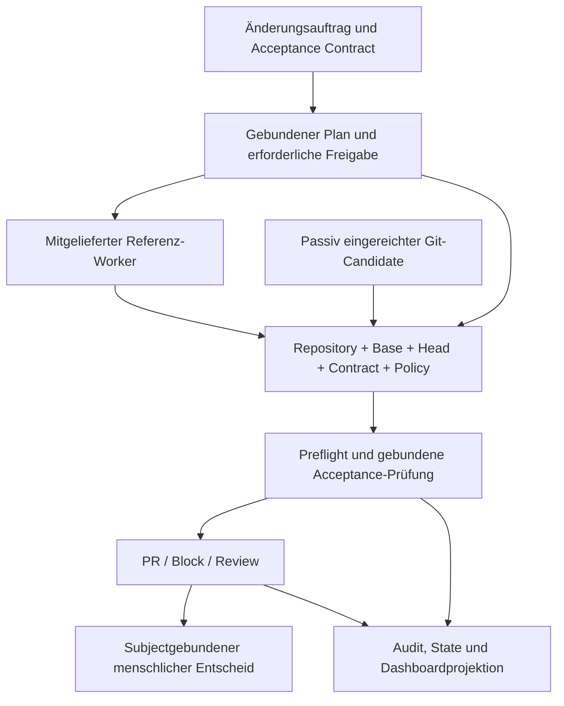

# Technischer Überblick

Diese Ebene erklärt Entwicklern, Operatoren und Reviewern, wie S.A.M.U.E.L.
eine Änderung mit ihrem Auftrag, ihren Prüfungen und ihren Entscheidungen
verbindet. Für Produktzweck und Zielgruppen beginnt der Weg in der
[README](../README.md); konkrete Befehle, Felder, Klassen und Fehlerfälle
stehen in der [Advanced-Referenz](README_technical.md) und den folgenden
Fachverweisen.

## Produktkern und mitgelieferter Worker

Der Kern verwaltet den Änderungsauftrag und Acceptance Contract, den exakt
gebundenen Prüfgegenstand, die Annahme von Evidence, die wirksame Policy und
die daraus nachvollziehbare Entscheidung: PR, Block oder Review. Das ist die
in [ADR-0678](adr/0678-product-boundary-and-integration-profile.md) festgelegte
Produktgrenze.

Der mitgelieferte Referenz-Worker kann ein Issue planen und Code schreiben.
Er liefert damit einen konkreten Weg bis zum Candidate. Ein separat erzeugter
Git-Candidate kann über die bestehende passive Einreichung an denselben
Approval-, Subject- und Gatepfad angeschlossen werden. Ein Producer erhält
weder durch seine Herkunft noch durch ein positives eigenes Urteil
Freigabeauthority. Eine allgemeine aktive Steuerung beliebiger Fremdworker
ist damit nicht zugesagt.

SCM, LLM-Provider, Ausführungsumgebung und Fachprüfer haben eigene Aufgaben.
Ports und Adapter verbinden die tatsächlich vorhandenen Implementierungen.
Für einen Anschluss werden der passende Adapter und seine wirksame
Konfiguration benötigt; Zielarchitektur und vorhandenes Wiring bleiben unterscheidbar.

Das Diagramm zeigt Verantwortungen, keine Umgehung einzelner Voraussetzungen.
Auch ein passiver Candidate benötigt die im Fachvertrag festgelegten
Bindungen. Die konkrete [Referenzstrecke](../technische%20Beschreibungen/README.md)
erklärt Planfreigabe, MANUAL-Nachweise, Review, optionalen Mergepfad und
Fehlerzustände getrennt. Die Anzeige dieser Zustände ist keine neue Authority.

## Was „gebunden“ bedeutet

| Begriff | Aufgabe | Wodurch er nicht ersetzt wird |
|---|---|---|
| Acceptance Contract | Beschreibt den erlaubten Änderungsumfang und die zu prüfenden Kriterien. | Freie Modellbehauptung, nachträglich angehakte Checkbox oder beliebige zusätzliche Datei. |
| EvaluationSubject | Identifiziert Repository, vollständige Base-/Head-SHA, Contract und Policy für die Candidateprüfung. | Branchname, neuester Commit oder ein früherer grüner Lauf. |
| Evidence | Belegt ein bestimmtes Kriterium beziehungsweise Ergebnis unter benannten Voraussetzungen. | Ungebundener Logauszug, fremder Head oder ungeprüfte Producerzusicherung. |
| Policy | Bestimmt Prüfungen, ihre bindende oder informative Wirkung und Fehlersemantik. | LLM-Score oder Entscheidung eines Produzenten über seine eigenen Rechte. |
| Authority | Erlaubt eine konkrete Handlung unter ihrem bestehenden Vertrag. | UI-Status, Telemetrie oder reine Existenz eines Records. |

Bei externer Evidence reicht die Übereinstimmung des Subjects allein nicht:
Vertrauensprofil, Provenance/Integrität, Tool und Umgebung, Freshness und
Replay-Schutz gehören zur jeweiligen Annahmegrenze. Details stehen in der
[Pipeline für Gates und Acceptance](../technische%20Beschreibungen/pipeline_pr_gates.md).

## Welche Funktionen ein Team tatsächlich nutzen kann

Die folgenden Wege zeigen, wie ein Team die vorhandenen Funktionen nutzt und
welche Voraussetzungen dabei wichtig sind. Beispiele erklären einen Ablauf.
Parameter und Einzelprüfungen stehen in den Fachverweisen; die
[Capability-/Wirksamkeitsmatrix](CAPABILITY_MATRIX.md) ordnet Implementierung,
Profilwirkung und vorhandene Nachweise zu.

### Änderung erzeugen, prüfen und entscheiden

| Fähigkeit und Problem | Vorhandener Weg und Beispiel | Voraussetzungen, Wirkung und Grenze |
|---|---|---|
| **Governance:** Auftrag und geprüfter Stand können auseinanderlaufen. | Der Core bindet Auftrag, Acceptance Contract, Subject und Policy; ein Reviewer kann feststellen, welcher vollständige Diff bewertet wurde. [Begriffe](TECHNICAL_OVERVIEW.md#was-gebunden-bedeutet), [Gates](README_technical.md#9-pr-gates-13). | Repository-, Base-/Head- und Contractbindung müssen passen. Required-Fehler blockieren an ihrer Grenze; advisory bleibt informativ. Der Core prüft tatsächlich, erzeugt aber keine menschliche Zustimmung. |
| **Acceptance:** „Tests grün“ beantwortet nicht jedes Auftragskriterium. | Kriteriumsweise Verifier liefern gebundene Ergebnisse; beispielsweise adressiert ein TEST-Kriterium einen konkreten Test. [Typen und Beispiele](README_technical.md#10-akzeptanzkriterien-verifier). | Unterstützter Runner und exakte Kriterien sind erforderlich. Ein offenes MANUAL-Kriterium braucht einen passenden menschlichen Receipt; Checkbox oder Modellurteil reichen nicht. |
| **Evidence:** Ein fremder oder alter Nachweis darf keine aktuelle Änderung freigeben. | Evidence enthält Prüfgegenstand und Herkunft. `evidence assess` bewertet vorhandene Gitea-Actions-Facts, etwa einen konkret benannten Run. [Annahmevertrag](README_technical.md#externe-scm-check-evidence-advisory). | Dieser SCM-Pfad startet keinen Job, hat keine Required-/Dispatch-/Mutationsauthority und ist kein SARIF-Ingest. Die getrennte passive Candidate-Einreichung nutzt den bestehenden gebundenen Prüfpfad. |
| **Referenz-Worker:** Ein erlaubter Auftrag muss in einen Candidate übersetzt werden. | Planning, Implementation, Healing und Review besitzen reale LLM-Consumer. Beispiel: gebundener Plan, Patch im Run-Worktree und anschließende PR-Prüfung. [Referenzpipeline](../technische%20Beschreibungen/README.md). | Modellzugang, Projektbindung, Rechte und aktiver Workflow sind erforderlich. Kontext-/Patchzielgrenzen gelten; Healing ist begrenzt. Die anschließenden Prüfungen bewerten den entstandenen Candidate. |
| **LLM-Routing:** Aufgaben benötigen unterschiedliche Provider oder Modellkonfigurationen. | Task-Routen und Schedules wählen den konfigurierten Adapter; Fallback, Retry und Circuit Breaker behandeln definierte Fehler. [LLM-Stack](README_technical.md#8-llm-stack), [Consumer/Overrides](agents/AGENT_PROMPTS_AND_INSTRUCTIONS.md). | Effektive Route und aktiver Consumer zählen, nicht allein ein gespeicherter Profileintrag. Passive Evaluation ist kein zusätzlicher aktiver LLM-Consumer. Providerverfügbarkeit und Modellqualität bleiben externe Voraussetzungen. |
| **Budgets:** Mehrere Attempts sollen eine zugelassene Tokenmenge nicht unkontrolliert verbrauchen. | Ausgabegrenze je Call und persistente Workflowzulassung sind getrennt. Ein Retry/Fallback benötigt vor dem physischen Aufruf eine Reservation. [Budgetvertrag](README_technical.md#12-routing-schedules-und-budgets). | Unbekannte Usage hält die Reserve. Das Workflowlimit ist ein Tokenlimit; Preisprojektionen sind keine Geldkostengarantie. |
| **Review und Merge:** Producer sollen ihre eigenen Änderungen nicht selbst legitimieren. | Strukturierter Review bindet Verdict und vollständigen Diff; der Mensch prüft PR und Receipts. [Reviewvertrag](README_technical.md#review-und-erwarteter-head). | Score und Reviewerherkunft schaffen keine Authority. Produkt-Auto-Merge ist default-off und hat eigene Voraussetzungen. R25 verlangt neue menschliche Freigabe nach explizitem Replan; die dokumentierte Durchsetzungslücke bleibt sichtbar. |

### Bedienen, beobachten und wiederaufnehmen

| Fähigkeit und Problem | Vorhandener Weg und Beispiel | Voraussetzungen, Wirkung und Grenze |
|---|---|---|
| **Dashboard:** Ein Operator muss den Zustand eines konkreten Laufs verstehen. | Run-/Stage-, Gate-/Acceptance- und LLM-Call-Projektionen zeigen Ergebnisse und offene Grenzen; Settings zeigen gespeicherte Konfiguration. [Bedienung](DASHBOARD.md). | Authentisierung und jeweilige Permissions gelten. Gespeichert ist nicht zwingend im Prozess wirksam; Restart-/Setupgrenzen beachten. Anzeigen erteilen keine neue Authority. |
| **CLI und API:** Bedienung und Automation brauchen definierte Eingaben und Fehlerausgänge. | Installiertes `samuel`-CLI, HTTP-Routen und Webhooks erschließen bestehende Funktionen, etwa Diagnose eines Runs. [CLI](README_technical.md#16-cli-reference), [API](README_technical.md#18-api-endpoints). | Projektbindung, Credentials, Permissions und aktivierter Betriebsmodus sind pro Route/Befehl beschrieben. Eine lesende Health-/Readinessantwort ist keine Workflowfreigabe. |
| **Audit:** Herkunft und Reihenfolge von Ereignissen müssen untersuchbar bleiben. | JSONL hält Ereignisse; `samuel audit verify` prüft eine vorhandene Kette. [Auditvertrag](README_technical.md#14-audit-trail). | HMAC-Verifikation benötigt den ursprünglichen Schlüssel; signierte lokale Appends benötigen POSIX-Locking. Kettenfehler und getrennte Fallbacktranskripte behandelt die Auditreferenz. |
| **State:** Ein Prozessneustart darf die Bindungen eines Auftrags nicht erfinden. | Runtime-State bewahrt Authorityrecords, Intents, Checkpoints und Beobachtungen. Die Workspace-Registry verfolgt getrennt Git-Arbeitsbereiche. [Datenmodell](STATE_STORE.md). | Runtime-State, Workspace-Registry und Git-Worktrees haben getrennte Sicherungs- und Restorewege. |
| **Recovery:** Wiederaufnahme muss auf den noch gültigen Gegenstand begrenzt bleiben. | Unterstützte Finalisierung kann nach Prüfung aktueller Bindungen fortgesetzt werden; ein Restore verlangt Quellen-/Epoch-Reconciliation. [Restore und Betrieb](INSTALL.md), [Recoverygrenzen](STATE_STORE.md). | Kein beliebiges Fortsetzen eines halben LLM-Aufrufs. Kopierte Dateien/Registry verleihen keine Authority; Auditprüfung und Workspace-Reconcile bleiben eigene Schritte. |
| **Installation, Identity und Konfiguration:** Gleiche Dateien garantieren keinen gleichen Betrieb. | Manifestgebundene Installation, explizite Projektregistrierung sowie vorhandene Auth-/Setupwege schaffen eine überprüfbare Ausgangslage. [INSTALL](INSTALL.md), [Konfigurationsmodi](DASHBOARD.md). | Credentials, Rechte, TLS und effektive Konfiguration werden für die Installation eingerichtet. Die Ausführungs- und Restoregrenzen stehen unten. |

### Security, technische Compliancehilfen und Erweiterung

| Fähigkeit und Problem | Vorhandener Weg und Beispiel | Voraussetzungen, Wirkung und Grenze |
|---|---|---|
| **Securitykontrollen:** Candidateinhalt und Prompts können Risiken transportieren. | Diff-Secret-Scan bewertet hinzugefügte Zeilen; Prompt-Risikosignale liefern begrenzte advisory Evidence. [Security-Model](README_technical.md#13-security-model). | Konkrete Regel, Scope und Profilwirkung unterscheiden. Phrasenheuristik ist kein vollständiger Injection-Schutz; Git-Command-Safety sichert nicht beliebige Prozesse. |
| **SARIF:** Findings sollen mit vorhandenen Analysewerkzeugen weiterverwendbar sein. | Der SARIF-Auditsink exportiert Findings mit `owasp_risk`; [Beispielartefakt](examples/findings.sarif) und [Exportgrenze](README_technical.md#14-audit-trail). | Write-only Export, kein universeller Scanner-Ingest. SARIF enthält nicht das vollständige JSONL-Transkript und beweist keine behobene Schwachstelle. |
| **OWASP-Zuordnung:** Technische Ereignisse brauchen eine verständliche Risikoeinordnung. | Vorhandene Codes und versionierte Mappingdefinitionen annotieren passende Ereignisse; die Dashboardlegende zeigt Zuordnung und Identität. [Framework-Mappings](COMPLIANCE_FRAMEWORK_MAPPINGS.md). | Ein Mapping bewertet keine fremde Evidence und aktiviert keine Gate-/Policywirkung. Nicht jeder zugeordnete Risikotyp wird vollständig erkannt oder blockiert. |
| **DSGVO-Unterstützung:** Personenbezug, Speicherung und Providerübermittlung müssen kontrolliert behandelt werden. | Konfigurierbares begrenztes PII-Scrubbing, explizite Anonymisierung und Retention-Dry-Run helfen beim technischen Review. [Privacy-/Betreibervorlage](DSGVO_VVT.md). | Keine vollständige PII-Erkennung. Retention wird report-only ausgeliefert; kein automatischer Scheduler, kein erzwungenes Providerlöschen. Zwecke, Fristen und rechtliche Eignung bleiben Betreiberprüfung. |
| **AI-Act-Unterstützung:** Modellbeteiligung und technische Nachweise sollen zuordenbar sein. | Attribution, LLM-Telemetrie und vorhandene Artikel-/Risikoklassenprojektion machen technische Beiträge sichtbar. [Attribution und Grenzen](AI_ACT_COMPLIANCE.md). | Konfigurationsklasse, Mappingbadge und Git-Trailer sind keine rechtliche Einstufung oder Konformitätsabnahme. Bestehende Attribution-/Privacycontracts bleiben eigenständig. |
| **Erweiterungen und Dokumentation:** Externe Daten und gepflegte Texte sollen anschließbar bleiben. | Öffentlicher Extension-Datenvertrag prüft gebundene statische Inventare; vorhandenes Wiki-Tooling projiziert gepflegte Quellen. [Extension Contract](EXTENSION_CONTRACT.md), [Dokumentwege](README.md). | Kein Pluginhost, keine automatische Wahrheit freier Prosa, kein universeller Fremdworker-Lifecycle. Wiki wird ausschließlich aus verifiziertem Main veröffentlicht. |

Diese Familien sind eine Leserführung durch den bestehenden Bestand. Auch
Kontextauswahl, Planvalidierung/Klärung, Patchtransaktion, Watch-Slotgrenze,
Idempotenz, Dead-Letter-Behandlung, Notifications und Self-Mode bleiben in
[Komponenten/Workflow](README_technical.md#5-workflow-engine),
[Slice-Katalog](README_technical.md#6-slice-katalog-31-slices) und
[Runtime-Inventar](RUNTIME_REFERENCE.md) auffindbar. Der vollständige Kontrollsatz
und seine Einzelproofs verbleiben in der Capabilitymatrix; die Übersicht
erklärt ihn, ohne aktive Profile oder historische Statuswerte zu überschreiben.
Die [Root-Funktionsübersicht](../README.md#was-samuel-bereits-mitbringt) verbindet
auch Workflowgraph, AST/Skeletons, Kontextsuche, Task-/Tag-Nacht-Routing und
editierbare Prompts mit ihren Fachquellen. Der Workflowgraph steuert Abläufe;
Python-Aufrufbezüge und heuristische Symbolsuche haben den dort erklärten
begrenzten Umfang. Ein CSV-Import-/Exportpfad gehört nicht zum implementierten
Produktangebot. Zielbilder bleiben in der Produktgrenzen-ADR gekennzeichnet.

## Ein konkreter Ablauf

1. Ein Issue beschreibt eine Änderung. CLI, Watch oder API führen in den
   konfigurierten Workflow. Readiness, Projektbindung und Berechtigungen
   werden an ihren jeweiligen Grenzen geprüft.
2. Planning erzeugt auf einer exakt aufgelösten Base einen Kontext und einen
   Plan. Readiness-/Contractprüfung, Budget und gegebenenfalls gebundene
   Klärung begrenzen den Vorgang. Die erforderliche menschliche Planfreigabe
   ist eine eigene Handlung; sie folgt aus dem aktiven Workflowvertrag.
3. Der Referenz-Worker bearbeitet den freigegebenen Umfang in einem eigenen
   Run-Worktree. Kontext-, Budget- und Patchzielgrenzen gelten vor dem
   Candidate. Ein Modelloutput ist ein Vorschlag, kein Nachweis des Erfolgs.
4. Die PR-Stufe bindet den Candidate und ermittelt seinen vollständigen Diff.
   Ein nicht bestandener Required-Preflight verhindert die nachgelagerte
   kandidatenkontrollierte Acceptance-Ausführung. Fehlende Bindungen werden
   nicht durch optimistische Annahmen ersetzt.
5. Die aktiven Gates bewerten die passende Evidence. Required-Fehler
   blockieren; advisory und Telemetrie behalten ihre begrenzte Wirkung.
   Ein ausschließlich offenes MANUAL-Kriterium benötigt den passenden
   menschlichen Nachweis. Es ist weder ein automatisches PASS noch Anlass
   für einen beliebigen neuen Implementierungsversuch.
6. PR und Review bleiben an denselben Gegenstand gebunden. Der Mensch kann
   die Änderung und ihre Nachweise prüfen und über den Merge entscheiden.
   Vor dem Review-LLM-Aufruf müssen die Eingabedaten zum passenden
   Git-Original gehören; ein bereinigter Report ist kein Ersatz dafür.
   Der produktseitige optionale Auto-Merge ist default-off und besitzt eigene
   zusätzliche Vertrags- und Qualificationvoraussetzungen.

Dieses Beispiel endet am Merge. Die weiteren Betriebs-, Wartungs- und
Recoveryaufgaben beschreibt der Abschnitt „Daten, Betrieb und Grenzen“.

Replan widerruft die bisherige Plan-/Approvalgrundlage ausdrücklich. Für jeden
Ersatzplan verlangt R25 eine neue menschliche Freigabe. Das bekannte begrenzte
Metadatenfinding in unbeaufsichtigten Workflows und die fehlende vollständige
Live-Evidence stehen in der [CLI-Referenz](README_technical.md#16-cli-reference).
Die Norm ist daher keine Behauptung lückenlos nachgewiesener Durchsetzung. Healing
ist ein begrenzter, evidencegebundener Pfad; es gibt keine unbegrenzte
Selbstkorrektur. Resume setzt benannte Finalisierungszustände fort und
rekonstruiert keinen halben LLM-Aufruf. Einzelheiten bleiben in den
[Pipelinebeschreibungen](../technische%20Beschreibungen/README.md) und der
[State-/Recoveryreferenz](STATE_STORE.md).

### Visueller Prüfzusammenhang

[Bearbeitbares Diagramm: vom Issue zur menschlichen Mergeentscheidung](images/issue-to-human-merge.svg).
Das SVG erklärt, welche Auftrags-, Prüf- und Entscheidungsgrundlagen zusammenpassen
müssen. Quellenreview auf Main `200c34c664a96b62b5f19c2dab6d957c852c7260`
(11.10.2026); kein Screenshot und kein Nachweis eines vollständig ausgeführten
Produktlaufs. Pfeile zeigen den Prüfzusammenhang, keine für alle Profile identische
Eventfolge. Der Bildverweis bleibt anklickbar; eine native Inlineanzeige ist damit
noch nicht nachgewiesen. Die wesentlichen Aussagen stehen auch ohne Bild hier:

| Station | Was zur Entscheidung bereitstehen muss | Grenze |
|---|---|---|
| Auftrag | Issue, genehmigter Umfang und Akzeptanzkriterien. | Ein Statuslabel oder eine Werkzeugnennung erteilt keine Authority. |
| Plan und Freigabe | Aufgelöste Base, Plan-/Contractbindung und Freigabe nach aktivem Workflow. | R25s neue menschliche Freigabe nach Replan und die oben benannte Durchsetzungslücke bleiben getrennt. |
| Änderungen | Vollständiger Diff und genauer Candidate-Head. | Ein anderer Head übernimmt ältere Nachweise nicht ungeprüft. |
| Acceptance und Gates | Gebundene Kriterienergebnisse, Required-/advisory-Wirkung und Fehler. | Ein nicht bestandener Required-Preflight verhindert die nachgelagerte kandidatenkontrollierte Acceptance-Ausführung. |
| Evidence | Subject, Contract, Policy, Herkunft, Zeitpunkt und Ergebnis. | Fehlende, fremde oder stale Bindung bleibt unzureichend. |
| MANUAL und Score | Passende echte menschliche Receipts getrennt von passiver Beobachtung. | Offenes MANUAL ist kein PASS; ein Score erlaubt keinen Merge. |
| PR und Review | Diff, gebundene Tests/Gates, offene Kriterien und Reviewbefund. | Referenz-Worker, technischer Reviewer und menschliche Authority behalten eigene Rollen. |
| Menschlicher Merge | Tatsächliche Entscheidung am geprüften PR-Head. | In diesem EPIC immer menschlich; der optionale Produkt-Auto-Merge bleibt default-off und an seinen eigenen Vertrag gebunden. |
| Integration | Tatsächlicher Main und betroffene Verträge; in diesem EPIC auch die bestehende Wiki-Veröffentlichung. | Candidate, Diagramm oder CI allein belegen keine vollständige Integration. |

Pflichtfehler führen zum Block beziehungsweise zur begrenzten Korrektur nach dem
aktiven Vertrag. Maßgeblich bleiben [Operating Rules](OPERATING_RULES.md),
[Acceptance](README_technical.md#10-akzeptanzkriterien-verifier) und
[Review](README_technical.md#review-und-erwarteter-head). Pflegezuständigkeit:
`repository-maintainers`; handbearbeitetes SVG mit Textbeschriftungen, keine
Aufnahme oder Bildbereinigung. Bild, Erklärung und maßgebliche Quellen sind im
bestehenden Dokumentvertrag gebunden. Relevante Änderungen prüfen Bildfolgen im
selben PR nach [Documentation acceptance](../CONTRIBUTING.md#fachliche-bilder-und-diagramme).
Die [realen historischen SCM-Aufnahmen](../technische%20Beschreibungen/README.md#reale-scm-aufnahmen-des-änderungsablaufs)
zeigen Auftrag, Plan, Diffausschnitt, Gates/Acceptance, passive Beobachtung,
Productreview und menschlichen Merge. Echte Planapproval-, MANUAL- und weitere
native Aufnahmegrenzen bleiben in #1032 offen; dieses Erklärdiagramm ersetzt
keine Aufnahme oder menschliche Verständlichkeitsprüfung.

## Aufbau im Prozess

S.A.M.U.E.L. ist ein Event-Driven Monolith mit Vertical Slices und Ports &
Adapters. Der Shared Kernel enthält gemeinsame Commands, Events, Ports und
Verträge. Der Bus vermittelt Commands und Events; Slices importieren einander
nicht. Bootstrap verbindet Handler und Adapter mit der geladenen
Konfiguration. Ein vorhandener Typ kann dennoch nur Kompatibilitätsbestand
sein: Das tatsächliche Wiring und die ausgelieferten Workflows entscheiden.

Planning, Implementation, Healing und Review besitzen tatsächliche
Product-LLM-Consumer. Passive Evaluation verarbeitet Gate-Evidence und ist
kein zusätzlicher aktiver Evaluation-LLM-Pfad. Die
[Agentenreferenz](agents/AGENT_PROMPTS_AND_INSTRUCTIONS.md) erklärt die
Consumer und Override-Reihenfolge. Entwicklungsanweisungen eines Coding-Agents
sind nicht automatisch Eingaben dieser Produktconsumer.

Die [technische Referenz](README_technical.md) enthält vollständige
Komponenten-, Event-/Command-, CLI-/API- und Konfigurationsbeschreibungen. Die
[generierte Runtime-Referenz](RUNTIME_REFERENCE.md) hält wiederholbare
Inventarfakten; die [Zielarchitektur](SAMUEL_ARCHITECTURE_V2.1.md) behält ihre
ausdrückliche Einordnung als Zielbild.

## Daten, Betrieb und Grenzen

Runtime-State bewahrt beispielsweise Approval-/Authorityrecords, Intents,
Checkpoints und gebundene Beobachtungen. Die getrennte Workspace-Registry
verfolgt Git-Arbeitsbereiche und ihren Lebenszyklus. Audit protokolliert
Ereignisse; Dashboard und Run-Projektion bereiten Zustände für Menschen auf.
Diese Speicher haben verschiedene Aufgaben. Eine Kopie einzelner Dateien ist
kein geprüfter Restore; Schema, Audit-Key/Kette, Witness/Epoch und
Arbeitsbereichsbindung behalten ihre jeweiligen Regeln.

Ein Prozessneustart verwendet vorhandenen State. Ein Restore ersetzt dagegen
einen Datenstand und verlangt die gebundene Quellen-/Epoch-Reconciliation,
bevor gesperrte Wirkungen wieder erlaubt sind. Die Auditprüfung bleibt separat
erforderlich; bei einer signierten Kette muss der ursprüngliche HMAC-Key passen.
Eine gültige State-Datenbank beweist ihre Integrität nicht. Das Runtime-State-Backup
enthält weder die separate Workspace-Registry noch die Git-Worktrees.
Workspacewirkungen werden über den bestehenden Reconcilecontract geklärt;
eine kopierte oder frei rekonstruierte Registry erteilt keine Authority.
Ein Checkpoint erlaubt nur die unterstützte technische Fortsetzung nach
Prüfung der aktuellen Bindungen, kein allgemeines Weiterlaufen am beliebigen
Unterbrechungspunkt. Die [State-/Recoveryreferenz](STATE_STORE.md) und
[INSTALL](INSTALL.md) führen durch die vorhandenen Prüf- und Bedienwege.

Für den Betrieb sind eine installierte Distribution, explizite Projekt- und
SCM-Bindung, passende Credentials/Rechte sowie wirksame Konfiguration
entscheidend. Gespeicherte Settings und laufender Prozess können sich bis zum
Neustart unterscheiden. [INSTALL](INSTALL.md) beschreibt Erstinstallation,
Rekonfiguration, Update und Restore;
[Dashboard](DASHBOARD.md) erklärt Felder, Rechte und Prozesswirkung.

Worktree-, Umgebungs- und Patchzielhärtung sind begrenzte Schutzmechanismen.
Der vorhandene lokale IMPORT-/TEST-Pfad ist keine allgemeine Prozesssandbox.
Ein externer Executionpfad benötigt seinen eigenen qualifizierten atomaren
Cutover; die ausgelieferte Providerkonfiguration ist deaktiviert und
unqualifiziert. Installations- und Freigabenachweise sind im [Produktstatus](status/CURRENT_PRODUCT_STATUS.md)
mit ihrem jeweiligen Geltungsbereich beschrieben.

Auch eine vollständige technische Nachweiskette mit menschlichen Freigaben
ist für sich keine Zusage regulatorischer Konformität.

## Welche Integration heute was bedeutet

| Anschluss | Vorhandener Zweck | Entscheidende Grenze |
|---|---|---|
| GitHub/Gitea und LLM-Adapter | Repository-/Issue-/PR-Verkehr beziehungsweise konkrete Workeraufrufe. | Provider, Credentials, Permissions und Betriebsnachweise bleiben installationsbezogen. |
| Passiver Git-Candidate | Einen extern erzeugten Candidate im bestehenden gebundenen Prüfpfad bewerten. | Kein universeller aktiver Fremdworker-Lifecycle. |
| Externe SCM-Checks über `evidence assess` | Vorhandene Gitea-Actions-Facts als gebundene advisory Bewertung übernehmen. | Kein Start eines Providerjobs und keine Required-/Dispatch-/Mutationsauthority daraus. |
| Documentation Extension | Externe statische Dokumentinventare als gebundene JSON-Daten prüfen. | Kein Pluginhost, keine Erzeugung korrekter Freitexte und kein automatischer Wikistart durch einen Schalter. |
| Repository-Wiki | Gepflegte Quellen mit dem bestehenden Tooling projizieren und aus verifiziertem Main veröffentlichen. | Keine zweite redaktionelle Wahrheit oder eigene Freigabeauthority. |

Der [Extension Contract](EXTENSION_CONTRACT.md) und die
[technische Bedienreferenz](README_technical.md) beschreiben die konkreten
Eingänge. Die im ADR genannten Standards sind Integrationsrichtung; sie sind
keine Zusage, dass jede genannte Schnittstelle heute aktiv verfügbar ist.

## Nachweise lesen und Dokumentation pflegen

Die [Capability-/Wirksamkeitsmatrix](CAPABILITY_MATRIX.md) trennt Existenz,
Profilwirkung, Fehlergrenzen und Belege. Der
[Produktstatus](status/CURRENT_PRODUCT_STATUS.md) führt datierte Release- und
Abnahmenachweise mit ihren Grenzen. Aktueller Main, veröffentlichter Release
und ein historischer Testlauf sind unterschiedliche Stände.

Dokumentationsrelevante Änderungen prüfen ihre Auswirkungen im selben PR:
auch eine neue Oberfläche ohne bisheriges Binding oder eine geänderte
fachliche Wirkung bei gleicher API. Der bestehende Impactbericht unterstützt
das Auffinden geänderter Quellen und begrenzter Strukturänderungen. Die
semantische Bewertung bleibt ein Reviewauftrag; eine begründete Entscheidung
gegen eine Dokumentänderung bleibt nachvollziehbar. Maßgeblich ist die
[Documentation acceptance](../CONTRIBUTING.md#documentation-acceptance).
