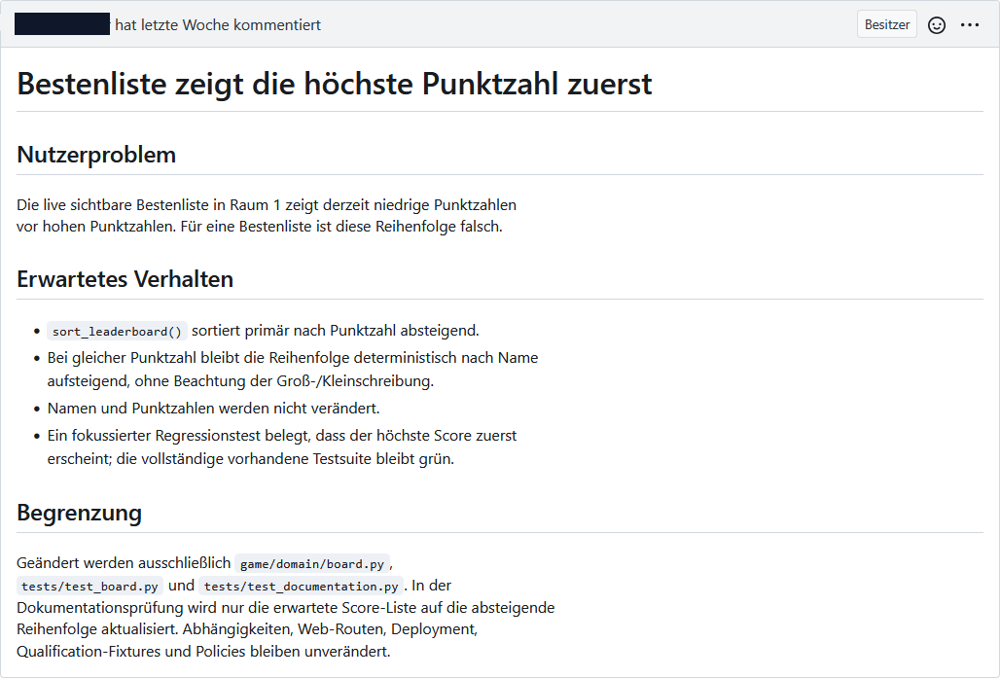
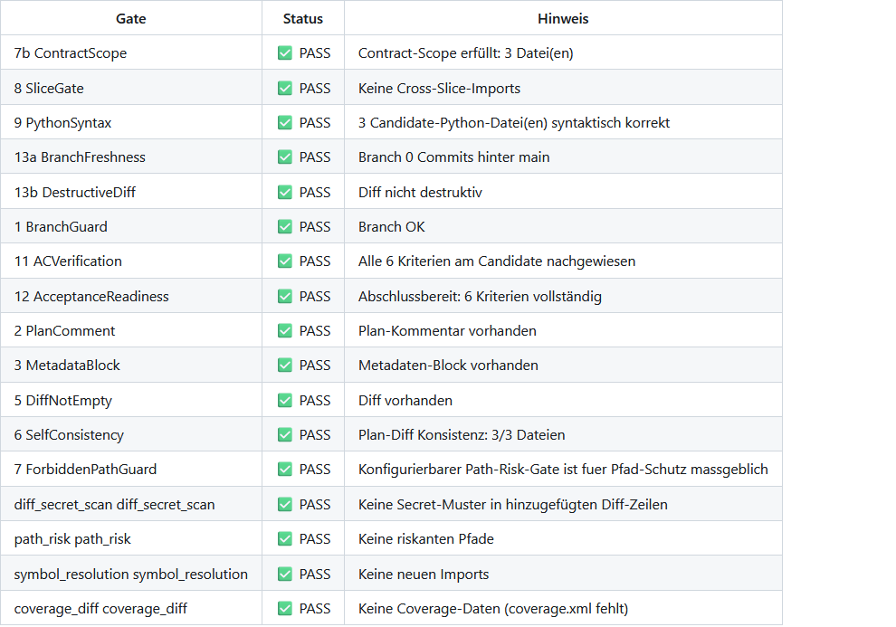
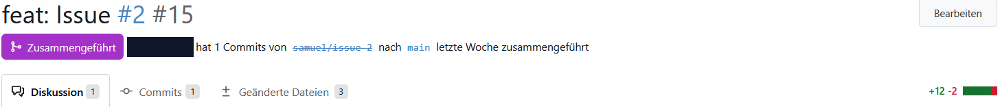

# Technische Beschreibungen — S.A.M.U.E.L. v2

[Produkt](../README.md) · [Technischer Überblick](../docs/TECHNICAL_OVERVIEW.md) · [Dokumentwege](../docs/README.md)

Diese Advanced-Referenz richtet sich an Entwickler und Reviewer, die den
mitgelieferten Referenz-Workflow bis zu seinen konkreten Consumern verfolgen
wollen. Jeder Knotenpunkt nennt Input/Output, beteiligte Dateien, unterstützte
Sprachen, Voraussetzungen und Beispiele. Die Pipeline ist ein konkreter
Produktpfad; die Produktgrenze einschließlich Core und externer Anschlüsse
bleibt in [ADR-0678](../docs/adr/0678-product-boundary-and-integration-profile.md)
definiert.

Für die konkrete Bedienung gelten die [CLI-/API-Referenzen](../docs/README_technical.md#16-cli-reference),
für dauerhafte Daten und Wiederanlauf die [State-/Recoveryreferenz](../docs/STATE_STORE.md).
Der [technische Komponentenkatalog](../docs/README_technical.md#1-architektur-prinzipien)
ordnet Core, Bus, Ports, Slices und Adapter ihren vorhandenen Funktionen zu.
Die [v2-Zielarchitektur](../docs/SAMUEL_ARCHITECTURE_V2.1.md) bleibt ein Zielbild;
aus ihren Beispielen folgt keine heutige Aktivierung.

**Historischer Quellenabgleich:**
**Prüfdatum:** 2026-10-10 · **Abgeglichener Commit:**
`b59b1fc3def41ce73fef1cf29841a2e6ffbe8db7`. Die fortlaufenden Quellenbindungen
und Prüfpfade stehen im [Document Contract](../docs/capabilities/document-contract.json);
neuere Änderungen tragen ihren eigenen commitgebundenen PR-/Integrationsnachweis.

Diese Seite beschreibt den mitgelieferten Referenzpfad. Installation,
Szenario und Runbook eines eigenständigen Demonstrationsprojekts gehören
nicht in dieses Repository. Aktuelle Release- und Qualificationaussagen
stehen getrennt vom Codevertrag in den bestehenden Status- und
Capabilityquellen; Komponentenbelege autorisieren keinen Gesamtsystem-PASS.
Die aktuellen Merge- und MANUAL-Hinweise sind ausschließlich Projektionen
des gebundenen Subjects: Planfreigabe ist getrennt vom MANUAL-Receipt;
`PRMerged` erzeugt keinen pauschalen Issue- oder Qualification-Abschluss.


---

## Pipeline-Übersicht

Der hier beschriebene Referenzpfad von Issue bis PR verbindet vier Pipelines
über den Bus. Externe Candidateübergabe und advisory Evidencebewertung haben
eigene unten beschriebene Grenzen:

```
┌─────────────────────────────────────────────────────────────┐
│  Issue (Gitea)                                              │
└────────────────────┬────────────────────────────────────────┘
                     │  IssueReady Event
                     ▼
┌─────────────────────────────────────────────────────────────┐
│  PIPELINE 1:  PLANNING                                      │
│                                                             │
│  PlanIssueCommand → LLM(Plan-Prompt) → validate_plan        │
│                   → Contract-Parser / Pre-Check             │
│                   → höchstens ein gemeinsamer Retry         │
│                   → Post Plan → ggf. menschliche Freigabe   │
│                                                             │
│  Details: pipeline_planning.md                              │
└────────────────────┬────────────────────────────────────────┘
                     │  PlanApproved / policygebunden PlanValidated
                     ▼
┌─────────────────────────────────────────────────────────────┐
│  PIPELINE 2:  IMPLEMENTATION (Context-Building)             │
│                                                             │
│  ImplementCommand                                           │
│   → K1 Issue laden                                          │
│   → K2-K11 Context bauen (Keywords, Skeleton, Grep, ...)    │
│   → K12 Prompt-Assembly                                     │
│   → K13 Validator-Gate                                      │
│   → K14 LLM-Loop (5 Runden, Retry mit echtem Code)          │
│   → K15 Patches anwenden                                    │
│   → K16 Git commit + Branch-Push                            │
│                                                             │
│  Details: pipeline_issue_to_llm.md                          │
└────────────────────┬────────────────────────────────────────┘
                     │  CodeGenerated Event
                     ▼
┌─────────────────────────────────────────────────────────────┐
│  PIPELINE 3:  PR-GATES (PR-Erzeugung)                       │
│                                                             │
│  CreatePRCommand                                            │
│   → G1 Repository/Base/Head/Contract/Policy binden          │
│   → G2 vollständigen Commit-Diff ermitteln                  │
│   → G4 Required-Preflight ohne Candidate-Prozess            │
│   → G5 externe statische Preflight-Gates                    │
│   → G4b Acceptance-Verifikation + nachgelagerte Gates       │
│   → G6 scm.create_pr()                                      │
│                                                             │
│  Details: pipeline_pr_gates.md                              │
└──────────┬───────────────────────────┬──────────────────────┘
           │ vollständige Evidence     │ Subject nicht etablierbar
           ▼                           ▼
 GateEvaluationCompleted       GateEvaluationUnavailable
           │
           ├── required bestanden → PRCreated → gebundener Review
           │                              ├── pass → optionaler Mergeentscheid
           │                              └── block/indeterminate → Blockade
           ├── Preflight blockiert → Gate 11 SKIP, kein Candidate-Prozess
           ├── Gate 11 eindeutig fehlgeschlagen → 1 Healing-Versuch
           └── Evaluation-Subscriber → ScoreObserved (nicht bindend)
```

```text
PIPELINE 4: PASSIVE EVALUATION
GateEvaluationCompleted/-Unavailable
  -> gebundene Rohbeobachtung in SQLite persistieren
  -> versionierte Score-Ableitung aus Gate-11-Evidence
  -> ScoreObserved ohne Workflowkante
  -> redigierte Issue-/Run-Projektion unabhängig von Auditrotation
  -> Darstellung erst getrennt nach PRCreated
```

Ein davon getrennter Operatorpfad liest mit `samuel evidence assess` einen
vorhandenen Gitea-Actions-Run. Er projiziert nur Run-, PR-, Workflow- und
Statusfacts, bindet sie an ein vorhandenes `EvaluationSubject` und speichert
das Assessment im selben Observation-Store. Dieser Pfad ist ausschließlich
advisory, startet keinen Providerlauf und beeinflusst weder Gates noch
Dispatch oder Mutation (#520/#679).

```text
RESTART-FINALISIERUNG (pipelineübergreifend, kein fünfter Fachworkflow)
Bootstrap / Watch / Operator -> ResumePendingCommand
  -> vorhandenen Run-Worktree per OS-Lock übernehmen
  -> abgelaufenes Lease per CAS übernehmen
  -> Binding-, Git- und SCM-Prädikate prüfen
  -> commit_pending | push_pending | gates_pending | pr_pending fortsetzen
  -> Drift: ResumeBlocked + Quarantäne, kein Reset/Force-Push
```

Der Resume-Koordinator läuft ausschließlich über Commands/Events und bestehende
Ports. Er rekonstruiert weder Planning noch einen halben LLM-/Healing-Round.
Ein resumefähiger Finalisierungscheckpoint trägt jedoch die bereits
autorisierte Workflow-Budgetzulassung weiter; Resume erzeugt keine neue
Zulassung aus der Correlation-ID.
Details der Finalisierung stehen in K16 und G6; Score und Healing bleiben von
Resume-Ereignissen unabhängig.

## End-to-End-Ablauf, Authority und Sichtbarkeit

Die optionale OCI-Python/Pytest-Toolchain (#978) gehört zur bestehenden
Runner-/Gate-Policy, nicht zur Producer-Authority. Doctor, Planning und TEST
validieren dasselbe read-only Artefakt; Gate 11 konsumiert weiterhin die
gebundene Acceptance-Evidence. Ein anderer Toolchain-Digest benötigt eine
neue Policy-/Subjectbindung. Der temporäre Doctor-Prüfer liest nur nativen
Branchschutz in Gitea oder GitHub; normale Runtimecredentials, Human Approval,
MANUAL und Human Merge bleiben davon unabhängig.

Die folgende Tabelle ist der Einstieg für einen realen Lauf. „Authority“ meint
die Komponente, deren Ergebnis den Übergang tatsächlich erlaubt oder stoppt;
ein Dashboard, LLM-Score oder Prompt ist nie Freigabeautorität.

| Stufe | Eingaben und tatsächlich eingesetzte Werkzeuge | Authority und Fehlersemantik | Evidence und Sichtbarkeit |
|---|---|---|---|
| Intake | SCM-Issue, Labels, CLI/REST/Watch; `IVersionControl` und Workflow-Konfiguration | Readiness-/Workflow-Regel entscheidet, ob `IssueReady` entsteht. Fehlende SCM-Konfiguration oder nicht passendes Issue blockiert/überspringt den Dispatch. | Issue/Labels, `IssueReady`, Audit und Run-Projektion; Watch-Exitcode bildet den terminalen Ausgang ab. |
| Planning | Issue-Text plus Repository, Base-Ref und vollständige SCM-Base-SHA; relevante Dateien, Skeleton und begrenzte Keyword-Suche werden bei jedem Command frisch im detached Base-Worktree gebaut, Architektur-Constraints und TEST-Runner-Policy stammen aus der Control Plane | Vor dem ersten LLM-Call bindet eine persistente Tokenzulassung Repository, Issue, Invocation, Source und Policy. Ein deterministischer Readiness-Check erkennt nur leere/ungültige Quellen, explizite Lücken und beweisbare Widersprüche. Bei Klärungsbedarf persistiert er höchstens zwei revisionsgebundene Runden mit je drei Fragen und expliziter endlicher Operatorfrist; Timeout, doppelte/späte/editierte Antwort oder Source-Drift blockieren ohne partiellen Contract. Nur ein ausdrückliches `samuel run` autorisiert nach terminalem Zustand eine neue Serie. Jeder physische Retry/Fallback reserviert atomar vor Sendung; unbekannte Usage hält den Bound. SCM-Auflösung und Snapshot-Materialisierung sowie Contract-Parser, Struktur-/Pre-Check-/Scope-Regeln blockieren fail-closed; das LLM autorisiert weder Readiness, Quellstand noch Plan. Eine am Ausgabetokenlimit unvollständige Providerantwort blockiert vor `PlanCreated`; der Operatorhinweis verweist auf Budget und Modell-/Prompt-Eignung statt den Issue-Text pauschal als unscharf zu bewerten. Eine im Snapshot fehlende Datei gilt nur mit passendem strukturiertem Scope als geplante Neuanlage, während vorhandene und ungescopte Referenzen skeletonpflichtig bleiben. Bei gültigem Scope sind dessen FILE-Einträge Mutationsauthority; Prosa-, Negativ- und TEST-Referenzen erweitern sie nicht. TEST-Readiness löst `test_cmd` vor Projektmarker auf und prüft Toolchain sowie bekannte Selektorgrammar ohne Ausführung. Der Planprompt erhält nur die daraus abgeleitete Selektorform und nie den Runnerbefehl. Ein formaler oder Readiness-Erstfehler darf genau den mit dem Pre-Check geteilten einzigen Retry verbrauchen. Precheck-Retries erhalten die konkreten fehlgeschlagenen Dimensionen und Validator-Warnungen; die tatsächliche Retry-Antwort wird nur bei unverändertem Source-/Scope-Contract, ohne Einzelregress und nach behobener Blocking-Dimension übernommen. Ein vorhandener autoritativer Plan blockiert einen impliziten Replan; nur `replan --reason` widerruft ihn und eine vorhandene Freigabe, bevor der Grund als abgegrenztes Feedback genau den Ersatzplan erreicht. Dieses Feedback erweitert weder Scope noch Authority. Für Ersatzpläne gilt R25 mit neuer menschlicher Freigabe; die unten beschriebene Implementierungsgrenze ist keine Ausnahme von dieser Regel. Beim regulären Erstplan benötigen Standard, Watch, Chat und Self eine gebundene menschliche Planfreigabe. Die Freigabe wird als create-only Authority-Record an Plan, Contract, SCM-Quelle und vorhandenen Source Snapshot gebunden; spätere Statuslabels projizieren nur den Workflow. Autonomous, Night und Patch bleiben nur für klare Issues automatisch; ein Plan mit Klärungsbasis wartet auch dort auf `PlanApproved`. | `WorkflowBudgetAdmitted`, `LLMBudgetAttemptReserved/-Settled/-Blocked`, `ClarificationRequested/Waiting/Accepted/Superseded`, `PlanContextLoaded.source_snapshot`, `PlanCreated`, `PlanPreCheckCompleted`, höchstens ein `PlanRetry`, `PlanRetryEvaluated`, `PlanValidated`, `PlanPosted`, `TokenLimitHit`, `PlanBlocked`, `WorkflowAborted`, `PlanReplanRejected`, `PlanRevoked`; `plan_approval.v1`; source- und Plan-Kommentar-gebundener Contract im Issue. |
| Implementation | Freigegebener/validierter Plan samt PlanningSourceSnapshot und exakter Workflow-Budgetzulassung, Run-Worktree auf derselben Base-SHA, `build_full_context`, Context-Validator, LLM-Adapter, Patch-Parser und Workspace-Transaktion | Repository-, Issue-, Plan-Kommentar-, Budget- oder Base-Drift blockiert vor LLM beziehungsweise nochmals vor Commit-Wirkung. Context-Validator, Patchziel-Policy und atomarer Loop blockieren vor Candidate; das Modell kann weder Branch noch Erfolg autorisieren. | LLM-/Token- und Budgetattempt-Metadaten, `TokenLimitHit`, `LLMBudgetBlocked`, `WorkflowBlocked` oder `CodeGenerated`; Audit, Issue-/Run-Projektion und Dashboard. |
| Subject/Preflight | Repository, vollständige Base-/Head-SHA, Contract- und Policy-Digest; SCM-Vergleich und Gates 7b/7/8/9/13a/13b | Subject-Aufbau ist fail-closed. Ein **required** Preflight-Gate ohne PASS stoppt Candidate-Prozesse; restliche Gates werden `skipped_precondition`. | `GateEvaluationUnavailable` bei fehlendem Subject, sonst kriteriumsweise Gate-Evidence und `GateFailedEvent`; Audit/Dashboard/Reviewer-Briefing. |
| Acceptance und Rest-Gates | Bei deaktiviertem Provider: detached Candidate-Worktree und lokaler AC-Verifier. Nach qualifiziertem atomarem Cutover: persistierter Verification Request und exakt gebundene Provider-Evidence. Dazu restliche interne und externe Gates | Nur das aktive Required-Gate-Profil entscheidet. Der Providerpfad bindet Plan/Approval, Subject, Policy, Run/Attempt, Workflow, Tool, Environment, Nonce/Freshness und Integrität; er prüft die aktuelle Authority vor Verwendung erneut. Trust-/Infrastrukturfehler sind nicht healbar und es gibt keinen automatischen lokalen Fallback. Die ausgelieferte Providerkonfiguration ist deaktiviert und unqualifiziert. Ein ausschließlich offenes MANUAL-Kriterium wartet mit gebundenem Checkpoint fail-closed; es erzeugt keinen terminalen Failure. | Lokal `ACVerified`/`ACFailed`/`ACManualPending`; providerseitig `ProviderVerificationRequested/Pending/Blocked`, danach genau ein gebundenes Gate-Ergebnis; PR-Body, Audit, Projektion und Dashboard. |
| PR/Review/Merge | Positives Gate-Ergebnis, persistierter PR-Intent, SCM-PR-Revision, vollständiger Diff und Acceptance Contract | S.A.M.U.E.L. darf den PR nur für dasselbe Subject erstellen. Bei einem budgetgeschützten Wiedereintritt nach MANUAL-Pause werden die vorhandene Admission und die ursprüngliche Planfreigabe über Repository, Issue, aktiven Planvertrag und Plan-Kommentar aus Authority-State zurückgebunden; `manual_pending` und Restart widerrufen sie nicht; ein allein aus MANUAL-Pending stammendes `status:failed` wird nicht mehr projiziert. Der ursprüngliche Approvaltransport wird anhand seiner historischen SCM-Evidence revalidiert, ohne das aktuelle `status:approved`-Label zu verlangen. Fehlende, fremde, stale oder durch Replan widerrufene Authority blockiert vor PR und Provider, ohne neue Authority oder einen neuen Budgettopf anzulegen. Der strukturierte Review bindet `pass\|block\|indeterminate` samt Findings an Subject, Diff, Policy, Tool und Prompt und ersetzt keine menschliche Freigabe. Auto-Merge bleibt default-off und verlangt zusätzlich frische Approval-/Required-Evidence, erneuten Headvergleich, eine deploymentbezogen qualifizierte native Expected-Head-Bedingung sowie einen vor Wirkung persistierten reviewgebundenen Mergeintent. Unbekannte Ausgänge werden ohne zweiten Effekt reconciliert. | `PRCreated`, `ReviewCompleted`, `ReviewBlocked`, `PRCreationFailed`, `EvaluationSubjectInvalidated`, `MergeOutcomeUnknown`, optional `PRMerged`; SCM, Authority-State, Audit und Dashboard. |
| Passive Evaluation | Terminale Gate-Evidence und unveränderlicher Subject | Keine Freigabeautorität. Score/Benchmark/Dashboard dürfen keinen blockierten Candidate freigeben und keinen positiven Gate-Lauf widerrufen. | SQLite-Observation, `ScoreObserved`, Audit, PR-Kommentar und Dashboard als nicht bindende Qualitätsbeobachtung. |
| Healing/Resume | Eindeutig gebundene Fehlevidence bzw. persistierter Finalisierungscheckpoint | Healing höchstens einmal und nur für genau ein heilbares Gate-11-Kriterium; Resume setzt nur Commit/Push/Gates/PR fort. Ein MANUAL-Wartecheckpoint löst kein automatisches Implement-Resume aus; `samuel watch` setzt erst nach exakt gebundenem menschlichem SCM-Receipt die Gate-Reevaluation fort. Drift, unklare Authority oder fehlende Bindung blockieren. | `HealingAttemptStarted`/`HealingAborted`, `ResumeAttempted`/`ResumeCompleted`/`ResumeBlocked`, Quarantäne und Doctor/Workspace-Diagnose. |

**Originaldaten und bereinigte Ansichten.** Vor dem Review-LLM-Aufruf wird
der angelieferte Diff gegen den vorhandenen Git-Vergleich genau desselben
Repository-/Base-/Head-Paars geprüft. Die PR-Referenz bindet außerdem
Subject, Prüfsumme und Attemptkorrelation. Fehlende Originale, fremde
Bindungen und bereinigte Ersatzdaten blockieren vor Providerkontakt.
Audit-/Run-/DLQ-Reports und die unten gezeigten Screenshots bleiben
nachvollziehbare Ansichten ihres Standes; sie sind keine Quelle zum
Wiederherstellen operativer Revieweingaben. Die bestehende
Promptbereinigung sensibler Inhalte bleibt davon getrennt erhalten.
Details stehen im [Reviewvertrag](../docs/README_technical.md#review-und-erwarteter-head).

**Replan: Regel und belegter Implementierungsstand.**
[Operating Rules R25](../docs/OPERATING_RULES.md#r25--re-planning-widerruft-plan-und-freigabe-explizit)
verlangt nach jedem Ersatzplan ein neues menschliches Freigabeereignis.
Der bekannte begrenzte Komponentenbefund zeigt nach dem Widerruf jedoch
`policy_approved` bei `plan_approval_required=False` ohne Klärungsbasis;
bei `True` bleibt der Ersatzplan `human_pending`. Das belegt die Auswahl im
Planning-Handler, keinen vollständigen Live-Bypass bis Implementation oder
Merge. Die [CLI-Referenz mit Befund und Nachweis](../docs/README_technical.md#argumente-voraussetzungen-und-ergebnisgrenzen)
ordnet diese Grenze ein. Weder ein automatisches Erstplanprofil noch dieser
Befund hebt R25 auf.

**Tatsächliche Product-LLM-Consumer.** Planning, Implementation, Review und
Healing verwenden die vier aktiven LLM-Tasks. Passive Evaluation wertet
gebundene Gate-Evidence aus; die konfigurierte `evaluation`-Route allein
belegt keinen aktiven LLM-Consumer. Promptquellen, Library-Einträge,
Operatoroverrides und dynamischer Handlerkontext stehen in der bestehenden
[Consumerreferenz](../docs/agents/AGENT_PROMPTS_AND_INSTRUCTIONS.md).
Produktinterne Prompt-, Profil- und Workeränderungen bleiben bei #878.

**Lesebeispiel, kein Laufnachweis:** Ein Issue im Standardworkflow erhält
einen Plan auf einer fest gebundenen Base-SHA. Die menschliche Planfreigabe
autorisiert diesen Plan; ein später erforderliches MANUAL-Receipt belegt
gesondert sein konkretes AC-Kriterium. Der daraus erzeugte Candidate wird
unter derselben Subject-/Policybindung geprüft. Ein positives Gate-Ergebnis
ermöglicht die PR-Erstellung; Review und Merge behalten ihre zusätzlichen
Voraussetzungen. Ein Score erteilt keine Freigabe. Bewegt sich die Planquelle
vor der Implementation, blockiert der Quellenvergleich vor dem LLM-Aufruf.
Die [CLI-Beispiele](../docs/README_technical.md#16-cli-reference) erklären den
expliziten Replan; [State/Recovery](../docs/STATE_STORE.md) ordnet gespeicherte
Authority und zulässige Wiederaufnahme zu.

Die Workflow-Liste und das Detail reduzieren den sichtbaren Issue-Status aus
dem neuesten korrelierten Lauf. Wegen synchron verschachtelter Dispatches ist
die physische Audit-Schreibreihenfolge keine Kausalitätsquelle: Ein außen
nachgeschriebenes `IssueReady` überstimmt keine bereits vorhandene
`PlanValidated`-, Implementierungs-, Block- oder PR-Evidence. Das angezeigte
`last_event` samt Zeitstempel ist die fachliche Statusbegründung; unvollständige
neue Läufe bleiben `unknown`, statt einen Erfolg aus einem alten Lauf zu erben
(#738). `PlanReplanRejected` beendet nur den abgelehnten Aufruf als `blocked`
und fehlgeschlagene Plan-Stage; `PlanRevoked` bleibt nichtterminal, weil der
explizite Ersatzlauf danach weitergeht (#772).

## Reale SCM-Aufnahmen des Änderungsablaufs

Diese acht vom Maintainer bereitgestellten Gitea-Originale zeigen einen echten,
**historischen** Entwicklungsfall: „Bestenliste zeigt die höchste Punktzahl
zuerst“, Issue **#2**, PR **#15** in einem konkreten historischen Referenzrepository; die private Owner-/
Repositoryzuordnung bleibt im geschützten Originalnachweis.
Der Plan nennt **2026-10-05T07:05:23Z**, Product
`2.0.0a26.dev142+gce0b36908` und Buildrevision
`ce0b36908cb847d766339950eef872e06561f84e`. Der sichtbare Candidate ist
`6a68dd11b09fc841fa2b6281872ef917470dfa62`, Base
`1a4e28e310a840dac6d3a870d7193522ee17fc5e`, Contract
`sha256:f3eb7a70d4624758ff4cacec274b8fffdd9d362bf2f91d489df1e7a4adfe0f09`.
Die relative SCM-Anzeige „letzte Woche“ ist kein exakter Aufnahmezeitpunkt.
Browser-/Capturemetadaten sowie die Merge-Commit-SHA fehlen im Bildbestand.
Ein zusätzlicher Live-Read dieses fremden Repositorys war mit dem vorhandenen
Productcredential HTTP404; es wird kein heutiger Remotezustand behauptet.

Die [separaten Dashboardaufnahmen](../docs/DASHBOARD.md#reale-aufnahmen-aus-dem-bereitgestellten-bildbestand)
zeigen a29 und einen anderen, blockierten Issue-#1-Lauf. Gleiche Issuezahlen,
ähnliche Beschriftungen oder späterer Main-PASS erlauben keine Cross-run-Zuordnung.
Der Code-/Quellenreview dieser Erklärung bindet Main
`fff8f58d320ecf0868f50b440acec5312e91bfca`; die historischen Bildbytes bleiben
Aufnahmen ihrer eigenen älteren Revision.

### Auftrag, Plan und Candidate

> 
>
> *Auftrag des historischen SCM-Beispiels: erwartetes Verhalten und begrenzter Änderungsscope.*

Der Auftrag benennt absteigende Punktzahlen, deterministische Namensreihenfolge,
unveränderte Namen/Scores und passende Regressionen. Der Plan enthält
**drei DIFF-, zwei TEST- und ein GREP-Kriterium**. Seine Score-/Checks-Metadaten
beschreiben die Planung, nicht bestandene Candidate-Acceptance. Der Plantext
wartet auf menschliche Planfreigabe; die tatsächliche Approvalhandlung ist in
diesen Ausschnitten nicht aufgenommen. **Kein MANUAL-Kriterium** gehört zu
diesem konkreten Contract.

| Aufnahme | Sichtbare Aussage / Fachkapitel |
|---|---|
| [Plan, Scope und sechs maschinelle Kriterien; wartet laut Text auf Humanapproval.](../docs/images/product-captures/gitea-plan-contract.png) | Plan-/Scope-/Kriterienansicht aus zwei pixelgleich überlappenden Aufnahmen zusammengesetzt. |
| [PR-Auftrag und redigierter Diffausschnitt; unterer Diffteil ist abgeschnitten.](../docs/images/product-captures/gitea-pr-request-and-diff.png) | PR-Auftrag und redigierter Diffausschnitt: drei Dateien, Sortieränderung und Tests. Der untere Diffteil fehlt; kein vollständiger Diff behauptet. |

Der sichtbare Diff ist bereits in der aufgenommenen PR-Darstellung redigiert
(`***REDACTED***`). Dieser Dokumentationsausschnitt dient der Erklärung;
Runtime-/Replayconsumer dürfen ihn nicht als operativen Originaldiff verwenden.
Der volle native Diff gehört zum tatsächlich gebundenen Candidate, nicht zum
beschnittenen Bild.

### Acceptance, Gates und passive Beobachtung

> 
>
> *Gateergebnisse des historischen Candidates. Der sichtbare Coverage-Hinweis belegt keinen gemessenen Coveragewert.*

Die sechs sichtbaren Acceptancekriterien sind jeweils **PASSED**.
Gateautorität stammt aus dem aktiven Required-Profil, nicht aus dem späteren
Score. `coverage_diff` zeigt „PASS“ neben „Keine Coverage-Daten
(coverage.xml fehlt)“; das belegt keinen Coveragewert oder ausgeführten
Coveragevergleich. Nicht jede grüne Zeile ist dieselbe Art von Sicherheits-
oder Funktionsnachweis. Die heutige Wirkungszuordnung bleibt in der
[Capability-Matrix](../docs/CAPABILITY_MATRIX.md).

| Aufnahme | Sichtbare Aussage / Fachkapitel |
|---|---|
| [Gateprofil, Korrelation, Repo, Base/Head, Contract und Policy; Serveradresse geschwärzt.](../docs/images/product-captures/gitea-evidence-binding.png) | Gateprofil default, Correlation-ID, Repository, Base/Head, Contract und Policy. Interne Serveradresse und privater Owner sind zusätzlich maskiert. |
| [Sechs gebundene DIFF/TEST/GREP-Kriterien PASSED; kein MANUAL-Kriterium.](../docs/images/product-captures/gitea-acceptance-results.png) | Sechs maschinelle Kriterien am Candidate; offene/erfüllte MANUAL-Kriterien sind hier nicht dargestellt. |
| [Nicht bindende Qualitätsbeobachtung 100%; sichtbarer Tabellenanfang, kein Mergesignal.](../docs/images/product-captures/gitea-passive-score.png) | Beobachteter Score 100%, Rohabdeckung 100%, Herkunft bound_acceptance_evidence und explizit nicht bindend. Nur der sichtbare Anfang der Detailtabelle ist aufgenommen. |

Eine **nicht bindende Qualitätsbeobachtung** ist weder ein zusätzliches
PASS/FAIL-Gate noch eine Mergefreigabe. Die Aufnahme erhält diese Erklärung
und ihre Herkunft, statt allein einen großen „100%“-Wert herauszulösen.

### Review und menschlicher Merge

> 
>
> *Native menschliche Mergehandlung im historischen PR. Der persönliche Handle ist maskiert; der Merge ist vom Botreview getrennt.*

Der PR-Kopf zeigt ausdrücklich die native Mergehandlung durch den **menschlichen Maintainer**; dessen privater Handle
ist in der veröffentlichten Fassung maskiert.
Das ist getrennt vom Botkommentar „Strukturierter Review“ mit `decision=pass`,
Candidatebindung, `Acceptance: 6/6 PASS`, Diffdigest und „Findings: keine“.
Ein Reviewer-PASS ersetzt weder die menschliche Entscheidung noch einen
Golden-/D0-Nachweis.

| Aufnahme | Sichtbare Aussage / Fachkapitel |
|---|---|
| [Strukturierter Review pass für Candidate 6a68dd; Acceptance 6/6 PASS.](../docs/images/product-captures/gitea-bound-review.png) | Strukturierter Productreview für denselben sichtbaren Candidate; keine menschliche Planapproval daraus ableiten. |
| [Entwicklungsabschluss nach bestätigtem Merge; Issueabschluss/Golden bleiben getrennt.](../docs/images/product-captures/gitea-development-completion.png) | Gebundener Entwicklungsabschluss: PR im SCM als gemergt bestätigt; kein automatischer Issueabschluss und kein Golden-/D0-PASS. |

Der Issuekopf ist im Original weiterhin **„Offen“**, obwohl `status:done`
sichtbar ist. Label, gemergter PR und geschlossenes Issue sind verschiedene
Zustände. Der menschliche Merge im PR-Kopf ist aufgenommen, der vollständige
Timeline-/CI-/Mergecommit-Readback und eine native Wiki-Bildanzeige nicht.

### Herkunft, Überlappungen und verbleibende Aufnahmegrenzen

| Originale | Verlustfreie Verarbeitung |
|---|---|
| `issue_gitea_1.png` | Auftrag aus dem Kommentar ausgeschnitten; seitliche Verwaltungsfelder weggelassen, privater Actorhandle maskiert. |
| `issue_gitea_Plan_1.png`, `issue_gitea_Plan_2.png` | Inhalt horizontal ausgerichtet; **55 × 990 Pixel** identische Überlappung geprüft, Doppelung entfernt. Keine Skalierung. |
| `issue_gitea_Review_1.png` | Review und Entwicklungsabschluss getrennt ausgeschnitten; die dazwischenliegende Timeline bleibt im Original erhalten. |
| `merge_info_gitea_1.png`, `merge_info_gitea_2.png` | Mergekopf separat, persönlicher Handle maskiert; PR-Auftrag/Diff über **35 × 930 Pixel** identische Überlappung verbunden. |
| `merge_info_gitea_3.png`, `merge_info_gitea_4.png` | Gates über **173 × 990 Pixel** identische Überlappung verbunden; Evidence, Acceptance und Score getrennt ausgeschnitten. Serveradresse und privater Owner opaque maskiert. |

**Zwischen PR-Auftrag/Diff und dem folgenden Evidenceabschnitt fehlt eine
nachweisbare Überlappung.** Die Bilder bleiben getrennte Ausschnitte;
eine nahtlose vollständige PR-Seite wird nicht vorgetäuscht. Der Productreview,
die sechs Acceptanceergebnisse und der menschliche Merge sind anhand ihrer
sichtbaren IDs zusammengehörig. Der historische Plan enthält keine neuen
MANUAL-Receipts und belegt nicht die fehlenden UI-/Recoverygegenfälle.

Die fehlenden echten Folgeaufnahmen sind im **Sammelissue #1048** des
operativen Gitea-Projekts mit Ausschnitt- und Metadatenanforderungen übernommen.
Für die fachliche Einordnung siehe
[fehlende Zustände](../docs/DASHBOARD.md#fehlende-zustände-und-gezielte-folgeaufnahmen):
aktiver Lauf, echte Planapproval, offenes und anschließend menschlich erfülltes
MANUAL an einem passenden eigenen Contract, negative Gates/Acceptance sowie
gebundene Dashboard-/SCM-Zuordnung. Diese Bildlücken sind kein pauschaler
Codingauftrag. Es wurden keine Beispielbilder, Provideraufrufe oder neuen
Workflows zur Vervollständigung erzeugt.

Die unveränderten Originale bleiben am bereitgestellten Quellort; vollständige
Original-/Outputdigests, Cropkoordinaten, Joinbänder, Masken und Pixelvergleiche
sind PR-Evidence. Die Bilder und diese Erklärung verwenden die bestehenden
Document-/Sourcebindings sowie die bestehende Main-only-Wiki-Projektion.
Pflegezuständigkeit: `repository-maintainers`. Ein Candidatepreview ist kein
Human Merge und keine native Bildabnahme nach Veröffentlichung.

## Belegreife der realen Referenzstrecke

Automatisierte Tests belegen Codepfade, nicht automatisch eine funktionierende
Kundeninstallation. Die [Capability-/Wirksamkeitsmatrix](../docs/CAPABILITY_MATRIX.md)
nennt je Kontrolle positive/negative Tests, Wirkung und offene Issues.
Der aktuelle [Produkt- und Qualificationstand](../docs/status/CURRENT_PRODUCT_STATUS.md)
ordnet veröffentlichte Releaseassets, unabhängige Erstinstallationen und
gebundene Komponentenabnahmen ihren tatsächlich geprüften Claims zu.

| Evidenceart | Heutige Aussagegrenze |
|---|---|
| Required CI und Regression | Belegt geprüfte Codepfade und Verträge am exakten Commit; kein Kunden-/Golden-/D0-PASS. |
| Veröffentlichte a29-Erstinstallation | Manifest-/OCI-gebundener Installations-, Setup-, Start-, Auth- und Recreate-Nachweis; keine positive Workflow-/Humanstrecke. |
| Immutable a29-Komponentenabnahmen #978/#962 | Doctor-/Planning-Toolchain, gebundener Candidate-Verifier und öffentliche State-CLI mit ausdrücklich begrenzten positiven/negativen Claims; keine vollständige Gate11-, Recovery- oder Isolationsqualification. |
| Positive Golden-/D0-Strecke | Benötigt einen frischen Lauf mit exakter Release-/Projekt-/Provider-/Policy-/Toolchainbindung und echten menschlichen Freigaben, MANUAL-Receipts und Mergehandlungen. Für a29 nicht vollständig ausgeführt. |
| Externer Required-Provider / Self-Mode | Ausgelieferter Provider deaktiviert und unqualifiziert; externe Isolation und Core-Self-Mode dürfen nicht aus lokalem CI oder anderen Referenzläufen abgeleitet werden. |

Ein veröffentlichter Tag darf erst als für eine Referenzstrecke qualifiziert
bezeichnet werden, wenn der frische Install, positive Golden Path und echte
Blockierfall mit genau dieser gebundenen Kombination abgeschlossen sind.
`v2.0.0a29` ist **PUBLISHED — INSTALLATION VERIFIED, NOT GOLDEN/D0 QUALIFIED**.
Die ursprünglichen Einzelabnahmen werden in #962 geführt; #994 beauftragt
bereits die aktuelle Inventur und Tamagotchi-Testplanung. Die erfüllte separate
Erstinstallation ist keine heutige Warteforderung vor dieser Planung.
Administrative Issueschließung, neuere Regressionen und engere Teilabnahmen
ersetzen keine fehlende gleichwertige reale Evidence.

Historische Referenzbefunde bleiben im
[a15-Evidencearchiv](../docs/archive/A15_REFERENCE_EVIDENCE_2026-09-21.md)
unverändert erhalten; sie erklären keine heutige Lauf- oder Bedienblockade.


## Operator: von Meldung zur Ursache

1. Im Dashboard zuerst Issue, Run/Correlation-ID, Eventname, Subject-Head und
   Zeitstempel notieren. Fehlt die Zuordnung, den Fall nicht einem Issue
   zurechnen. #697/#711/#712 sind historische Findingträger; aktuelle
   Diagnose-/Cause-Anforderungen stehen in #890/#986 und die übertragenen
   realen Teilabnahmen in #962.
2. `samuel doctor` prüft Konfiguration und externe Voraussetzungen; `samuel
   health` und Dashboard-Self-Check prüfen zusätzlich Runtime-Readiness wie die
   erforderliche Git-Ausführbarkeit. Beide sind weder allein ein vollständiger
   Funktionsnachweis (#693/#727). Ein fehlender Branchschutz/Required Check ist
   eine reale Betriebsblockade, kein Dashboardfehler (#694).
3. Audit zeigt empfangene Events und Security-Signale. Ein absichtlich im Test
   erzeugtes `TamperDetected` bleibt ein echtes Security-Testereignis; es ist
   nicht automatisch ein Produkt-Issue (#692).
4. `GateEvaluationUnavailable` bedeutet: kein belastbarer Subject, daher keine
   Gateentscheidung. `GateEvaluationCompleted(blocked=true)` bedeutet:
   Subject vorhanden, mindestens eine erforderliche Schranke blockiert.
5. Erst die Detail-Evidence des betroffenen Gates/AC-Kriteriums bestimmt die
   sichere nächste Handlung. Score, grüne Self-Check-Kacheln oder wiederholte
   LLM-Versuche dürfen fehlende Authority-Evidence nicht ersetzen.

---

## Pipeline-Dokumente

| Pipeline | Datei | Knoten | Stand |
|---|---|---|---|
| 1. Planning | [pipeline_planning.md](pipeline_planning.md) | P1-P10 | geprüft 2026-10-10 |
| 2. Implementation (Context→LLM) | [pipeline_issue_to_llm.md](pipeline_issue_to_llm.md) | K1-K16 + gebundene Commit-/Push-/Gate-Finalisierung | geprüft 2026-10-10 |
| 3. PR-Gates | [pipeline_pr_gates.md](pipeline_pr_gates.md) | G0-G6, 13 Gates, commitgebundener Subject + PR-Recovery | geprüft 2026-10-10 |
| 4. Passive Evaluation | [pipeline_evaluation.md](pipeline_evaluation.md) | terminale Gate-Evidence, SQLite-Beobachtung/Run-Projektion, Retention/Replay, Darstellung und Evidence-Healing | geprüft 2026-10-10 |

---

## Übergreifende Komponenten (nicht Pipeline-spezifisch)

Diese Module werden von mehreren Pipelines genutzt:

| Komponente | Datei | Zweck |
|---|---|---|
| Event-Bus | `samuel/core/bus.py` | Pub/Sub + Command-Dispatch; Idempotency-, Audit-, Error- und Metrics-Middleware. Security liegt an Input-, Artefakt- und Aktionsgrenzen |
| WorkflowEngine | `samuel/core/workflow.py` | Liest `config/workflows/*.json`, verdrahtet Events→Commands |
| SCM-Adapter | `samuel/adapters/gitea/`, `adapters/github/` | Issue/Comment/PR/Label API |
| LLM-Adapter | `samuel/adapters/llm/` | Provider-Abstraction (DeepSeek/Claude/Ollama/LMStudio) |
| Audit-Trail | `samuel/slices/audit_trail/` | OWASP-Klassifikation + JSONL-Log |
| Architecture | `samuel/slices/architecture/` | Konfig-getriebene Scope-Regeln |
| Labels | `samuel/slices/labels/` | Workflow-Label-Transitions |

---

## Historische Gap-Referenzen

Der ursprüngliche Stand vom 17. April 2026 verwies auf #152
(Skeleton-as-TOC/Slice-Request-Loop) und #153 (gemessene LLM-Qualität). Beide
Issues sind inzwischen geschlossen und werden deshalb nicht mehr als aktuelle
Lücken geführt. Verbindliche aktuelle Prüftiefe und offene Folgeissues stehen
in der [Capability-/Wirksamkeitsmatrix](../docs/CAPABILITY_MATRIX.md); die
einzelnen Pipeline-Dokumente beschreiben nur ihren jeweiligen Ablauf.

Wiederholbare Inventare, AC-Tags, Gate-Profile, Schwellen und ausgelieferte
Workflowübergänge stehen in der aus Code und Config erzeugten
[Runtime-Referenz](../docs/RUNTIME_REFERENCE.md). Manuelle Pipelineaussagen
bleiben über den Dokumentvertrag abschnittsbezogen prüfpflichtig.

---

## Lese-Tipps nach Persona

**Neueinsteiger:** Lies in dieser Reihenfolge:
1. Diese README (Übersicht)
2. `pipeline_planning.md` (höchstens zwei logische Planversuche; physische
   Transport-/Fallbackversuche bleiben separat budgetiert)
3. `pipeline_issue_to_llm.md` (die komplexeste, Herzstück)
4. `pipeline_pr_gates.md` (Regeln + Gates)
5. `pipeline_evaluation.md` (nicht bindende Qualitätsbeobachtung und Evidence-Healing)

**Debugger eines schlechten LLM-Outputs:**
Starte in `pipeline_issue_to_llm.md` bei K13 (Validator) und arbeite rückwärts.

**Erweiterung um neue Sprache:**
Siehe `pipeline_issue_to_llm.md` Abschnitt "K7 Skeleton-Builders" + Registry.

**Neues Gate für PR:**
Siehe `pipeline_pr_gates.md` → Gate in `samuel/slices/pr_gates/gates.py` anlegen + in `GATE_REGISTRY` eintragen.

**Neue Architektur-Regel:**
`config/architecture.json` bearbeiten — keine Code-Änderung nötig. Siehe K5 in `pipeline_issue_to_llm.md`.

---

## Konfigurations-Dateien

Zentrale Config-Dateien die Pipeline-Verhalten steuern:

| Datei | Schema | Zweck |
|---|---|---|
| `config/agent.json` | - | Mode, exclude_dirs, Context-Limits |
| `config/architecture.json` | - | Rollen + Scopes (Pipeline 2, K5) |
| `config/features.json` | - | Feature-Flags |
| `config/labels.json` | - | Workflow-Labels (Seeded via `samuel setup-labels`) |
| `config/gates.json` | `GatesConfigSchema` | Required/Optional/Disabled Gates (Pipeline 3) |
| `config/eval.json` | `EvalSchema` | passive Scoring-Policy sowie bootstrapgebundene TEST-Runner-Policy |
| `config/llm.json` + `config/llm/*.json` | - | Provider + Routing |
| `config/workflows/*.json` | - | Workflow-Definitionen (Events↔Commands) |
| `config/hooks.json` | strikt validiert | Extension→`IQualityCheck`-Registry des lokalen Self-Preflights |
| `config/audit.json` | - | JSONL-Sink-Config |
| `config/notifications.json` | - | Notification-Sinks |
| `config/privacy.json` | - | DSGVO-Regionen, Retention |
| `config/repo_patterns.json` | - | Sequence-Validator Patterns |

---

## Pflege-Regel

Maßgeblich ist die bestehende
[Documentation acceptance](../CONTRIBUTING.md#documentation-acceptance):
Dokumentationswirkung auch für neue, noch ungebundene Funktionen und geänderte
fachliche Wirkungen prüfen. Erforderliche Dokument-, Quellenbindungs- und
Prüfanpassungen gehören in denselben PR; ein Verzicht braucht Suchumfang und
konkrete Begründung. Automatische Strukturhinweise ersetzen dieses Review nicht.

Wenn die Pipeline erweitert wird (z.B. neuer Knoten K17 / P11), diese README
um die Übersicht aktualisieren und den jeweiligen Pipeline-Datei-Eintrag
ergänzen.

---

*Erstellt: 2026-04-17. Historischer Quellenabgleich vom 2026-10-10 auf Main
`b59b1fc3def41ce73fef1cf29841a2e6ffbe8db7`; der anschließende Projektabgleich
#1001 ist abgeschlossen. Seine Evidence behält ihre ursprüngliche Bindung.
Aktuelle Quellenbindungen und neue PR-/Integrationsnachweise gelten jeweils
für ihren eigenen Stand; eine Quellenprüfung erteilt keine Mergefreigabe.*
